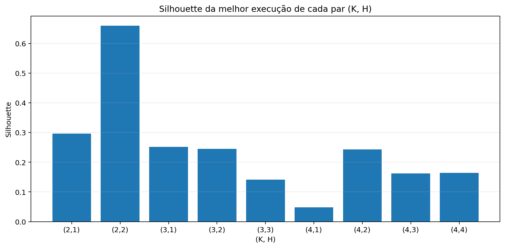
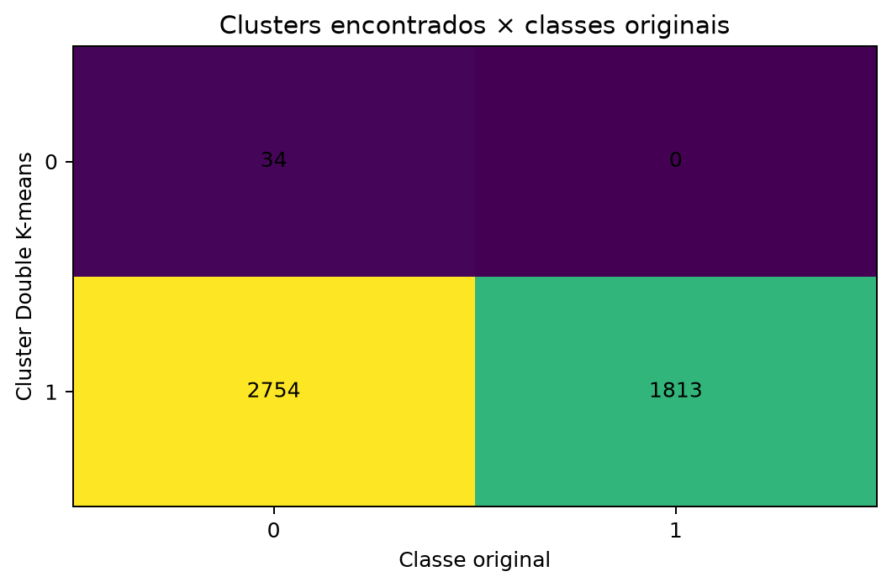
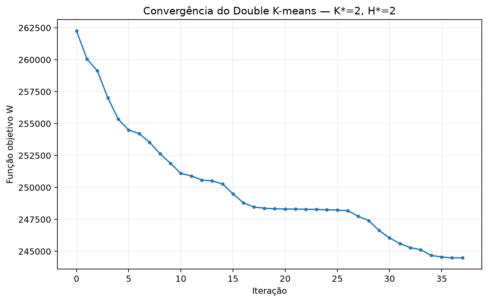
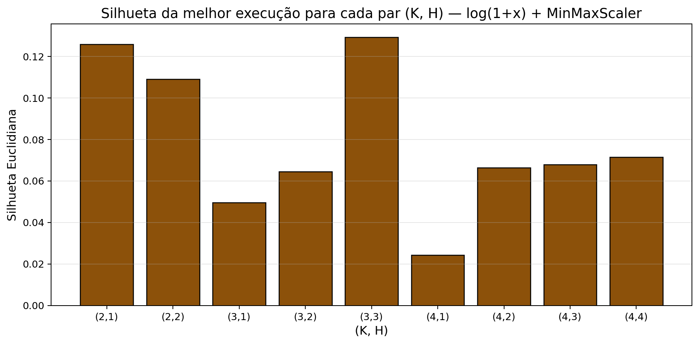
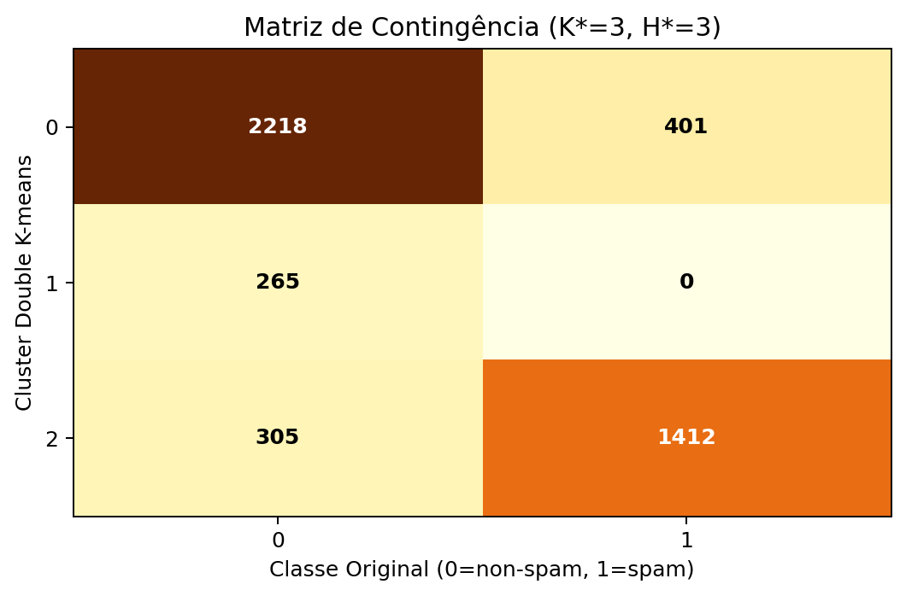
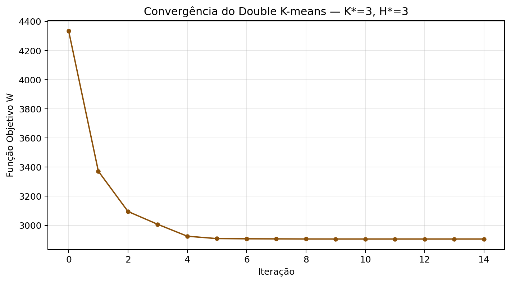
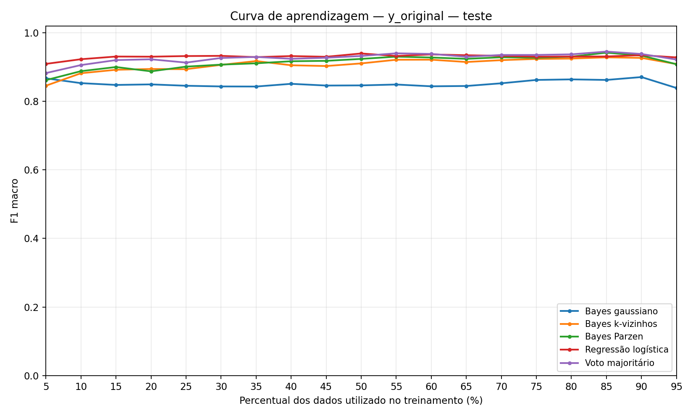
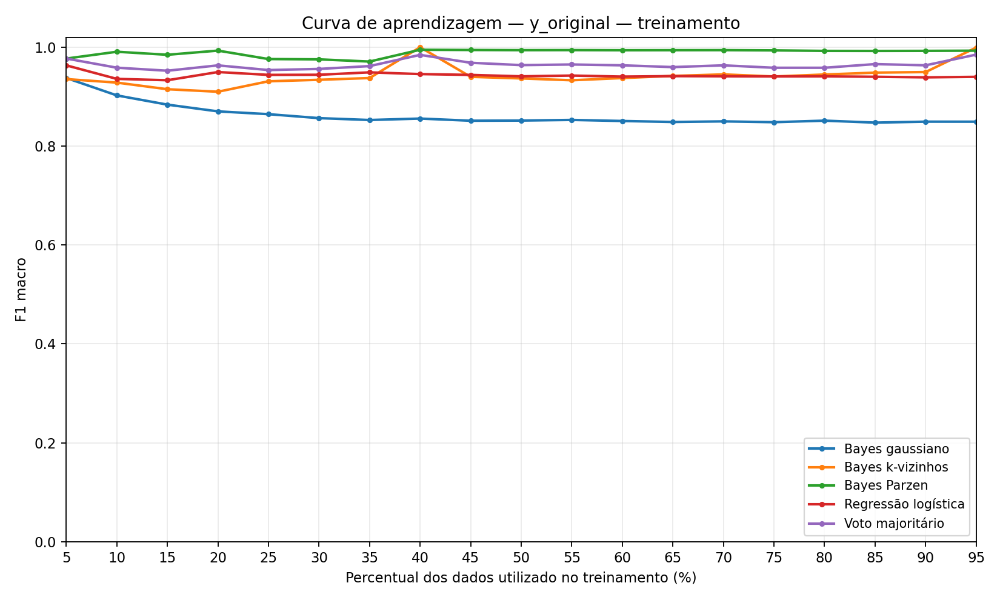
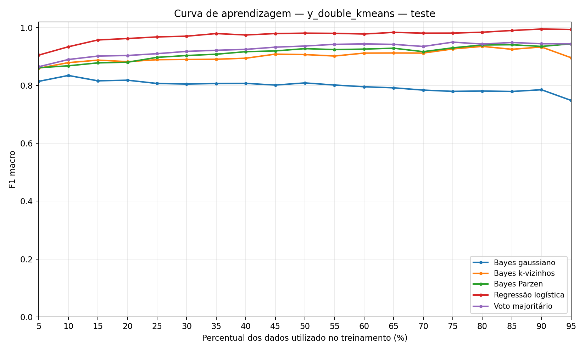
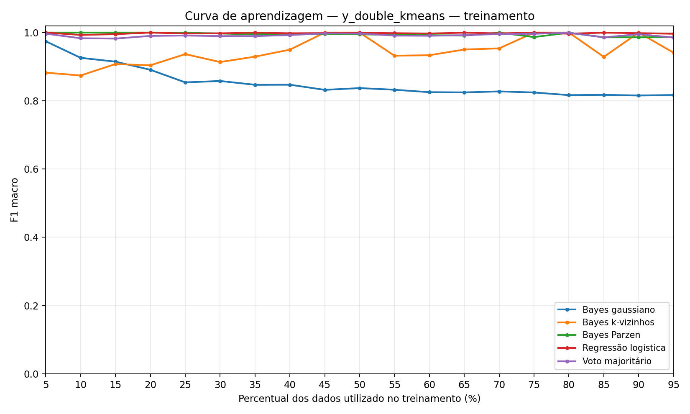

Relatório Final do Projeto
Disciplina de Aprendizagem de Máquina (IN1102, pós-graduação)
Grupo: Douglas Araújo Silva, Felipe Araújo de Lima, Letícia De Albuquerque S. Leitão
2026.2

---

## Resumo

Este relatório consolida o desenvolvimento metodológico, os experimentos computacionais, a análise estatística e os mecanismos de reprodutibilidade do projeto da disciplina **Aprendizagem de Máquina (IN1102 — CIn/UFPE, 2026.2)** aplicado à base de dados **Spambase** ($4.601$ e-mails, $57$ atributos numéricos contínuos e rótulo binário original `non-spam`/`spam`).

Na **Questão 1 (aprendizagem não supervisionada)**, implementou-se e validou-se o algoritmo **Double K-means** (*co-clustering* simultâneo de instâncias e atributos) sobre uma grade de $9$ pares $(K, H)$ com $K \in \{2, 3, 4\}$ e $H \in \{1, \ldots, K\}$, executando $100$ reinicializações válidas por par ($900$ execuções válidas por estratégia) com sementes determinísticas. Em cada representação, a seleção dos hiperparâmetros seguiu o critério em dois estágios: menor função objetivo $W$ entre os *restarts* e, em seguida, escolha de $(K^*, H^*) = \arg\max_{(K,H)} \text{Sil}((K,H))$. Uma investigação sistemática de sensibilidade ao pré-processamento comparou $7$ tratamentos distintos ($6.300$ execuções válidas ao todo), demonstrando que a padronização clássica z-score (`StandardScaler` puro, linha de base `revisada`) sofre do chamado **"Paradoxo da Silhueta"**: ao isolar um microcluster de apenas $34$ mensagens legítimas ($0,74\%$) com vocabulário técnico específico frente às demais $4.567$ ($99,26\%$), atinge Silhueta Euclidiana de $0,6596$, mas concordância externa nula com as classes originais ($\text{ARI} = -0,00495$). Para a Questão 2,adotou-se a representação `log_minmax` ($\log(1+x)$ seguida de `MinMaxScaler`), motivado tanto pela preservação dos atributos e pela compressão de caudas pesadas quanto pela concordância externa observada via ARI **após** cada agrupamento. Assim, o ARI informou a escolha **entre representações**, embora não tenha participado do ajuste dos clusters nem da seleção de $(K,H)$ **dentro de cada representação**. Nessa representação, obteve-se $(K^*, H^*) = (3, 3)$ ($W = 2.906,2307$, Silhueta $= 0,129219$, $\text{ARI} = +0,391111$, grupos de $2.619$, $265$ e $1.717$ instâncias). O arquivo exportado para a Questão 2 (`spambase_q2.csv`, verificado por hash SHA-256) preservou integralmente os $57$ atributos em **escala bruta original**.

Na **Questão 2 (aprendizagem supervisionada)**, avaliaram-se cinco classificadores — **Bayesiano Gaussiano Multivariado**, **Bayes k-NN**, **Bayes Parzen** (kernel gaussiano multivariado produto), **Regressão Logística** e **Voto Majoritário** — nas duas versões do alvo (`y_original` com $2$ classes e `y_double_kmeans` com $3$ clusters). O protocolo empregou validação cruzada estratificada **30 × 10-folds** ($3.000$ avaliações externas; $1.380.300$ predições auditadas), com **CV 5-folds interna** restrita aos $9$ folds de treino externo para seleção de hiperparâmetros e ajuste de `log1p + MinMaxScaler` estritamente dentro de cada partição de treino, evitando *data leakage*. Em `y_original`, **Voto Majoritário** ($\text{F1 macro} = 0,9397$, taxa de erro $= 5,71\%$) e **Bayes Parzen** ($\text{F1 macro} = 0,9394$, taxa de erro $= 5,75\%$) lideraram, sem diferença detectada entre si pelo pós-teste exploratório de Nemenyi ($p = 0,9883$). Em `y_double_kmeans`, a **Regressão Logística** obteve o melhor desempenho ($\text{F1 macro} = 0,9827$, erro $= 0,95\%$), superando Voto Majoritário ($0,9347$), Parzen ($0,9224$), k-NN ($0,9114$) e Gaussiano ($0,7976$), com $p = 0,1024$ entre Logística e Voto no Nemenyi exploratório ($\text{CD} = 1,1136$). Um estudo complementar ($1 \times 10$-folds, $300$ avaliações) corroborou exploratoriamente a escolha de `log1p + MinMaxScaler` sobre dados brutos e `MinMaxScaler` isolado, e curvas de aprendizagem estratificadas ($5\%$ a $95\%$ em passo de $5\%$) caracterizaram o comportamento treino-teste sob diferentes tamanhos amostrais. Ao final, toda a suíte unificada do repositório alcança **$71$ testes automatizados aprovados** ($4$ testes e $14$ subtestes na Questão 1; $67$ testes e $29$ subtestes na Questão 2).

---

## Sumário

- [Resumo](#resumo)
- [1. Introdução](#1-introdução)
  - [1.1 Objetivos do Projeto](#11-objetivos-do-projeto)
  - [1.2 Descrição Sucinta dos Dados (*Spambase*)](#12-descrição-sucinta-dos-dados-spambase)
- [2. Etapas e Andamento do Projeto](#2-etapas-e-andamento-do-projeto)
  - [2.1 Questão 1 — Agrupamento Co-clustering via Double K-means](#21-questão-1--agrupamento-co-clustering-via-double-k-means)
    - [2.1.1 Formulação Matemática e Otimização](#211-formulação-matemática-e-otimização)
    - [2.1.2 Obtenção dos Hiperparâmetros (K, H) e Seleção em Dois Estágios](#212-obtenção-dos-hiperparâmetros-k-h-e-seleção-em-dois-estágios)
    - [2.1.3 Comparação de Estratégias de Pré-processamento (6.300 Execuções)](#213-comparação-de-estratégias-de-pré-processamento-6300-execuções)
    - [2.1.4 Diagnóstico da Linha de Base (`revisada`): o Paradoxo da Silhueta](#214-diagnóstico-da-linha-de-base-revisada-o-paradoxo-da-silhueta)
    - [2.1.5 Solução Oficial Selecionada (`log_minmax`): Co-clusters, Matriz G, Contingência e ARI](#215-solução-oficial-selecionada-log_minmax-co-clusters-matriz-g-contingência-e-ari)
  - [2.2 Transição Segura entre Questão 1 e Questão 2 (Prevenção de *Data Leakage*)](#22-transição-segura-entre-questão-1-e-questão-2-prevenção-de-data-leakage)
  - [2.3 Questão 2 — Classificação Supervisionada e Comparação Estatística](#23-questão-2--classificação-supervisionada-e-comparação-estatística)
    - [2.3.1 Organização Experimental: 30 × 10-Folds, Tuning 5-Folds Interno e Métricas](#231-organização-experimental-30--10-folds-tuning-5-folds-interno-e-métricas)
    - [2.3.2 Modelos Implementados e Obtenção dos Hiperparâmetros](#232-modelos-implementados-e-obtenção-dos-hiperparâmetros)
    - [2.3.3 Resultados da Avaliação 30 × 10-Folds (Estimativas Pontuais e ICs Descritivos)](#233-resultados-da-avaliação-30--10-folds-estimativas-pontuais-e-ics-descritivos)
    - [2.3.4 Comparação Estatística: Testes de Friedman e Pós-teste de Nemenyi](#234-comparação-estatística-testes-de-friedman-e-pós-teste-de-nemenyi)
    - [2.3.5 Curvas de Aprendizagem (5% a 95%, passo 5%)](#235-curvas-de-aprendizagem-5-a-95-passo-5)
    - [2.3.6 Estudo Complementar de Sensibilidade ao Pré-processamento](#236-estudo-complementar-de-sensibilidade-ao-pré-processamento)
  - [2.4 Andamento, Organização do Repositório e Garantia de Qualidade](#24-andamento-organização-do-repositório-e-garantia-de-qualidade)
- [3. Discussão](#3-discussão)
  - [3.1 Síntese Integradora dos Resultados (Q1 e Q2)](#31-síntese-integradora-dos-resultados-q1-e-q2)
  - [3.2 Ameaças à Validade](#32-ameaças-à-validade)
  - [3.3 Diretrizes de Entrega e Apresentação (18/11/2026)](#33-diretrizes-de-entrega-e-apresentação-18112026)
- [4. Reprodutibilidade](#4-reprodutibilidade)
- [5. Referências](#5-referências)
- [6. Anexos](#6-anexos)
  - [Anexo A — Tabelas Completas da Grade (K, H) e Contingência na Questão 1](#anexo-a--tabelas-completas-da-grade-k-h-e-contingência-na-questão-1)
  - [Anexo B — Tabelas Completas de Ranks Médios e Pós-teste de Nemenyi (Todas as Métricas)](#anexo-b--tabelas-completas-de-ranks-médios-e-pós-teste-de-nemenyi-todas-as-métricas)
  - [Anexo C — Dados Completos das Curvas de Aprendizagem (19 Proporções) e Catálogo de Gráficos](#anexo-c--dados-completos-das-curvas-de-aprendizagem-19-proporções-e-catálogo-de-gráficos)
  - [Anexo D — Inventário para Entrega Individual no Google Classroom](#anexo-d--inventário-para-entrega-individual-no-google-classroom)

---

## 1. Introdução

A filtragem automática de mensagens indesejadas (*spam*) e a descoberta de estruturas latentes em coleções textuais representam problemas clássicos de Aprendizagem de Máquina que exigem cuidado experimental tanto na representação numérica dos atributos quanto na separação rigorosa entre conjuntos de treinamento, validação e teste.

Este relatório documenta o cumprimento integral das duas frentes especificadas no enunciado oficial da disciplina ([Projeto-AM-2026-2.pdf](../Enunciado%20do%20Projeto/Projeto-AM-2026-2.pdf)), utilizando a base **Spambase** em um fluxo experimental encadeado, auditado e reproduzível.

### 1.1 Objetivos do Projeto

1. **Questão 1 (Co-clustering não supervisionado):**
   - Aplicar o algoritmo **Double K-means** à matriz de atributos do Spambase (sem qualquer acesso à classe original), executando $100$ reinicializações válidas para cada par $(K, H)$ com $K \in \{2, 3, 4\}$ e $H \in \{1, \ldots, K\}$.
   - Selecionar, em cada par $(K, H)$, a solução de menor função objetivo $W$, computar sua Silhueta Euclidiana média, escolher $(K^*, H^*) = \arg\max_{(K,H)} \text{Sil}((K,H))$ e avaliar *a posteriori* a concordância com as classes originais via *Adjusted Rand Index* (ARI).
   - Reportar a matriz de protótipos dos blocos ($G$), a matriz de confusão/contingência frente à partição *a priori*, a evolução de $W$ ao longo das iterações e investigar criticamente a sensibilidade do algoritmo ao pré-processamento.

2. **Questão 2 (Classificação supervisionada e comparação estatística):**
   - Construir duas tarefas supervisionadas distintas sobre os mesmos $57$ preditores em escala bruta: `y_original` ($2$ classes originais) e `y_double_kmeans` ($K^*$ clusters descobertos na Questão 1).
   - Avaliar e comparar cinco classificadores — **Bayesiano Gaussiano Multivariado**, **Bayes k-vizinhos (k-NN)**, **Bayes baseado em janela de Parzen** (kernel gaussiano multivariado produto), **Regressão Logística** e **Voto Majoritário** — sob validação cruzada estratificada **30 × 10-folds**, com ajuste de hiperparâmetros via **5-folds internos** restritos aos $9$ folds de treino externo e retreino nos $9$ folds.
   - Obter estimativas pontuais e intervalos de confiança para Taxa de erro, Precisão, Cobertura e F-measure; comparar os modelos pelo teste de **Friedman** e pós-teste de **Nemenyi** em todas as métricas; e construir e comentar curvas de aprendizagem de F-measure em treinamento e teste de $5\%$ a $95\%$ (passo de $5\%$).

### 1.2 Descrição Sucinta dos Dados (*Spambase*)

O conjunto de dados **Spambase**, originalmente doado pelos laboratórios *Hewlett-Packard* (HP Labs) ao *UCI Machine Learning Repository* (`https://archive.ics.uci.edu/dataset/94/spambase`), é armazenado no repositório em [`data/raw/spambase.data`](../data/raw/spambase.data) e documentado em [`data/raw/spambase.names`](../data/raw/spambase.names).

- **Dimensões:** $N = 4.601$ instâncias (e-mails), $P = 57$ atributos numéricos contínuos não negativos, sem valores ausentes ou infinitos.
- **Variável alvo original (`y_original`):**
  - Classe `0` (*non-spam* / legítimo): **$2.788$ instâncias** ($60,60\%$);
  - Classe `1` (*spam* / não solicitado): **$1.813$ instâncias** ($39,40\%$).
- **Estrutura dos 57 atributos preditores:**
  1. **Frequências de palavras (`0` a `47`, $48$ atributos `word_freq_WORD`):** percentual em $[0, 100]$ das palavras do e-mail que coincidem com termos como `make`, `address`, `free`, `money`, `remove`, `hp`, `hpl`, `george`, `415`, `857`, `telnet`, `technology`, entre outros.
  2. **Frequências de caracteres (`48` a `53`, $6$ atributos `char_freq_CHAR`):** percentual em $[0, 100]$ das ocorrências dos caracteres `;`, `(`, `[`, `!`, `$`, `#`.
  3. **Sequências de letras maiúsculas (`54` a `56`, $3$ atributos):**
     - `capital_run_length_average`: comprimento médio das sequências ininterruptas de maiúsculas (valor real contínuo $\ge 1$);
     - `capital_run_length_longest`: comprimento máximo de uma sequência ininterrupta de maiúsculas (inteiro contínuo $\ge 1$);
     - `capital_run_length_total`: soma total de letras maiúsculas no e-mail (inteiro contínuo $\ge 1$).

Do ponto de vista estatístico, a base apresenta três propriedades críticas para métodos baseados em distância e covariância:
1. **Alta esparsidade:** nos atributos de frequência de palavras e caracteres, mais de $80\%$ das entradas são iguais a zero;
2. **Assimetria positiva acentuada e caudas pesadas:** termos raros permanecem zerados na maioria dos e-mails, mas atingem picos elevados em subconjuntos restritos (por exemplo, `word_freq_415` atinge $4,76\%$, correspondendo a $z \approx +14,30$ sob padronização z-score global);
3. **Discrepância severa de escalas:** enquanto frequências percentuais variam tipicamente de $0$ a algumas unidades ou dezenas, `capital_run_length_total` possui média $283$, desvio-padrão $606$ e máximo $15.841$, e `capital_run_length_longest` atinge escore padronizado $z \approx +50,99$ sem compressão logarítmica.

---

## 2. Etapas e Andamento do Projeto

### 2.1 Questão 1 — Agrupamento Co-clustering via Double K-means

#### 2.1.1 Formulação Matemática e Otimização

Implementado em [`questao1/src/double_kmeans.py`](../questao1/src/double_kmeans.py), o algoritmo **Double K-means** particiona simultaneamente as $N$ linhas (e-mails) em $K$ grupos $U \in \{0,1\}^{N \times K}$ ($\sum_{k=1}^K u_{ik} = 1$) e as $P$ colunas (atributos) em $H$ grupos $V \in \{0,1\}^{P \times H}$ ($\sum_{h=1}^H v_{jh} = 1$), resumindo cada co-cluster pela matriz de protótipos de blocos $G = [g_{kh}] \in \mathbb{R}^{K \times H}$. A função objetivo minimizada é a inércia quadrática intrabloco:

$$W(G, U, V) = \sum_{k=1}^{K} \sum_{h=1}^{H} \sum_{i=1}^{N} \sum_{j=1}^{P} u_{ik} v_{jh} (x_{ij} - g_{kh})^2$$

Partindo de partições aleatórias iniciais *hard* que garantem ao menos um objeto em cada cluster de linhas e ao menos uma variável em cada cluster de colunas (`_initial_partition`), a otimização alterna três passos determinísticos a cada iteração:

1. **Atualização da matriz de protótipos $G$ ($U, V$ fixos):**
   $$g_{kh} = \frac{1}{|C_k| \cdot |D_h|} \sum_{i \in C_k} \sum_{j \in D_h} x_{ij}$$
   onde $C_k = \{i \mid u_{ik} = 1\}$ e $D_h = \{j \mid v_{jh} = 1\}$.
2. **Atualização da partição de objetos $U$ ($G, V$ fixos):** atribui cada objeto $i$ ao grupo $k^*$ que minimiza $\sum_{h=1}^H \sum_{j \in D_h} (x_{ij} - g_{kh})^2$.
3. **Atualização da partição de variáveis $V$ ($G, U$ fixos):** atribui cada variável $j$ ao grupo $h^*$ que minimiza $\sum_{k=1}^K \sum_{i \in C_k} (x_{ij} - g_{kh})^2$.

**Critério de parada, monotonicidade e descarte de degenerescências:**
- O algoritmo converge quando **não ocorrem transferências** em nenhuma das duas partições entre iterações sucessivas (`object_labels` e `variable_labels` idênticos aos da iteração anterior), ou ao atingir o teto `max_iter = 200` iterações.
- Verifica-se a cada passo se $W \le W_{\text{anterior}} + \text{monotonic\_tol}$ com `monotonic_tol = 1e-7`.
- Se em qualquer etapa algum cluster de objetos ou de variáveis ficar vazio ($|C_k| = 0$ ou $|D_h| = 0$), a execução retorna `None`, é contabilizada em `invalid_attempts` e descartada até que se completem exatamente **$100$ execuções válidas** por par $(K, H)$ (com limite de segurança `max_attempts = 50 * n_restarts`).

#### 2.1.2 Obtenção dos Hiperparâmetros (K, H) e Seleção em Dois Estágios

Conforme o protocolo não supervisionado implementado em [`questao1/src/experimento.py`](../questao1/src/experimento.py):

- **Grade completa ($9$ pares):** $K \in \{2, 3, 4\}$ e $H \in \{1, \ldots, K\}$, isto é, $(2,1), (2,2), (3,1), (3,2), (3,3), (4,1), (4,2), (4,3), (4,4)$.
- **Restarts e sementes determinísticas:** cada par executa $100$ rodadas válidas com sementes regidas por:
  $$\text{seed} = \text{base\_seed} + 10.000 \cdot K + 1.000 \cdot H + \text{attempt}, \qquad \text{base\_seed} = 42$$
- **Invariante de seleção em cascata (repetido independentemente em cada representação):**
  1. *Estágio 1 (interno ao par):* seleciona-se entre as $100$ execuções válidas **exclusivamente aquela de menor função objetivo $W$**; nunca se seleciona *restart* pela Silhueta.
  2. *Estágio 2 (entre os 9 pares):* calcula-se a Silhueta Euclidiana média sobre a partição de objetos vencedora por $W$, definindo $(K^*, H^*) = \arg\max_{(K,H)} \text{Sil}((K,H))$.
  3. *Avaliação externa a posteriori:* apenas após a fixação de $(K^*, H^*)$ compara-se a partição descoberta com `y_original` via *Adjusted Rand Index* (ARI). A coluna `y_original` não participa da transformação dos atributos, da otimização de $U$, $V$, $G$ ou da escolha de $(K^*, H^*)$ **dentro da representação avaliada**. Entretanto, o ARI calculado posteriormente foi considerado pelo grupo na **decisão entre as sete representações**, que é uma etapa adicional, informada pelos rótulos conhecidos.

#### 2.1.3 Comparação de Estratégias de Pré-processamento (6.300 Execuções)

Como o enunciado não fixa uma transformação prévia obrigatória para o Double K-means, conduziu-se uma investigação complementar de sensibilidade ao pré-processamento em [`questao1/src/preprocessamentos.py`](../questao1/src/preprocessamentos.py) comparando a linha de base (`revisada`, com `StandardScaler` puro) e seis estratégias alternativas sob exatamente a mesma grade, sementes e critério de seleção ($900$ execuções válidas por estratégia; $6.300$ ao todo).

| Estratégia | Pré-processamento Aplicado | Par $(K^*, H^*)$ | Silhueta Euclidiana | Melhor $W$ | Melhor Seed | ARI (vs `y_original`) | Tamanhos dos Clusters ($N=4.601$) | Diagnóstico Metodológico |
| :--- | :--- | :---: | :---: | :---: | :---: | :---: | :--- | :--- |
| **`revisada`** *(Linha de base)* | `StandardScaler` puro global ($57$ atributos) | $(2, 2)$ | **0,659631** | 244.486,70 | 22042 | **−0,004950** | 34 / 4.567 | Isola microcluster de 34 *non-spam* por vocabulário técnico específico; Silhueta artificialmente inflada. |
| **`binarizacao`** | Presença binária `(x > 0)` nas $54$ frequências + `log1p` nas $3$ maiúsculas + `StandardScaler` | $(3, 3)$ | 0,210019 | 208.777,15 | 33337 | +0,269498 | 1.344 / 3.025 / 232 | Elimina o microcluster de 34; no par $(2,2)$ atinge ARI $= +0,3553$ (3.228 vs 1.373). |
| **`log_minmax`** *(Oficial Q2)* | $\log(1+x)$ seguida de `MinMaxScaler` em $[0, 1]^{57}$ | $(3, 3)$ | 0,129219 | 2.906,23 | 33044 | **+0,391111** | 2.619 / 265 / 1.717 | Comprime caudas pesadas preservando todas as $57$ variáveis; maior ARI entre as vencedoras por Silhueta. |
| **`quantile_uniform`** | `QuantileTransformer(output_distribution='uniform', random_state=42)` | $(3, 3)$ | 0,190317 | 21.926,53 | 33087 | +0,292525 | 2.787 / 1.240 / 574 | Mapeamento não paramétrico uniforme por quantis; elimina microcluster de 34. |
| **`clip_log_standard`** | Truncamento no quantil $99\%$ por coluna + `log1p` + `StandardScaler` | $(2, 1)$ | 0,172059 | 251.544,66 | 21042 | +0,129196 | 1.372 / 3.229 | Mantém $H=1$; em $(2,2)$ alcançou ARI $= +0,5517$ (Sil $= 0,1085$), mas não venceu o critério de seleção. |
| **`filtragem_dominio`** | Remoção de $8$ termos específicos (`hp`, `hpl`, `george`, `lab`, `labs`, `650`, `415`, `857`) + `StandardScaler` ($49$ variáveis) | $(2, 1)$ | 0,292614 | 220.269,24 | 21042 | +0,136301 | 1.129 / 3.472 | Confirma sensibilidade ao bloco lexical: remove microcluster de 34; em $(2,2)$ obteve ARI $= +0,3607$. |
| **`tratamento_diferenciado_runs`** | `StandardScaler` nas $54$ frequências + `StandardScaler(log1p)` nas $3$ maiúsculas | $(2, 2)$ | 0,653702 | 244.485,00 | 22116 | −0,004950 | 4.567 / 34 | Mostra que comprimir apenas maiúsculas não dissolve o microcluster de 34 no par vencedor; em $(3,3)$ ARI $= +0,4632$. |

> **Comparabilidade entre representações:** os valores de $W$ e de Silhueta foram calculados em espaços transformados distintos; por isso, não se devem comparar diretamente seus valores absolutos como se compartilhassem a mesma escala e geometria. A seleção pelo maior valor de Silhueta ocorreu **dentro dos nove pares de cada representação**. A decisão posterior de usar `log_minmax` na Questão 2 considerou a preservação dos 57 atributos, o tratamento das caudas e o ARI observado após o agrupamento. Como esse último critério recorre a `y_original`, a escolha **entre representações não foi completamente cega aos rótulos**, embora o Double K-means e a escolha de $(K,H)$ dentro de cada representação tenham sido não supervisionados.

#### 2.1.4 Diagnóstico da Linha de Base (`revisada`): o Paradoxo da Silhueta

A auditoria conduzida por [`questao1/src/auditoria.py`](../questao1/src/auditoria.py) sobre a linha de base (`StandardScaler` puro, $(K^*, H^*) = (2,2)$, `seed = 22042`, $W = 244.486,6983$, $\text{Sil} = 0,659631$) explica por que uma Silhueta aparentemente alta produziu $\text{ARI} = -0,004950$:

- **Partição de variáveis ($H^* = 2$):** conforme [`particao_variaveis.csv`](../questao1/resultados/revisada/particao_variaveis.csv), o grupo de variáveis `0` concentrou exatamente **$11$ termos técnicos específicos**: `word_freq_415`, `650`, `85`, `857`, `direct`, `hp`, `hpl`, `lab`, `labs`, `technology` e `telnet`. O grupo `1` agregou as $46$ variáveis restantes.
- **Matriz de protótipos $G$** ([`matriz_prototipos_G.csv`](../questao1/resultados/revisada/matriz_prototipos_G.csv)):

| Grupo de Objetos | Variáveis `0` (11 termos específicos) | Variáveis `1` (46 atributos gerais) |
| :--- | ---: | ---: |
| **Cluster 0 ($34$ objetos)** | **+6,861185** | −0,144405 |
| **Cluster 1 ($4.567$ objetos)** | −0,051080 | +0,001075 |

- **Matriz de contingência** ([`matriz_contingencia.csv`](../questao1/resultados/revisada/matriz_contingencia.csv)): os $34$ objetos do Cluster `0` pertencem integralmente à classe `0` (*non-spam*), enquanto o Cluster `1` aglutina $2.754$ *non-spam* e todos os $1.813$ *spam*. Com $99,26\%$ dos pontos concentrados em um único bloco fortemente coeso em torno da média, a Silhueta global média resulta artificialmente alta ($0,6596$), sem correspondência com a separação *spam* versus *non-spam*.
- Na estratégia `tratamento_diferenciado_runs`, mesmo após aplicar `log1p` às $3$ colunas de comprimento de maiúsculas, o mesmo microcluster de $34$ objetos e exatamente o mesmo bloco de $11$ termos voltou a dominar o critério de menor $W$ em $(2,2)$, corroborando que o isolamento provinha da esparsidade combinada aos altos escores z dessas frequências específicas (por exemplo, `word_freq_857` com $z = +9,58$, `word_freq_415` com $z = +9,55$, `word_freq_direct` com $z = +8,81$).

| Silhueta × $(K, H)$ — Linha de Base (`revisada`) | Contingência — Linha de Base (`revisada`) | Convergência de $W$ — Linha de Base (`revisada`) |
| :---: | :---: | :---: |
|  |  |  |

#### 2.1.5 Solução Oficial Selecionada (`log_minmax`): Co-clusters, Matriz G, Contingência e ARI

A representação adotada pelo grupo para gerar a partição `y_double_kmeans` da Questão 2 foi **`log_minmax`** ($\log(1+x)$ seguida de `MinMaxScaler`). Essa **escolha entre representações** combinou razões de tratamento dos dados (preservação das 57 variáveis e compressão monotônica de caudas longas) com a concordância externa observada ($\text{ARI}=+0,391111$, maior entre as soluções vencedoras por Silhueta de cada representação). **O ARI não determinou $(K^*,H^*)=(3,3)$**: esse par foi definido pela maior Silhueta entre os nove pares **apenas dentro de `log_minmax`**. Como o ARI orientou a escolha final da representação, a decisão não foi inteiramente não supervisionada, e essa limitação deve acompanhar sua interpretação:

- **Par ótimo escolhido:** $(K^*, H^*) = (3, 3)$, `best_seed = 33044`, convergência em **$14$ iterações**, $W = 2.906,230738$, $\text{Silhueta} = 0,129219$, $\text{ARI} = +0,391111$ (houve $2$ tentativas inválidas descartadas antes de atingir $100$ rodadas válidas em $(3,3)$).
- **Partição das $57$ variáveis ($H^* = 3$)** ([`particao_variaveis.csv`](../questao1/resultados/log_minmax/particao_variaveis.csv)):
  - **Grupo de variáveis `0` ($4$ atributos):** `capital_run_length_longest`, `capital_run_length_total`, `word_freq_you`, `word_freq_your`;
  - **Grupo de variáveis `1` ($31$ atributos):** `char_freq_#`, `(`, `;`, `[` e $27$ termos frequenciais, incluindo termos técnicos/contextuais como `1999`, `3d`, `415`, `650`, `85`, `857`, `conference`, `cs`, `data`, `direct`, `edu`, `font`, `george`, `hp`, `hpl`, `lab`, `labs`, `meeting`, `original`, `parts`, `pm`, `project`, `re`, `report`, `table`, `technology`, `telnet`;
  - **Grupo de variáveis `2` ($22$ atributos):** `capital_run_length_average`, `char_freq_!`, `char_freq_$` e $19$ termos frequentes em comunicações comerciais/gerais (`000`, `address`, `addresses`, `all`, `business`, `credit`, `email`, `free`, `internet`, `mail`, `make`, `money`, `order`, `our`, `over`, `people`, `receive`, `remove`, `will`).
- **Matriz de protótipos dos blocos $G$** ([`matriz_prototipos_G.csv`](../questao1/resultados/log_minmax/matriz_prototipos_G.csv), médias no espaço pré-processado $[0, 1]$):

| Grupo de Objetos | Variáveis `0` (4 atributos) | Variáveis `1` (31 atributos) | Variáveis `2` (22 atributos) |
| :--- | ---: | ---: | ---: |
| **Cluster 0 ($2.619$ objetos)** | 0,194479 | 0,022612 | 0,025559 |
| **Cluster 1 ($265$ objetos)** | 0,240859 | **0,132449** | 0,024273 |
| **Cluster 2 ($1.717$ objetos)** | **0,420265** | 0,008495 | **0,090361** |

- **Matriz de contingência frente à partição original** ([`matriz_contingencia.csv`](../questao1/resultados/log_minmax/matriz_contingencia.csv)):

| Cluster (`y_double_kmeans`) | Non-spam (`0`) | Spam (`1`) | Total | Perfil Observado |
| :--- | ---: | ---: | ---: | :--- |
| **Cluster `0`** | 2.218 | 401 | **2.619** ($56,92\%$) | $84,69\%$ *non-spam* |
| **Cluster `1`** | 265 | 0 | **265** ($5,76\%$) | $100,00\%$ *non-spam* |
| **Cluster `2`** | 305 | 1.412 | **1.717** ($37,32\%$) | $82,24\%$ *spam* |
| **Total** | **2.788** | **1.813** | **4.601** ($100\%$) | $\text{ARI} = +0,391111$ |

- **Comentário sobre o ARI:** um ARI de $+0,3911$ indica concordância externa parcial e substantivamente superior ao acaso ($\text{ARI} \approx 0$): o Cluster `2` concentra $77,88\%$ ($1.412 / 1.813$) dos *spams* da base, com protótipo elevado nas variáveis de maiúsculas (`0,4203`) e termos comerciais/exclamativos (`0,0904`); o Cluster `0` concentra a maior parte dos e-mails legítimos ($79,56\%$ dos *non-spams*, embora com $401$ *spams* misturados); e o Cluster `1` ($265$ e-mails, $100\%$ *non-spam*) exibe intensidade média mais alta no grupo de variáveis `1` (`0,1324`). Ainda assim, como um algoritmo não supervisionado otimiza homogeneidade geométrica e não fronteiras de classe, não há correspondência exata $1$-para-$1$.

| Silhueta × $(K, H)$ — Oficial (`log_minmax`) | Contingência — Oficial (`log_minmax`) | Convergência de $W$ — Oficial (`log_minmax`) |
| :---: | :---: | :---: |
|  |  |  |

---

### 2.2 Transição Segura entre Questão 1 e Questão 2 (Prevenção de *Data Leakage*)

A passagem da Questão 1 para a Questão 2 foi protegida por quatro barreiras metodológicas explícitas ([`questao2/dados/proveniencia_q1.json`](../questao2/dados/proveniencia_q1.json), [`questao2/src/dados.py`](../questao2/src/dados.py)):

1. **Preservação da escala original:** o arquivo [`questao2/dados/spambase_q2.csv`](../questao2/dados/spambase_q2.csv) é cópia verificada byte a byte de [`spambase_com_clusters_log_minmax.csv`](../questao1/resultados/log_minmax/spambase_com_clusters_log_minmax.csv) (SHA-256 `84d4176669d713138b584e354ac0506025a21bae3dc169795ed78c745480eb4a`), contendo os $57$ atributos na **escala bruta original**, acrescidos das colunas `y_original` e `y_double_kmeans`.
2. **Isolamento por fold (*Pipeline* aninhado):** na Questão 2, os quatro classificadores paramétricos/não paramétricos encapsulam `FunctionTransformer(np.log1p)` e `MinMaxScaler()` em um `Pipeline` ajustado **exclusivamente** nos índices de treinamento de cada fold interno ($5$-fold) e depois no conjunto de treinamento externo ($9$ folds). O fold de teste recebe apenas `transform()`.
3. **Proibição de vazamento entre alvos:** ao treinar classificadores para `y_original`, a coluna `y_double_kmeans` é completamente excluída; o inverso vale ao treinar para `y_double_kmeans`.
4. **Distinção entre validade supervisionada e transdutiva:** os rótulos `y_double_kmeans` foram aprendidos pelo Double K-means sobre toda a matriz de $4.601$ instâncias na Questão 1. Por essa razão, os experimentos da Questão 2 sobre `y_double_kmeans` avaliam o quão bem cada classificador supervisionado consegue **reproduzir uma partição previamente descoberta**, não equivalendo a uma validação externa independente de novos clusters sobre e-mails inéditos.

---

### 2.3 Questão 2 — Classificação Supervisionada e Comparação Estatística

#### 2.3.1 Organização Experimental: 30 × 10-Folds, Tuning 5-Folds Interno e Métricas

Conforme [`questao2/src/validacao.py`](../questao2/src/validacao.py) e [`questao2/src/metricas.py`](../questao2/src/metricas.py), o protocolo foi organizado separadamente para cada variável resposta (`y_original` e `y_double_kmeans`):

- **Validação cruzada externa 30 × 10-folds:** executam-se $30$ repetições ($r = 1, \ldots, 30$) de `StratifiedKFold(n_splits=10, shuffle=True, random_state=2026 + r - 1)`. Em cada repetição, todas as $4.601$ instâncias são testadas exatamente uma vez sem sobreposição nem vazamento. Dentro de cada alvo, os cinco classificadores compartilham **exatamente os mesmos índices de treino e teste** em todas as $300$ partições externas ($30 \times 10$). Ao todo, foram auditadas **$3.000$ avaliações externas** ($10$ combinações alvo/modelo $\times 300$ folds) e **$1.380.300$ predições individuais out-of-fold** ([`AUDITORIA_30x10.md`](../questao2/docs/AUDITORIA_30x10.md)).
- **Validação cruzada interna 5-folds:** em cada fold externo $(rep, fold)$, os quatro classificadores-base realizam busca exaustiva em grade (*grid search*) por `StratifiedKFold(n_splits=5, shuffle=True, random_state=2026 + 1000*rep + fold)` restrita aos $9$ folds de treino externo, maximizando o **F1 macro** médio de validação interna (`zero_division=0`). Selecionado o melhor conjunto de hiperparâmetros, o `Pipeline` correspondente é reajustado do zero nos $9$ folds de treino e avaliado uma única vez no $10^\circ$ fold de teste externo.
- **Métricas avaliadas:**
  $$\text{Taxa de erro} = 1 - \text{Acurácia}, \quad \text{Precisão}_{\text{macro}} = \frac{1}{C}\sum_{c=1}^{C} P_c, \quad \text{Cobertura}_{\text{macro}} = \frac{1}{C}\sum_{c=1}^{C} R_c, \quad \text{F1}_{\text{macro}} = \frac{1}{C}\sum_{c=1}^{C} \frac{2 P_c R_c}{P_c + R_c}$$
  O uso de médias **macro** é essencial porque o Cluster `1` de `y_double_kmeans` possui apenas $265$ e-mails ($5,76\%$); métricas ponderadas ou acurácia pura poderiam mascarar falhas nessa classe minoritária. Métricas por classe também são salvas por fold em todos os CSVs de resultado.
- **Estimativas pontuais e ICs:** a medida de cada repetição ($1 \ldots 30$) é a média aritmética dos seus $10$ folds externos; a estimativa pontual é a média das $30$ repetições. Os intervalos de $95\%$ utilizam a distribuição *t* de Student ($gl = 29$) sobre essas $30$ médias, com **caráter explicitamente descritivo**, dado que as $30$ repetições reutilizam o mesmo conjunto de $4.601$ instâncias.

#### 2.3.2 Modelos Implementados e Obtenção dos Hiperparâmetros

A tabela abaixo resume a formulação de cada um dos cinco modelos, as grades avaliadas na CV interna $5$-folds e as frequências reais observadas nos **$300$ folds externos** de cada alvo (auditadas diretamente em `questao2/resultados/{modelo}/{alvo}_30x10_folds.csv`).

| Classificador | Formulação e Detalhes de Implementação | Espaço de Hiperparâmetros (CV Interna 5-folds) | Seleção Observada em `y_original` (300 folds) | Seleção Observada em `y_double_kmeans` (300 folds) |
| :--- | :--- | :--- | :--- | :--- |
| **Bayesiano Gaussiano Multivariado** ([`bayes_gaussiano.py`](../questao2/src/modelos/bayes_gaussiano.py)) | Prioris empíricas $\hat{P}(\omega_c) = n_c/n$, médias $\hat\mu_c$ e covariâncias **completas** de máxima verossimilhança $\hat\Sigma_{c,\mathrm{ML}}$ (divisor $n_c$; *não* Naive Bayes). **Na densidade, usa a matriz regularizada** $\Sigma_{c,\text{utilizada}} = \hat\Sigma_{c,\mathrm{ML}} + \lambda s_{\text{treino}}I$, com $s_{\text{treino}}$ calculado somente a partir do treinamento; log-densidades por Cholesky. **A matriz utilizada não é a estimativa ML pura.** | Regularização isotrópica relativa:<br>`λ ∈ {1e-6, 1e-4, 1e-2, 1e-1}` ($4$ candidatos) | `0.1`: $224$ folds<br>`0.01`: $76$ folds | `0.1`: $300$ folds ($100\%$) |
| **Bayes k-vizinhos (k-NN)** ([`bayes_knn.py`](../questao2/src/modelos/bayes_knn.py)) | Estima posterior $\hat{P}(\omega_c \mid x) = k_c / k$ pela fração de classes entre os $k$ vizinhos mais próximos (conforme notas de aula de Técnicas Não Paramétricas); em caso de empate, remove iterativamente o vizinho mais distante até haver vencedor único. | `k ∈ {1, 3, 5, 7, 11, 15, 21}` ×<br>`distancia ∈ {euclidiana, city_block, chebyshev}` ($21$ candidatos) | `city_block`: $160$, `euclidiana`: $140$, `chebyshev`: $0$;<br>`k`: `{5: 154, 7: 104, 3: 25, 1: 9, 11: 8}` | `euclidiana`: $289$, `city_block`: $11$, `chebyshev`: $0$;<br>`k`: `{1: 133, 7: 86, 3: 43, 5: 32, 11: 6}` |
| **Bayes Parzen** ([`bayes_parzen.py`](../questao2/src/modelos/bayes_parzen.py)) | Estimador não paramétrico com kernel multivariado produto de gaussianas univariadas e largura única $h$ em `[log1p+MinMax]`: $\hat{p}(x \mid c) = \frac{1}{n_c} \sum_{i: y_i=c} \prod_{j=1}^{57} \frac{1}{h}\phi\!\left(\frac{x_j - x_{ij}}{h}\right)$, avaliado em escala logarítmica (`log-sum-exp`) em lotes. | Largura de janela:<br>`h ∈ {0.04, 0.08, 0.12, 0.20, 0.35, 0.55}` ($6$ candidatos) | `0.12`: $300$ folds ($100\%$) | `0.20`: $249$ folds<br>`0.12`: $51$ folds |
| **Regressão Logística** ([`regressao_logistica.py`](../questao2/src/modelos/regressao_logistica.py)) | Modelo linear discriminativo com penalidade L2 e otimizador L-BFGS (`max_iter=2000`, `tol=1e-4`); utiliza perda *softmax* multinomial para $3$ classes em vez de um-contra-todos. | `C ∈ {0.03, 0.3, 3.0, 30.0, 300.0}` ×<br>`class_weight ∈ {None, 'balanced'}` ($10$ candidatos) | `C`: `{30: 164, 300: 129, 3: 7}`;<br>`None`: $162$, `'balanced'`: $138$ | `C`: `{300: 246, 30: 54}`;<br>`None`: $193$, `'balanced'`: $107$ |
| **Voto Majoritário** ([`voto_majoritario.py`](../questao2/src/modelos/voto_majoritario.py)) | Combina os rótulos preditos *out-of-fold* pelos $4$ modelos anteriores nos mesmos índices de teste; em empates ($2 \times 2$ ou triplo/duplo em 3 classes), desempata pela maior priori estimada exclusivamente no treino externo. | Sem hiperparâmetros internos adicionais | Empates resolvidos por priori variaram de $7$ a $30$ instâncias por fold | Empates resolvidos por priori variaram de $8$ a $29$ instâncias por fold |

**Ressalva sobre a especificação gaussiana:** para cada classe $c$, estima-se $\hat\mu_c=\frac{1}{n_c}\sum_{i:y_i=c}x_i$ e $\hat\Sigma_{c,\mathrm{ML}}=\frac{1}{n_c}\sum_{i:y_i=c}(x_i-\hat\mu_c)(x_i-\hat\mu_c)^\top$. O fator $s_{\text{treino}}$ é a **média das variâncias dos 57 atributos** no treinamento transformado, usando divisor $n$ (não depende do teste). O código acrescenta $\lambda s_{\text{treino}}I$ a cada matriz de classe, com $\lambda \in \{10^{-6},10^{-4},10^{-2},10^{-1}\}$ selecionado por validação interna 5-fold; todos os candidatos oficiais têm $\lambda>0$. Essa opção evita singularidade ou instabilidade na decomposição de Cholesky, preserva correlações fora da diagonal, mas desvia da aplicação literal da covariância de MV sem regularização prevista no enunciado. Os resultados reportados são, portanto, do **Gaussiano multivariado com covariância ML regularizada**, não de uma execução estritamente não regularizada.

#### 2.3.3 Resultados da Avaliação 30 × 10-Folds (Estimativas Pontuais e ICs Descritivos)

Os valores abaixo reportam **média [IC95 inferior; IC95 superior]** (aproximação descritiva por *t* de Student sobre as $30$ repetições, conforme [`resumo_metricas.csv`](../questao2/resultados/analise_estatistica/y_original/resumo_metricas.csv) e [`y_double_kmeans/resumo_metricas.csv`](../questao2/resultados/analise_estatistica/y_double_kmeans/resumo_metricas.csv)).

##### Versão 1 — `y_original` (*spam* versus *non-spam*, 2 classes)

| Classificador | Taxa de erro ($\downarrow$) [IC95] | Precisão macro ($\uparrow$) [IC95] | Cobertura macro ($\uparrow$) [IC95] | F1 macro ($\uparrow$) [IC95] |
| :--- | :---: | :---: | :---: | :---: |
| **Bayes gaussiano multivariado** | 15,16% [15,11%; 15,21%] | 0,8525 [0,8520; 0,8529] | 0,8683 [0,8678; 0,8688] | 0,8471 [0,8466; 0,8476] |
| **Bayes k-vizinhos** | 6,74% [6,67%; 6,82%] | 0,9321 [0,9313; 0,9329] | 0,9266 [0,9257; 0,9274] | 0,9290 [0,9282; 0,9298] |
| **Bayes Parzen** | 5,75% [5,70%; 5,81%] | 0,9422 [0,9416; 0,9428] | **0,9372** [0,9366; 0,9378] | 0,9394 [0,9389; 0,9400] |
| **Regressão logística** | 6,16% [6,12%; 6,20%] | 0,9357 [0,9352; 0,9361] | 0,9359 [0,9354; 0,9364] | 0,9355 [0,9351; 0,9360] |
| **Voto majoritário** | **5,71%** [5,66%; 5,76%] | **0,9439** [0,9434; 0,9444] | 0,9364 [0,9358; 0,9370] | **0,9397** [0,9392; 0,9402] |

##### Versão 2 — `y_double_kmeans` (3 clusters de objetos, $K^* = 3, H^* = 3$)

| Classificador | Taxa de erro ($\downarrow$) [IC95] | Precisão macro ($\uparrow$) [IC95] | Cobertura macro ($\uparrow$) [IC95] | F1 macro ($\uparrow$) [IC95] |
| :--- | :---: | :---: | :---: | :---: |
| **Bayes gaussiano multivariado** | 16,99% [16,93%; 17,04%] | 0,7624 [0,7616; 0,7632] | 0,8774 [0,8768; 0,8781] | 0,7976 [0,7968; 0,7984] |
| **Bayes k-vizinhos** | 6,55% [6,46%; 6,63%] | 0,9392 [0,9376; 0,9408] | 0,8903 [0,8883; 0,8922] | 0,9114 [0,9099; 0,9129] |
| **Bayes Parzen** | 5,66% [5,61%; 5,71%] | 0,9521 [0,9510; 0,9532] | 0,9000 [0,8990; 0,9011] | 0,9224 [0,9217; 0,9232] |
| **Regressão logística** | **0,95%** [0,92%; 0,98%] | **0,9840** [0,9832; 0,9848] | **0,9819** [0,9810; 0,9828] | **0,9827** [0,9821; 0,9833] |
| **Voto majoritário** | 4,64% [4,59%; 4,69%] | 0,9612 [0,9600; 0,9625] | 0,9141 [0,9129; 0,9153] | 0,9347 [0,9338; 0,9357] |

#### 2.3.4 Comparação Estatística: Testes de Friedman e Pós-teste de Nemenyi

Seguindo [`questao2/src/estatistica.py`](../questao2/src/estatistica.py), cada repetição $r \in \{1, \ldots, 30\}$ constitui um bloco pareado ($n = 30$ blocos; $k = 5$ classificadores) onde os modelos são ordenados da posição $1$ (melhor) à $5$ (pior). A diferença crítica de Nemenyi para $\alpha = 0,05$, $k = 5$ e $n = 30$ é **$\text{CD} = 1,1136$** ranks. Todos os resultados possuem caráter **exploratório**, pois os $30$ blocos compartilham as mesmas $4.601$ instâncias e o Voto Majoritário depende estruturalmente dos outros quatro modelos.

##### Testes globais de Friedman ($n = 30$, $k = 5$, $\alpha = 0,05$, $\text{CD} = 1,1136$)

| Variável Resposta | Métrica | $\chi^2$ de Friedman | $p$-valor | Rejeita $H_0$? |
| :--- | :--- | ---: | ---: | :---: |
| `y_original` | Taxa de erro | 114,5175 | `7,91e-24` | Sim |
| `y_original` | Precisão macro | 115,8933 | `4,02e-24` | Sim |
| `y_original` | Cobertura macro | 98,2400 | `2,33e-20` | Sim |
| `y_original` | F1 macro | 114,2400 | `9,07e-24` | Sim |
| `y_double_kmeans` | Taxa de erro | 120,0000 | `5,34e-25` | Sim |
| `y_double_kmeans` | Precisão macro | 120,0000 | `5,34e-25` | Sim |
| `y_double_kmeans` | Cobertura macro | 119,2267 | `7,81e-25` | Sim |
| `y_double_kmeans` | F1 macro | 120,0000 | `5,34e-25` | Sim |

##### Síntese dos Ranks Médios ($1 =$ melhor, $5 =$ pior) e Contrastes Principais de Nemenyi

- **Em `y_original` (F1 macro):**
  - Ranks médios: **Voto (`1,40`)**, **Parzen (`1,60`)**, **Logística (`3,00`)**, **k-NN (`4,00`)**, **Gaussiano (`5,00`)**.
  - O contraste principal **Voto × Parzen** apresenta diferença de rank de apenas $0,20$ ($p = 0,988321$), logo o pós-teste **não detecta diferença** entre eles (o mesmo padrão se repete em Taxa de erro com $p = 0,9792$, Precisão macro com $p = 0,4761$ e Cobertura macro com $p = 0,9883$). Em Cobertura macro, Parzen (`1,73`), Voto (`1,93`) e Logística (`2,33`) também não se distinguem estatisticamente pelo Nemenyi ($p \ge 0,5823$).
  - Entre **Gaussiano (`5,00`)** e **k-NN (`4,00`)**, a diferença exata de $1,00$ rank fica abaixo de $\text{CD} = 1,1136$ ($p = 0,102449$ em Erro, Cobertura e F1; $p = 0,0838$ em Precisão), ilustrando que testes baseados exclusivamente em postos não capturam automaticamente a magnitude absoluta da diferença de médias ($\Delta \text{F1} \approx 0,0819$).
- **Em `y_double_kmeans` (F1 macro, Erro e Precisão macro):**
  - Ranks médios exatos e idênticos nessas três métricas: **Logística (`1,00`)**, **Voto (`2,00`)**, **Parzen (`3,00`)**, **k-NN (`4,00`)**, **Gaussiano (`5,00`)** ($\chi^2 = 120,00$, concordância perfeita de ordenação nas $30$ repetições). Em Cobertura macro, apenas `k-NN` (`3,97`) e `Parzen` (`3,03`) oscilam em uma repetição ($\chi^2 = 119,23$).
  - Embora a **Regressão Logística** lidere com ampla vantagem numérica ($\Delta \text{F1} = +0,0480$ sobre o Voto; erro $5 \times$ menor), pares adjacentes diferem por $1,00 < \text{CD} = 1,1136$ e têm $p = 0,102449$ no Nemenyi (`Logística × Voto`, `Voto × Parzen`, `Parzen × k-NN`, `k-NN × Gaussiano`). Já todos os pares separados por $2$ ou mais ranks — como `Logística × Parzen` ($p = 9,54 \times 10^{-6}$), `Logística × k-NN` ($p = 2,00 \times 10^{-12}$) e `Logística × Gaussiano` ($p = 1,11 \times 10^{-16}$) — são detectados como significativamente distintos. (As tabelas integrais de todas as $4$ métricas encontram-se no [Anexo B](#anexo-b--tabelas-completas-de-ranks-médios-e-pós-teste-de-nemenyi-todas-as-métricas).)

#### 2.3.5 Curvas de Aprendizagem (5% a 95%, passo 5%)

Conforme a letra (d) do enunciado e [`questao2/src/curvas_aprendizagem.py`](../questao2/src/curvas_aprendizagem.py), as curvas foram produzidas **separadamente** do protocolo $30 \times 10$-folds. Operacionalmente, a expressão «conjunto original de treinamento» foi interpretada como a **base de 4.601 registros disponível para a tarefa supervisionada**, antes de fixar uma separação externa: para cada alvo e cada proporção $p \in \{5,10,\ldots,95\}\%$, a base foi particionada uma vez, com $p\%$ para treino e $(100-p)\%$ para teste, de forma estratificada, complementar e sem sobreposição (semente 2026). Isso corresponde a $38$ divisões (19 proporções $\times$ 2 alvos) e $190$ avaliações de modelo (quatro treinados e o voto derivado, por divisão), com $230$ a $4.370$ exemplos de treinamento e $4.371$ a $231$ de teste. Todos os modelos usam os mesmos índices por alvo e proporção; a CV interna 5-fold e o ajuste de `log1p + MinMaxScaler` ocorrem **somente no treino** de cada divisão. As curvas mostram F1 macro *in-sample* e de teste; os subconjuntos entre percentuais não são necessariamente aninhados.

| Alvo | Classificador | F1 (5% Tr / Te) | F1 (25% Tr / Te) | F1 (50% Tr / Te) | F1 (75% Tr / Te) | F1 (95% Tr / Te) |
| :--- | :--- | :---: | :---: | :---: | :---: | :---: |
| **`y_original`** | Bayes gaussiano | 0,9378 / 0,8670 | 0,8646 / 0,8454 | 0,8517 / 0,8464 | 0,8484 / 0,8623 | 0,8494 / 0,8388 |
| **`y_original`** | Bayes k-vizinhos | 0,9356 / 0,8455 | 0,9311 / 0,8937 | 0,9369 / 0,9105 | 0,9408 / 0,9236 | 0,9993 / 0,9086 |
| **`y_original`** | Bayes Parzen | 0,9770 / 0,8618 | 0,9761 / 0,9012 | 0,9941 / 0,9237 | 0,9936 / 0,9271 | 0,9930 / 0,9082 |
| **`y_original`** | Regressão logística | 0,9633 / **0,9092** | 0,9441 / **0,9320** | 0,9411 / **0,9395** | 0,9409 / 0,9301 | 0,9401 / **0,9280** |
| **`y_original`** | Voto majoritário | 0,9771 / 0,8824 | 0,9538 / 0,9129 | 0,9638 / 0,9323 | 0,9585 / **0,9352** | 0,9851 / 0,9218 |
| **`y_double_kmeans`** | Bayes gaussiano | 0,9746 / 0,8143 | 0,8541 / 0,8069 | 0,8373 / 0,8088 | 0,8244 / 0,7797 | 0,8171 / 0,7484 |
| **`y_double_kmeans`** | Bayes k-vizinhos | 0,8826 / 0,8597 | 0,9368 / 0,8891 | 1,0000 / 0,9069 | 1,0000 / 0,9262 | 0,9411 / 0,8960 |
| **`y_double_kmeans`** | Bayes Parzen | 1,0000 / 0,8614 | 0,9994 / 0,8972 | 0,9948 / 0,9274 | 0,9869 / 0,9302 | 0,9865 / 0,9440 |
| **`y_double_kmeans`** | Regressão logística | 1,0000 / **0,9050** | 0,9972 / **0,9679** | 0,9997 / **0,9809** | 0,9998 / **0,9811** | 0,9966 / **0,9936** |
| **`y_double_kmeans`** | Voto majoritário | 0,9968 / 0,8648 | 0,9914 / 0,9100 | 0,9971 / 0,9364 | 0,9966 / 0,9498 | 0,9855 / 0,9440 |

**Análise dos padrões observados:**
1. **Eficiência amostral da Regressão Logística:** já com $5\%$ de treinamento ($230$ amostras), alcança F1 de teste de $0,9092$ (`y_original`) e $0,9050$ (`y_double_kmeans`), escalando suavemente para $0,9936$ aos $95\%$ em `y_double_kmeans` — o que confirma que a partição induzida pelo Double K-means no espaço `log1p + MinMax` possui fronteiras altamente separáveis por hiperplanos lineares.
2. **Lacuna treino–teste e memorização local:** em k-NN (quando a CV interna escolhe $k=1$) e em Parzen (com $h$ pequeno, como $0,12$), o F1 de treinamento atinge $0,99$ a $1,00$ porque o próprio exemplo de consulta contribui para sua vizinhança/densidade *in-sample*; já o F1 de teste cresce progressivamente de $\sim 0,85$ ($5\%$) até $\sim 0,92\text{--}0,94$ ($75\%\text{--}90\%$).
3. **Comportamento do Bayesiano Gaussiano:** com $5\%$ de treino ($230$ amostras em $57$ dimensões, matriz de covariância $57 \times 57$ estimada por classe), há forte sobreajuste inicial em treino ($0,9378$ em `y_original` e $0,9746$ em `y_double_kmeans`), que cai para $\sim 0,85$ e $\sim 0,82$ à medida que $N_{\text{treino}}$ aumenta e reduz a variância amostral; em `y_double_kmeans`, o teste oscila até $0,7484$ em $95\%$ (com apenas $231$ amostras de teste, sendo cerca de $13$ na classe minoritária), não caracterizando prova de degradação real por ter sido usada uma única partição por percentual.
4. **Oscilações em proporções elevadas:** aos $95\%$ de treino, restam apenas $231$ instâncias de teste e as divisões entre percentuais não são necessariamente aninhadas; logo, pequenas quedas pontuais em $95\%$ refletem variância amostral de um conjunto de teste pequeno.

| `y_original` — F1 Teste | `y_original` — F1 Treinamento |
| :---: | :---: |
|  |  |
| **`y_double_kmeans` — F1 Teste** | **`y_double_kmeans` — F1 Treinamento** |
|  |  |

#### 2.3.6 Estudo Complementar de Sensibilidade ao Pré-processamento

Sem alterar nem substituir a avaliação oficial $30 \times 10$-folds, conduziu-se em [`questao2/scripts/comparar_preprocessamento.py`](../questao2/scripts/comparar_preprocessamento.py) uma comparação pareada de $1 \times 10$-folds ($300$ avaliações externas: $2$ alvos $\times 3$ estratégias $\times 5$ modelos $\times 10$ folds, com ajustes internos $5$-fold), incluindo uma reavaliação (`v2`, $80$ registros) que elevou `max_iter=20000, tol=1e-6` na Logística em escala bruta (reduzindo avisos de não convergência de $311 \to 171$ em `y_original` e $510 \to 308$ em `y_double_kmeans`, sem eliminá-los) e ampliou a grade de Parzen em `MinMax` puro para $h \in \{0,005; 0,01; 0,02; 0,03; 0,04; 0,08; 0,12; 0,20; 0,35; 0,55\}$ ([`comparacao_resumo.csv`](../questao2/resultados/comparacao_preprocessamento/comparacao_resumo.csv)):

| Alvo | Classificador | Sem Pré-processamento | Apenas MinMax | `Log1p + MinMax` | Ganho (`Log1p+MinMax` vs Bruto) |
| :--- | :--- | :---: | :---: | :---: | :---: |
| `y_original` | Gaussiano multivariado | 0,8279 | 0,8287 | **0,8467** | +0,0188 |
| `y_original` | Bayes k-vizinhos | 0,8445 | 0,9054 | **0,9287** | +0,0842 |
| `y_original` | Bayes Parzen | 0,8268 | 0,9022 | **0,9416** | +0,1148 |
| `y_original` | Regressão logística | 0,9247 | 0,9230 | **0,9352** | +0,0105 |
| `y_original` | Voto majoritário | 0,8937 | 0,9189 | **0,9404** | +0,0467 |
| `y_double_kmeans` | Gaussiano multivariado | 0,6822 | 0,5550 | **0,7967** | +0,1145 |
| `y_double_kmeans` | Bayes k-vizinhos | 0,8229 | 0,8953 | **0,9155** | +0,0927 |
| `y_double_kmeans` | Bayes Parzen | 0,7818 | 0,8958 | **0,9254** | +0,1436 |
| `y_double_kmeans` | Regressão logística | 0,8977 | 0,8928 | **0,9813** | +0,0836 |
| `y_double_kmeans` | Voto majoritário | 0,8458 | 0,9063 | **0,9349** | +0,0891 |

Em todas as $10$ combinações alvo/classificador dessa repetição exploratória, `Log1p + MinMaxScaler` alcançou o maior F1 macro médio, com ganhos expressivos sobretudo em métodos baseados em distância/kernel (Parzen $+0,1148$ e $+0,1436$; k-NN $+0,0842$ e $+0,0927$).

---

### 2.4 Andamento, Organização do Repositório e Garantia de Qualidade

Durante o ciclo do projeto, a arquitetura do repositório foi unificada e simetricamente organizada entre as duas questões ([`README.md`](../README.md)):

- **Fonte única de dados brutos:** [`data/raw/`](../data/raw/) (`spambase.data`, `spambase.names`).
- **Módulo da Questão 1 (`questao1/`):** código modular (`src/`), CLI parametrizada (`scripts/rodar_experimentos.py`), notebook unificado ([`questao1_experimentos.ipynb`](../questao1/questao1_experimentos.ipynb)) centralizando todas as $7$ estratégias (preservando os notebooks históricos em `questao1/notebooks/`), relatórios em `docs/` e saídas isoladas por estratégia em `resultados/`.
- **Módulo da Questão 2 (`questao2/`):** código modular dos $5$ classificadores, validação aninhada, métricas, análise estatística e curvas de aprendizagem (`src/`), scripts CLI (`scripts/`), notebook de diagnóstico ([`questao2_experimentos.ipynb`](../questao2/questao2_experimentos.ipynb)), relatórios em `docs/` e resultados auditáveis em `resultados/`.
- **Padronização de ambiente e integridade:** dependências unificadas em [`requirements.txt`](../requirements.txt), finais de linha padronizados em LF via `.gitattributes` e validação contínua por suíte automatizada: em execução completa via `pytest questao1/tests questao2/tests`, observaram-se **$71$ testes e $43$ subtestes aprovados** sem falhas ($4$ testes / $14$ subtestes na Questão 1; $67$ testes / $29$ subtestes na Questão 2).

---

## 3. Discussão

### 3.1 Síntese Integradora dos Resultados (Q1 e Q2)

1. **Papel decisivo da geometria induzida pelo pré-processamento:** na Questão 1, `StandardScaler` puro sobre frequências altamente esparsas permitiu que um grupo restrito de $11$ termos raros isolasse $34$ observações, produzindo Silhueta enganosamente alta ($0,6596$) com $\text{ARI} \approx 0$. A compressão logarítmica seguida de `MinMaxScaler` resolveu o domínio desproporcional de caudas longas e revelou $3$ grupos mais equilibrados ($\text{ARI} = +0,3911$), além de impulsionar de maneira consistente os classificadores na Questão 2.
2. **Desempenho comparativo na classificação original (`y_original`):** métodos locais não paramétricos baseados em densidade (**Bayes Parzen**, $\text{F1} = 0,9394$) e sua combinação com os demais modelos (**Voto Majoritário**, $\text{F1} = 0,9397$) atingiram o melhor equilíbrio entre precisão e cobertura macro na detecção de *spam*, sem separação estatística entre si ($p = 0,9883$).
3. **Estrutura linear da partição de clusters (`y_double_kmeans`):** a liderança destacada da **Regressão Logística** ($\text{F1} = 0,9827$, erro $= 0,95\%$) e sua rápida convergência nas curvas de aprendizagem ($0,9050$ em $5\%$ e $0,9936$ em $95\%$) mostram que partições formadas por protótipos euclidianos em `[log1p+MinMax]` geram fronteiras quase lineares (poliedros de Voronoi/hiperplanos no espaço transformado), naturalmente favorecendo discriminadores lineares *softmax* em relação a estimadores isotrópicos locais ou gaussianos por classe.
4. **Limitação do Bayesiano Gaussiano Multivariado:** obteve os menores escores nas duas tarefas ($0,8471$ em `y_original` e $0,7976$ em `y_double_kmeans`). Em $57$ dimensões com atributos esparsos (zero-inflacionados) após `log1p + MinMax`, a hipótese de normalidade multivariada por classe é fortemente violada, além de exigir covariância regularizada com $\lambda = 0,1$ na quase totalidade dos folds (`224/300` em `y_original` e `300/300` em `y_double_kmeans`), o que suaviza e atenua a geometria discriminativa de covariância plena.

### 3.2 Ameaças à Validade

De modo transparente e conforme boas práticas de experimentação empírica, destacam-se as seguintes ameaças à validade organizadas por categoria:

- **Validade de Construto:**
  1. *Natureza transdutiva de `y_double_kmeans`:* na Questão 2, os rótulos dos clusters foram obtidos aplicando o Double K-means sobre todos os $4.601$ e-mails antes da validação cruzada. Assim, altas métricas em `y_double_kmeans` medem a fidelidade de **reprodução supervisionada** daquela partição fixa, e não provam que o agrupamento generalize para novos e-mails nem que possua superioridade semântica sobre `y_original`.
  2. *Incomparabilidade direta entre tarefas:* `y_original` ($2$ classes, razão $\approx 60,6\% / 39,4\%$) e `y_double_kmeans` ($3$ classes, com grupo minoritário de $5,76\%$) definem problemas de decisão distintos; escores numéricos maiores em uma tarefa não implicam qualidade superior sobre a outra.
  3. *Aproximação dos modelos paramétricos/não paramétricos:* o Bayesiano Gaussiano **emprega em todos os ajustes oficiais** covariância ML regularizada ($\hat\Sigma_{\text{ML}} + \lambda s_{\text{treino}} I$, com $\lambda>0$ selecionado por CV), em lugar da forma ML pura; o classificador Parzen adota largura escalar única $h$ compartilhada pelas $57$ dimensões (kernel isotrópico em $[0,1]^{57}$).

- **Validade Interna:**
  1. *Dependência do voto majoritário:* o Voto Majoritário reutiliza as predições externas dos quatro classificadores-base; logo, não constitui um modelo estatisticamente independente no conjunto de $5$ classificadores comparados.
  2. *Não convergência em escala bruta (estudo complementar):* na comparação exploratória de pré-processamento, a Regressão Logística sem escalonamento manteve avisos de não convergência (`171` em `y_original` e `308` em `y_double_kmeans` mesmo com `max_iter=20000`), exigindo cautela nessa linha específica da comparação.
  3. *Controle de vazamento garantido:* o risco de *data leakage* por pré-processamento ou seleção de hiperparâmetros foi neutralizado por construção (escalonadores e buscas internos em `Pipeline` restritos ao treino e checados por testes unitários dedicados).

- **Validade de Conclusão Estatística:**
  1. *Violação parcial de independência nas $30$ repetições:* nos experimentos $30 \times 10$-folds, todas as repetições reamostram as mesmas $4.601$ observações. Consequentemente, os intervalos de confiança *t* de Student e os testes de Friedman/Nemenyi sobre as $30$ médias de repetição são **descritivos e exploratórios**, não fornecendo garantias inferenciais estritas para novas amostras populacionais independentes.
  2. *Poder discriminativo baseado em postos:* no Nemenyi ($\text{CD} = 1,1136$ para $k=5, n=30$), pares com diferença de rank exatamente igual a $1,00$ (como Logística vs Voto em `y_double_kmeans`, $p = 0,1024$) não são declarados distintos ao nível de $5\%$ apesar de diferenças absolutas relevantes de F1; inversamente, ausência de detecção estatística não implica equivalência.
  3. *Amostragem única nas curvas de aprendizagem:* a Questão 2(d) utilizou uma única divisão estratificada por percentual aplicada à base completa disponível ($19$ pontos não necessariamente aninhados, semente $2026$). Aos $95\%$ de treino, o conjunto de teste conta com apenas $231$ instâncias, elevando a variância amostral nas extremidades das curvas.

- **Validade Externa:**
  1. *Especificidade do corpus Spambase:* os $4.601$ e-mails refletem um recorte histórico específico em língua inglesa (incluindo vocabulário corporativo da década de 1990 da HP Labs), não garantindo transferência direta para e-mails contemporâneos, multilíngues ou com formatos HTML/anexos modernos.
  2. *Sensibilidade à representação escolhida na Q1:* outros pré-processamentos válidos (como `binarizacao` ou `quantile_uniform`) geram partições distintas que poderiam alterar os resultados caso fossem levados à Questão 2.

---

### 3.3 Diretrizes de Entrega e Apresentação (18/11/2026)

Conforme as instruções finais de [`Projeto-AM-2026-2.pdf`](../Enunciado%20do%20Projeto/Projeto-AM-2026-2.pdf):
- **Data da entrega e apresentação:** quarta-feira, **18/11/2026** (tempo rigoroso de **10 minutos** por equipe, incluindo discussão, com presença e participação obrigatórias de todos os membros).
- **Formato de envio no Google Classroom:** enviar **arquivos individuais** (código-fonte, executável se houver, slides de apresentação e relatório final); **é estritamente proibido compactar em `.zip`**.

---

## 4. Reprodutibilidade

Todo o pipeline foi desenvolvido e validado em **Python 3.12.10** com dependências fixadas em [`requirements.txt`](../requirements.txt).

### 4.1 Sementes e Rastreabilidade Determinística

- **Questão 1:** $\text{seed} = 42 + 10.000 \cdot K + 1.000 \cdot H + \text{attempt}$, com $100$ execuções válidas por par $(K, H)$ e checagem por [`manifesto_execucao.json`](../questao1/resultados/revisada/manifesto_execucao.json). Partição oficial exportada: `log_minmax`, $(K^*, H^*) = (3, 3)$, `seed = 33044`, SHA-256 `84d4176669d713138b584e354ac0506025a21bae3dc169795ed78c745480eb4a`.
- **Questão 2 ($30 \times 10$-folds):** `StratifiedKFold(n_splits=10, shuffle=True, random_state=2026 + r - 1)` para $r = 1, \ldots, 30$; CV interna $5$-folds com `random_state = 2026 + 1000*r + fold`.
- **Questão 2 (Curvas de aprendizagem):** divisão estratificada complementar com `random_state = 2026` por percentual $p \in \{5, 10, \ldots, 95\}$; CV interna $5$-folds com `seed_cv = 2026 + 10000*1 + 101*p`.

### 4.2 Comandos de Execução e Verificação (a partir da raiz do projeto)

```powershell
# 1. Preparação do ambiente Python 3.12+
python -m venv .venv
.\.venv\Scripts\Activate.ps1
python -m pip install --upgrade pip
pip install -r requirements.txt

# 2. Suíte completa de testes automatizados (71 testes, 43 subtestes)
pytest questao1/tests questao2/tests -v

# 3. Questão 1: resumo comparativo e reprodução das 7 estratégias
python -m questao1.scripts.rodar_experimentos --resumo
python -m questao1.scripts.rodar_experimentos --estrategia todas
# Alternativa interativa: abrir questao1/questao1_experimentos.ipynb

# 4. Questão 2: auditoria de base, folds, status e consolidação estatística/curvas
python -m questao2.scripts.validar_base
python -m questao2.scripts.verificar_folds
python -m questao2.scripts.status_estudo
python -m questao2.scripts.analisar_resultados --repeticoes 30
python -m questao2.scripts.rodar_curvas --repeticoes 1 --apenas-consolidar
# Alternativa interativa: abrir questao2/questao2_experimentos.ipynb
```

---

## 5. Referências

1. **Carvalho, F. A. T. de.** *Projeto AM 2026-2 — Especificação do Projeto de Aprendizagem de Máquina*. Centro de Informática (CIn / UFPE), Recife, 2026. Documento local: [`Projeto-AM-2026-2.pdf`](../Enunciado%20do%20Projeto/Projeto-AM-2026-2.pdf).
2. **UCI Machine Learning Repository.** *Spambase Dataset*. Doadores originais: Hewlett-Packard Labs (Hopkins et al.). URL oficial citada no enunciado: <https://archive.ics.uci.edu/dataset/94/spambase>. Metadados locais: [`spambase.names`](../data/raw/spambase.names).
3. **Carvalho, F. A. T. de.** *Notas de aula da disciplina Aprendizagem de Máquina (IN1102 — CIn/UFPE)*: *Double K-means*, *Técnicas Não Paramétricas (Janela de Parzen e k-NN Bayesiano)* e *Instance-Based Learning* (referenciadas nos cabeçalhos dos módulos [`double_kmeans.py`](../questao1/src/double_kmeans.py), [`bayes_parzen.py`](../questao2/src/modelos/bayes_parzen.py) e [`bayes_knn.py`](../questao2/src/modelos/bayes_knn.py)).
4. **Documentação técnica auxiliar do repositório:**
   - [`questao1/docs/relatorio_questao1_double_kmeans.md`](../questao1/docs/relatorio_questao1_double_kmeans.md)
   - [`questao2/docs/RELATORIO_FINAL_QUESTAO2.md`](../questao2/docs/RELATORIO_FINAL_QUESTAO2.md)
   - [`questao2/docs/AUDITORIA_30x10.md`](../questao2/docs/AUDITORIA_30x10.md)
   - [`questao2/docs/RELATORIO_CURVAS_APRENDIZAGEM.md`](../questao2/docs/RELATORIO_CURVAS_APRENDIZAGEM.md)
   - [`questao2/docs/ANALISE_COMPARACAO_PREPROCESSAMENTO_QUESTAO2.md`](../questao2/docs/ANALISE_COMPARACAO_PREPROCESSAMENTO_QUESTAO2.md)

---

## 6. Anexos

### Anexo A — Tabelas Completas da Grade (K, H) e Contingência na Questão 1

#### A.1 Grade Completa $(K, H)$ — Linha de Base `revisada` (`StandardScaler` puro)

Fonte: [`questao1/resultados/revisada/resultados_KH.csv`](../questao1/resultados/revisada/resultados_KH.csv).

| $K$ | $H$ | Melhor Objetivo $W$ | Silhueta Euclidiana | Melhor Seed | Iterações | Válidas / Inválidas / Total |
| :---: | :---: | ---: | ---: | :---: | :---: | :---: |
| 2 | 1 | 256.513,7482 | 0,296094 | 21042 | 11 | 100 / 0 / 100 |
| **2** | **2** | **244.486,6983** | **0,659631** *(Vencedor)* | **22042** | **37** | **100 / 0 / 100** |
| 3 | 1 | 254.414,0129 | 0,251468 | 31042 | 40 | 100 / 0 / 100 |
| 3 | 2 | 239.373,6577 | 0,245379 | 32098 | 62 | 100 / 0 / 100 |
| 3 | 3 | 234.585,8664 | 0,140921 | 33055 | 26 | 100 / 23 / 123 |
| 4 | 1 | 253.278,6795 | 0,048426 | 41042 | 38 | 100 / 1 / 101 |
| 4 | 2 | 233.358,7022 | 0,242797 | 42050 | 28 | 100 / 5 / 105 |
| 4 | 3 | 228.516,4437 | 0,161961 | 43045 | 40 | 100 / 9 / 109 |
| 4 | 4 | 227.234,1115 | 0,163998 | 44115 | 23 | 100 / 36 / 136 |

#### A.2 Grade Completa $(K, H)$ — Estratégia Oficial `log_minmax` ($\log(1+x)$ + `MinMaxScaler`)

Fonte: [`questao1/resultados/log_minmax/resultados_KH.csv`](../questao1/resultados/log_minmax/resultados_KH.csv).

| $K$ | $H$ | Melhor Objetivo $W$ | Silhueta Euclidiana | Melhor Seed | Iterações | Válidas / Inválidas / Total |
| :---: | :---: | ---: | ---: | :---: | :---: | :---: |
| 2 | 1 | 4.300,9630 | 0,125882 | 21042 | 12 | 100 / 0 / 100 |
| 2 | 2 | 3.127,1457 | 0,109001 | 22044 | 15 | 100 / 0 / 100 |
| 3 | 1 | 4.268,5874 | 0,049616 | 31042 | 13 | 100 / 0 / 100 |
| 3 | 2 | 3.091,8291 | 0,064403 | 32043 | 20 | 100 / 0 / 100 |
| **3** | **3** | **2.906,2307** | **0,129219** *(Vencedor)* | **33044** | **14** | **100 / 2 / 102** |
| 4 | 1 | 4.256,9570 | 0,024264 | 41042 | 66 | 100 / 0 / 100 |
| 4 | 2 | 3.043,4461 | 0,066331 | 42042 | 19 | 100 / 2 / 102 |
| 4 | 3 | 2.829,1288 | 0,067895 | 43053 | 30 | 100 / 1 / 101 |
| 4 | 4 | 2.715,6365 | 0,071414 | 44044 | 16 | 100 / 11 / 111 |

#### A.3 Matrizes de Contingência das Demais Estratégias Alternativas na Questão 1

Fontes: `questao1/resultados/{estrategia}/matriz_contingencia.csv` (linhas = `cluster_double_kmeans`, colunas = `Non-spam (0)` e `Spam (1)`).

| Estratégia | Cluster `0` (`0` / `1`) | Cluster `1` (`0` / `1`) | Cluster `2` (`0` / `1`) |
| :--- | :---: | :---: | :---: |
| **`binarizacao`** $(3,3)$ | `244 / 1.100` | `2.312 / 713` | `232 / 0` |
| **`quantile_uniform`** $(3,3)$ | `2.126 / 661` | `98 / 1.142` | `564 / 10` |
| **`clip_log_standard`** $(2,1)$ | `506 / 866` | `2.282 / 947` | — |
| **`filtragem_dominio`** $(2,1)$ | `368 / 761` | `2.420 / 1.052` | — |
| **`tratamento_diferenciado_runs`** $(2,2)$ | `2.754 / 1.813` | `34 / 0` | — |

---

### Anexo B — Tabelas Completas de Ranks Médios e Pós-teste de Nemenyi (Todas as Métricas)

Fontes: [`y_original/ranking_medio.csv`](../questao2/resultados/analise_estatistica/y_original/ranking_medio.csv), [`y_original/nemenyi_pares.csv`](../questao2/resultados/analise_estatistica/y_original/nemenyi_pares.csv), [`y_double_kmeans/ranking_medio.csv`](../questao2/resultados/analise_estatistica/y_double_kmeans/ranking_medio.csv) e [`y_double_kmeans/nemenyi_pares.csv`](../questao2/resultados/analise_estatistica/y_double_kmeans/nemenyi_pares.csv). ($\text{CD} = 1,113609$ para $\alpha = 0,05$, $k = 5$, $n = 30$).

#### B.1 Ranks Médios por Métrica ($1 =$ melhor, $5 =$ pior)

| Alvo | Métrica | Gaussiano | k-NN | Parzen | Logística | Voto |
| :--- | :--- | :---: | :---: | :---: | :---: | :---: |
| `y_original` | Taxa de erro | 5,0000 | 4,0000 | 1,6167 | 3,0000 | **1,3833** |
| `y_original` | Precisão macro | 5,0000 | 3,9667 | 1,8333 | 3,0333 | **1,1667** |
| `y_original` | Cobertura macro | 5,0000 | 4,0000 | **1,7333** | 2,3333 | 1,9333 |
| `y_original` | F1 macro | 5,0000 | 4,0000 | 1,6000 | 3,0000 | **1,4000** |
| `y_double_kmeans` | Taxa de erro | 5,0000 | 4,0000 | 3,0000 | **1,0000** | 2,0000 |
| `y_double_kmeans` | Precisão macro | 5,0000 | 4,0000 | 3,0000 | **1,0000** | 2,0000 |
| `y_double_kmeans` | Cobertura macro | 5,0000 | 3,9667 | 3,0333 | **1,0000** | 2,0000 |
| `y_double_kmeans` | F1 macro | 5,0000 | 4,0000 | 3,0000 | **1,0000** | 2,0000 |

#### B.2 Pós-teste de Nemenyi — `y_original` (Todas as 4 Métricas)

| Par Comparado | Taxa de erro ($\Delta R$ / $p$ / Sig.) | Precisão macro ($\Delta R$ / $p$ / Sig.) | Cobertura macro ($\Delta R$ / $p$ / Sig.) | F1 macro ($\Delta R$ / $p$ / Sig.) |
| :--- | :---: | :---: | :---: | :---: |
| Gaussiano × k-NN | 1,0000 / `0,102449` / Não | 1,0333 / `0,083823` / Não | 1,0000 / `0,102449` / Não | 1,0000 / `0,102449` / Não |
| Gaussiano × Parzen | 3,3833 / `1,33e-15` / Sim | 3,1667 / `8,73e-14` / Sim | 3,2667 / `1,24e-14` / Sim | 3,4000 / `9,99e-16` / Sim |
| Gaussiano × Logística | 2,0000 / `9,54e-06` / Sim | 1,9667 / `1,44e-05` / Sim | 2,6667 / `6,49e-10` / Sim | 2,0000 / `9,54e-06` / Sim |
| Gaussiano × Voto | 3,6167 / `1,11e-16` / Sim | 3,8333 / `1,11e-16` / Sim | 3,0667 / `5,83e-13` / Sim | 3,6000 / `1,11e-16` / Sim |
| k-NN × Parzen | 2,3833 / `5,28e-08` / Sim | 2,1333 / `1,73e-06` / Sim | 2,2667 / `2,81e-07` / Sim | 2,4000 / `4,13e-08` / Sim |
| k-NN × Logística | 1,0000 / `0,102449` / Não | 0,9333 / `0,149262` / Não | 1,6667 / `0,000428` / Sim | 1,0000 / `0,102449` / Não |
| k-NN × Voto | 2,6167 / `1,46e-09` / Sim | 2,8000 / `6,95e-11` / Sim | 2,0667 / `4,11e-06` / Sim | 2,6000 / `1,91e-09` / Sim |
| Parzen × Logística | 1,3833 / `0,006320` / Sim | 1,2000 / `0,027230` / Sim | 0,6000 / `0,582280` / Não | 1,4000 / `0,005473` / Sim |
| Parzen × Voto | 0,2333 / `0,979204` / Não | 0,6667 / `0,476134` / Não | 0,2000 / `0,988321` / Não | 0,2000 / `0,988321` / Não |
| Logística × Voto | 1,6167 / `0,000715` / Sim | 1,8667 / `4,74e-05` / Sim | 0,4000 / `0,864477` / Não | 1,6000 / `0,000845` / Sim |

#### B.3 Pós-teste de Nemenyi — `y_double_kmeans` (Todas as 4 Métricas)

| Par Comparado | Taxa de erro, Precisão macro e F1 macro ($\Delta R$ / $p$ / Sig.) | Cobertura macro ($\Delta R$ / $p$ / Sig.) |
| :--- | :---: | :---: |
| Gaussiano × k-NN | 1,0000 / `0,102449` / Não | 1,0333 / `0,083823` / Não |
| Gaussiano × Parzen | 2,0000 / `9,54e-06` / Sim | 1,9667 / `1,44e-05` / Sim |
| Gaussiano × Logística | 4,0000 / `1,11e-16` / Sim | 4,0000 / `1,11e-16` / Sim |
| Gaussiano × Voto | 3,0000 / `2,00e-12` / Sim | 3,0000 / `2,00e-12` / Sim |
| k-NN × Parzen | 1,0000 / `0,102449` / Não | 0,9333 / `0,149262` / Não |
| k-NN × Logística | 3,0000 / `2,00e-12` / Sim | 2,9667 / `3,68e-12` / Sim |
| k-NN × Voto | 2,0000 / `9,54e-06` / Sim | 1,9667 / `1,44e-05` / Sim |
| Parzen × Logística | 2,0000 / `9,54e-06` / Sim | 2,0333 / `6,28e-06` / Sim |
| Parzen × Voto | 1,0000 / `0,102449` / Não | 1,0333 / `0,083823` / Não |
| Logística × Voto | 1,0000 / `0,102449` / Não | 1,0000 / `0,102449` / Não |

---

### Anexo C — Dados Completos das Curvas de Aprendizagem (19 Proporções) e Catálogo de Gráficos

Fonte: [`questao2/resultados/curvas_aprendizagem/resumo_curvas.csv`](../questao2/resultados/curvas_aprendizagem/resumo_curvas.csv) (formato das células: `F1 treino / F1 teste`, com $1$ divisão estratificada por percentual, semente $2026$).

#### C.1 Curvas de Aprendizagem Completas — `y_original`

| Treino % ($n_{\text{tr}} / n_{\text{te}}$) | Gaussiano | k-NN | Parzen | Logística | Voto |
| :---: | :---: | :---: | :---: | :---: | :---: |
| 5% (230 / 4.371) | 0,9378 / 0,8670 | 0,9356 / 0,8455 | 0,9770 / 0,8618 | 0,9633 / 0,9092 | 0,9771 / 0,8824 |
| 10% (460 / 4.141) | 0,9026 / 0,8530 | 0,9284 / 0,8819 | 0,9909 / 0,8880 | 0,9360 / 0,9228 | 0,9586 / 0,9057 |
| 15% (690 / 3.911) | 0,8839 / 0,8478 | 0,9151 / 0,8920 | 0,9847 / 0,9000 | 0,9332 / 0,9306 | 0,9525 / 0,9202 |
| 20% (920 / 3.681) | 0,8703 / 0,8494 | 0,9100 / 0,8943 | 0,9932 / 0,8874 | 0,9498 / 0,9302 | 0,9633 / 0,9226 |
| 25% (1.150 / 3.451) | 0,8646 / 0,8454 | 0,9311 / 0,8937 | 0,9761 / 0,9012 | 0,9441 / 0,9320 | 0,9538 / 0,9129 |
| 30% (1.380 / 3.221) | 0,8566 / 0,8434 | 0,9341 / 0,9063 | 0,9755 / 0,9070 | 0,9443 / 0,9326 | 0,9561 / 0,9264 |
| 35% (1.610 / 2.991) | 0,8528 / 0,8431 | 0,9377 / 0,9174 | 0,9710 / 0,9108 | 0,9492 / 0,9289 | 0,9618 / 0,9294 |
| 40% (1.840 / 2.761) | 0,8557 / 0,8510 | 1,0000 / 0,9052 | 0,9949 / 0,9169 | 0,9457 / 0,9320 | 0,9845 / 0,9240 |
| 45% (2.070 / 2.531) | 0,8514 / 0,8460 | 0,9401 / 0,9029 | 0,9944 / 0,9180 | 0,9440 / 0,9299 | 0,9685 / 0,9271 |
| 50% (2.300 / 2.301) | 0,8517 / 0,8464 | 0,9369 / 0,9105 | 0,9941 / 0,9237 | 0,9411 / 0,9395 | 0,9638 / 0,9323 |
| 55% (2.530 / 2.071) | 0,8530 / 0,8490 | 0,9332 / 0,9212 | 0,9942 / 0,9303 | 0,9427 / 0,9322 | 0,9651 / 0,9400 |
| 60% (2.760 / 1.841) | 0,8508 / 0,8438 | 0,9376 / 0,9214 | 0,9939 / 0,9278 | 0,9406 / 0,9368 | 0,9634 / 0,9382 |
| 65% (2.990 / 1.611) | 0,8488 / 0,8447 | 0,9420 / 0,9147 | 0,9940 / 0,9239 | 0,9416 / 0,9344 | 0,9598 / 0,9300 |
| 70% (3.220 / 1.381) | 0,8500 / 0,8526 | 0,9450 / 0,9200 | 0,9941 / 0,9285 | 0,9412 / 0,9326 | 0,9633 / 0,9352 |
| 75% (3.450 / 1.151) | 0,8484 / 0,8623 | 0,9408 / 0,9236 | 0,9936 / 0,9271 | 0,9409 / 0,9301 | 0,9585 / 0,9352 |
| 80% (3.680 / 921) | 0,8515 / 0,8640 | 0,9448 / 0,9247 | 0,9926 / 0,9302 | 0,9411 / 0,9306 | 0,9585 / 0,9370 |
| 85% (3.910 / 691) | 0,8475 / 0,8623 | 0,9486 / 0,9282 | 0,9925 / 0,9419 | 0,9402 / 0,9308 | 0,9659 / 0,9451 |
| 90% (4.140 / 461) | 0,8495 / 0,8707 | 0,9498 / 0,9266 | 0,9926 / 0,9333 | 0,9391 / 0,9347 | 0,9634 / 0,9380 |
| 95% (4.370 / 231) | 0,8494 / 0,8388 | 0,9993 / 0,9086 | 0,9930 / 0,9082 | 0,9401 / 0,9280 | 0,9851 / 0,9218 |

#### C.2 Curvas de Aprendizagem Completas — `y_double_kmeans`

| Treino % ($n_{\text{tr}} / n_{\text{te}}$) | Gaussiano | k-NN | Parzen | Logística | Voto |
| :---: | :---: | :---: | :---: | :---: | :---: |
| 5% (230 / 4.371) | 0,9746 / 0,8143 | 0,8826 / 0,8597 | 1,0000 / 0,8614 | 1,0000 / 0,9050 | 0,9968 / 0,8648 |
| 10% (460 / 4.141) | 0,9260 / 0,8346 | 0,8743 / 0,8790 | 1,0000 / 0,8680 | 0,9931 / 0,9338 | 0,9834 / 0,8898 |
| 15% (690 / 3.911) | 0,9148 / 0,8161 | 0,9078 / 0,8876 | 1,0000 / 0,8782 | 0,9954 / 0,9574 | 0,9824 / 0,9017 |
| 20% (920 / 3.681) | 0,8909 / 0,8183 | 0,9041 / 0,8824 | 1,0000 / 0,8804 | 1,0000 / 0,9623 | 0,9903 / 0,9037 |
| 25% (1.150 / 3.451) | 0,8541 / 0,8069 | 0,9368 / 0,8891 | 0,9994 / 0,8972 | 0,9972 / 0,9679 | 0,9914 / 0,9100 |
| 30% (1.380 / 3.221) | 0,8582 / 0,8050 | 0,9137 / 0,8899 | 0,9973 / 0,9036 | 0,9977 / 0,9704 | 0,9898 / 0,9179 |
| 35% (1.610 / 2.991) | 0,8470 / 0,8068 | 0,9295 / 0,8907 | 0,9948 / 0,9080 | 1,0000 / 0,9795 | 0,9897 / 0,9217 |
| 40% (1.840 / 2.761) | 0,8472 / 0,8072 | 0,9500 / 0,8943 | 0,9964 / 0,9169 | 0,9979 / 0,9746 | 0,9927 / 0,9249 |
| 45% (2.070 / 2.531) | 0,8321 / 0,8015 | 1,0000 / 0,9083 | 0,9957 / 0,9195 | 0,9985 / 0,9795 | 0,9975 / 0,9325 |
| 50% (2.300 / 2.301) | 0,8373 / 0,8088 | 1,0000 / 0,9069 | 0,9948 / 0,9274 | 0,9997 / 0,9809 | 0,9971 / 0,9364 |
| 55% (2.530 / 2.071) | 0,8324 / 0,8016 | 0,9322 / 0,9018 | 0,9932 / 0,9241 | 0,9982 / 0,9803 | 0,9912 / 0,9422 |
| 60% (2.760 / 1.841) | 0,8254 / 0,7956 | 0,9337 / 0,9119 | 0,9924 / 0,9258 | 0,9971 / 0,9780 | 0,9908 / 0,9438 |
| 65% (2.990 / 1.611) | 0,8247 / 0,7919 | 0,9504 / 0,9123 | 0,9912 / 0,9288 | 0,9998 / 0,9836 | 0,9922 / 0,9421 |
| 70% (3.220 / 1.381) | 0,8276 / 0,7841 | 0,9537 / 0,9121 | 0,9998 / 0,9169 | 0,9976 / 0,9809 | 0,9959 / 0,9349 |
| 75% (3.450 / 1.151) | 0,8244 / 0,7797 | 1,0000 / 0,9262 | 0,9869 / 0,9302 | 0,9998 / 0,9811 | 0,9966 / 0,9498 |
| 80% (3.680 / 921) | 0,8167 / 0,7809 | 1,0000 / 0,9352 | 0,9996 / 0,9401 | 0,9967 / 0,9841 | 0,9994 / 0,9432 |
| 85% (3.910 / 691) | 0,8176 / 0,7793 | 0,9288 / 0,9250 | 0,9862 / 0,9408 | 0,9998 / 0,9901 | 0,9859 / 0,9486 |
| 90% (4.140 / 461) | 0,8156 / 0,7853 | 1,0000 / 0,9331 | 0,9863 / 0,9350 | 0,9983 / 0,9952 | 0,9953 / 0,9443 |
| 95% (4.370 / 231) | 0,8171 / 0,7484 | 0,9411 / 0,8960 | 0,9865 / 0,9440 | 0,9966 / 0,9936 | 0,9855 / 0,9440 |

#### C.3 Catálogo Completo de Figuras das Curvas de Aprendizagem (14 Gráficos)

Localização: [`questao2/resultados/curvas_aprendizagem/graficos/`](../questao2/resultados/curvas_aprendizagem/graficos/)

- Comparativos (5 modelos): `y_original_f1_teste.png`, `y_original_f1_treinamento.png`, `y_double_kmeans_f1_teste.png`, `y_double_kmeans_f1_treinamento.png`.
- Individuais (treino vs teste por modelo e alvo): `y_{original,double_kmeans}_{gaussiano,knn,parzen,logistica,voto}_treino_vs_teste.png`.

---

### Anexo D — Inventário para Entrega Individual no Google Classroom

Em atenção estrita à regra do enunciado (**não enviar arquivo `.zip`; submeter arquivos individuais em 18/11/2026**), os artefatos principais do projeto encontram-se distribuídos conforme abaixo (lista detalhada de conferência em [`entrega/README_entrega.md`](README_entrega.md)):

- **Relatório Final Consolidado:** [`entrega/relatorio_final_projeto_am_2026_2.md`](relatorio_final_projeto_am_2026_2.md)
- **Código-fonte principal (Questão 1):** [`questao1/questao1_experimentos.ipynb`](../questao1/questao1_experimentos.ipynb), [`questao1/src/double_kmeans.py`](../questao1/src/double_kmeans.py), [`questao1/src/dados.py`](../questao1/src/dados.py), [`questao1/src/preprocessamentos.py`](../questao1/src/preprocessamentos.py), [`questao1/src/experimento.py`](../questao1/src/experimento.py), [`questao1/src/auditoria.py`](../questao1/src/auditoria.py), [`questao1/scripts/rodar_experimentos.py`](../questao1/scripts/rodar_experimentos.py).
- **Código-fonte principal (Questão 2):** [`questao2/questao2_experimentos.ipynb`](../questao2/questao2_experimentos.ipynb), módulos em [`questao2/src/`](../questao2/src/) e [`questao2/src/modelos/`](../questao2/src/modelos/), e scripts executáveis em [`questao2/scripts/`](../questao2/scripts/).
- **Configuração e Dependências:** [`requirements.txt`](../requirements.txt), [`data/raw/spambase.data`](../data/raw/spambase.data), [`questao2/dados/spambase_q2.csv`](../questao2/dados/spambase_q2.csv), [`questao2/dados/proveniencia_q1.json`](../questao2/dados/proveniencia_q1.json).
- **Slides da apresentação:** a preparar para a apresentação de $10$ minutos em **18/11/2026** e anexar como arquivo individual no Google Classroom junto aos códigos-fonte e ao relatório.
