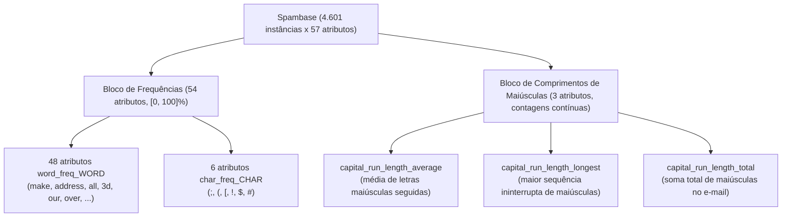
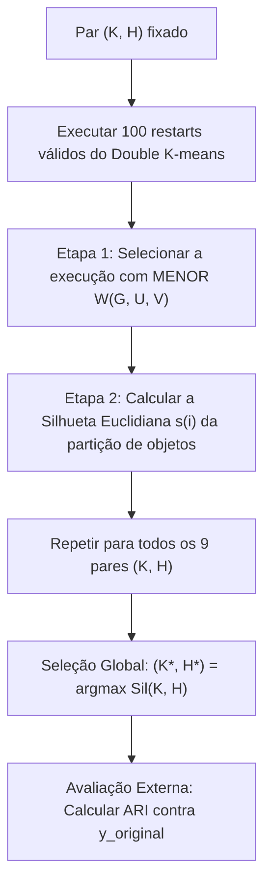
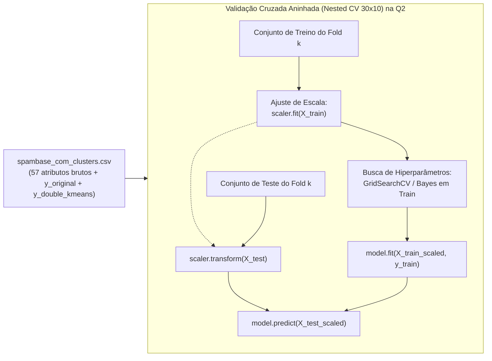

# Relatório Técnico — Questão 1: Co-clustering no Spambase via Double K-means
**Disciplina:** Aprendizagem de Máquina (AM 2026.2) — Centro de Informática (CIn / UFPE)  
**Projeto Prático:** Questão 1 — Agrupamento Bidirecional e Sensibilidade ao Pré-processamento  

---

## Sumário Executivo

Este relatório apresenta o desenvolvimento, a validação empírica e a análise comparativa de pré-processamentos para o algoritmo **Double K-means** aplicado ao conjunto de dados *Spambase*. O objetivo principal da Questão 1 consiste em realizar um co-clustering (agrupamento simultâneo de instâncias e atributos) em uma grade de hiperparâmetros $K \in \{2, 3, 4\}$ e $H \in \{1, \ldots, K\}$, selecionando a partição ótima $(K^*, H^*)$ por meio da máxima Silhueta Euclidiana e avaliando a concordância da partição com as classes a priori (*spam* versus *non-spam*) por meio do *Adjusted Rand Index* (ARI).

O relatório documenta:
1. Uma descrição sucinta das características distributivas e estruturais do *Spambase*;
2. A formulação matemática do Double K-means e o processo formal de obtenção dos hiperparâmetros;
3. O delineamento do protocolo experimental estritamente não supervisionado e reprodutível;
4. A investigação aprofundada do comportamento patológico do z-score clássico (*StandardScaler puro*), que resultou no isolamento de um grupo de 34 e-mails com vocabulário técnico específico e Silhueta elevada ($0,6596$) e $\text{ARI} \approx 0$;
5. O desenvolvimento e a execução exaustiva de seis estratégias de pré-processamento alternativas (totalizando 6.300 execuções válidas reportadas do algoritmo (900 por estratégia));
6. A comparação quantitativa e qualitativa das partições obtidas;
7. Diretrizes metodológicas para evitar vazamento de informações entre treino e teste na Questão 2, com ressalva quanto à origem dos rótulos de agrupamento.

---

## 1. Descrição Sucinta dos Dados (*Spambase*)

O conjunto de dados *Spambase* é proveniente do *UCI Machine Learning Repository*, originalmente doado pelos laboratórios de pesquisa da *Hewlett-Packard* (HP Labs). Ele é composto por **$N = 4.601$ e-mails (observações)** descritos por **$P = 57$ atributos numéricos contínuos** e **1 variável alvo binária ($y$)**, indicando a classe do e-mail:
- **Classe 0 (*non-spam* / legítimo):** $2.788$ e-mails ($60,60\%$ da base);
- **Classe 1 (*spam* / não solicitado):** $1.813$ e-mails ($39,40\%$ da base).

> [!IMPORTANT]
> **Integridade Não Supervisionada:** Conforme as diretrizes estritas do projeto, a variável de classe original $y$ foi completamente excluída de todas as etapas de pré-processamento, padronização, agrupamento bidirecional e critério de parada do Double K-means. O rótulo $y$ foi utilizado única e exclusivamente a posteriori para o cálculo do *Adjusted Rand Index* (ARI) como métrica de validação externa.

### 1.1 Tipologia e Granularidade dos Atributos

Os 57 atributos preditores dividem-se em dois blocos conceituais e matemáticos com grandezas físicas distintas:

1. **Bloco de Frequências Percentuais (Atributos 0 a 53):**
   - $48$ variáveis `word_freq_WORD`: percentual de palavras no e-mail que coincidem com o termo especificado ($100 \times \frac{\text{contagem do termo}}{\text{total de palavras}}$);
   - $6$ variáveis `char_freq_CHAR`: percentual de caracteres correspondentes aos símbolos `';'`, `'('`, `'['`, `'!'`, `'$'`, `'#'`.
2. **Bloco de Comprimentos de Sequências de Maiúsculas (Atributos 54 a 56):**
   - `capital_run_length_average`: comprimento médio das sequências ininterruptas de letras maiúsculas;
   - `capital_run_length_longest`: comprimento máximo observado de uma sequência de maiúsculas;
   - `capital_run_length_total`: número total de letras maiúsculas no e-mail.

### 1.2 Características Estatísticas e Desafios para Algoritmos de Agrupamento

A análise exploratória dos dados revela propriedades estatísticas adversas que afetam diretamente métricas euclidianas:
- **Esparsidade e Excesso de Zeros:** No bloco de frequências de palavras, mais de $80\%$ das entradas são identicamente nulas ($0,0\%$). A maioria dos e-mails não contém termos específicos como `"conference"`, `"415"`, `"telnet"` ou `"cs"`.
- **Assimetria Positiva Extrema e Caudas Longas:** Para as observações onde uma palavra ocorre, a frequência varia pontualmente de $0,1\%$ até valores como $20\%$ ou $30\%$, configurando uma distribuição fortemente assimétrica à direita com curtose elevada.
- **Heterogeneidade de Escala e Variância:** Enquanto as frequências estão restritas ao intervalo $[0, 100]$, a variável `capital_run_length_total` possui média de $283$, desvio-padrão de $606$ e atinge o valor máximo de $15.841$. Sem pré-processamento, a variância desta única variável domina em dezenas de vezes a variância de todo o bloco de palavras.
- **Vocabulário específico em microclusters:** um grupo de 34 e-mails classificados como legítimos apresenta frequências elevadas de termos e códigos como `word_freq_857`, `word_freq_415`, `word_freq_650`, `word_freq_direct`, `word_freq_telnet`, `word_freq_technology`, `word_freq_hp`, `word_freq_hpl`, `word_freq_lab` e `word_freq_labs`. Essa associação lexical não permite concluir a origem institucional ou o conteúdo integral dos e-mails.

---

## 2. Modelo Matemático: Double K-means

O **Double K-means** (também denominado *Two-way K-means* ou co-clustering matricial) realiza a partição simultânea das $N$ linhas (objetos) em $K$ clusters e das $P$ colunas (atributos) em $H$ clusters, modelando a interação entre dados e variáveis por meio de uma matriz de protótipos de blocos $G \in \mathbb{R}^{K \times H}$.

### 2.1 Função Objetivo

Sejam:
- $X \in \mathbb{R}^{N \times P}$ a matriz de dados pré-processada;
- $U \in \{0, 1\}^{N \times K}$ a matriz de pertinência binária dos objetos, satisfazendo $\sum_{k=1}^K u_{ik} = 1, \forall i$;
- $V \in \{0, 1\}^{P \times H}$ a matriz de pertinência binária das variáveis, satisfazendo $\sum_{h=1}^H v_{jh} = 1, \forall j$;
- $G = [g_{kh}] \in \mathbb{R}^{K \times H}$ a matriz de centros prototípicos dos co-clusters.

A função de perda a ser minimizada é a inércia intrabloco (soma dos quadrados dos desvios euclidianos):
$$W(G, U, V) = \sum_{k=1}^K \sum_{h=1}^H \sum_{i=1}^N \sum_{j=1}^P u_{ik} v_{jh} (x_{ij} - g_{kh})^2$$

### 2.2 Algoritmo de Otimização e Regras de Atualização

O problema é resolvido por um procedimento iterativo de descida alternada em três passos até a convergência:

1. **Atualização da Matriz de Protótipos $G$ (dados $U$ e $V$ fixos):**
   Cada elemento $g_{kh}$ é computado como a média aritmética de todas as entradas $x_{ij}$ pertencentes à interseção do cluster de objetos $k$ e cluster de variáveis $h$:
   $$g_{kh} = \frac{\sum_{i=1}^N \sum_{j=1}^P u_{ik} v_{jh} x_{ij}}{\left(\sum_{i=1}^N u_{ik}\right) \left(\sum_{j=1}^P v_{jh}\right)} = \frac{1}{|C_k| \cdot |D_h|} \sum_{i \in C_k} \sum_{j \in D_h} x_{ij}$$
   onde $C_k = \{i \mid u_{ik} = 1\}$ e $D_h = \{j \mid v_{jh} = 1\}$.

2. **Atualização da Partição de Objetos $U$ (dados $G$ e $V$ fixos):**
   Cada objeto $i \in \{1, \ldots, N\}$ é atribuído ao cluster de objetos $k^*$ que minimiza a soma das distâncias aos protótipos das variáveis:
   $$k^* = \arg\min_{k \in \{1, \ldots, K\}} \sum_{h=1}^H \sum_{j \in D_h} (x_{ij} - g_{kh})^2$$

3. **Atualização da Partição de Variáveis $V$ (dados $G$ e $U$ fixos):**
   Cada variável $j \in \{1, \ldots, P\}$ é atribuída ao cluster de variáveis $h^*$ que minimiza a soma das distâncias aos protótipos dos objetos:
   $$h^* = \arg\min_{h \in \{1, \ldots, H\}} \sum_{k=1}^K \sum_{i \in C_k} (x_{ij} - g_{kh})^2$$

4. **Critério de Parada e Robustez:**
   - **Convergência efetivamente implementada:** o algoritmo encerra quando **nem os rótulos dos objetos nem os das variáveis mudam** entre iterações sucessivas, ou quando alcança o limite de **200 iterações** (neste caso, devolve a última solução válida).
   - **Checagem de monotonicidade:** `monotonic_tol=1e-7` é a tolerância numérica usada para acusar um aumento relevante em $W$; **não** é um limiar de redução relativa usado para definir convergência.
   - Tratamento de Degenerescência: caso alguma atualização resulte em um cluster de objetos ou variáveis vazio ($|C_k| = 0$ ou $|D_h| = 0$), a execução é imediatamente considerada **inválida**, descartada, e uma nova semente determinística é disparada até que se totalizem $100$ execuções completas e válidas.

---

## 3. Obtenção dos Hiperparâmetros do Modelo

Diferente de algoritmos supervisionados nos quais a validação cruzada orienta a busca, no agrupamento bidirecional não supervisionado os hiperparâmetros foram determinados conforme o protocolo experimental rigoroso estabelecido pelo projeto.

### 3.1 Espaço de Hiperparâmetros Avaliado

A grade experimental obrigatória contempla $K$ (número de grupos de e-mails) e $H$ (número de grupos de atributos):
- **Clusters de objetos:** $K \in \{2, 3, 4\}$;
- **Clusters de variáveis:** $H \in \{1, \ldots, K\}$ para cada $K$;
- **Grade completa (9 pares):**
  $$(2,1), (2,2), (3,1), (3,2), (3,3), (4,1), (4,2), (4,3), (4,4)$$

### 3.2 Otimização Estocástica e Reprodutibilidade (100 Restarts por Par)

Como a função $W(G, U, V)$ é não convexa e sujeita a mínimos locais, cada par $(K, H)$ foi submetido a **100 reinicializações aleatórias independentes e válidas**.
Para garantir total reprodutibilidade científica, a sequência de números pseudoaleatórios seguiu a regra determinística:
$$\text{seed} = \text{base\_seed} + 10.000 \cdot K + 1.000 \cdot H + \text{restart\_idx}, \quad (\text{com } \text{base\_seed} = 42)$$

### 3.3 Protocolo Estrito de Seleção em Dois Estágios

A metodologia segue um protocolo em cascata que não permite inversões:

1. **Estágio 1 (Interno aos Restarts — Função Objetivo $W$):**
   Entre as 100 execuções válidas de um par $(K, H)$, é selecionada **exclusivamente aquela de menor função objetivo $W$**.
   > [!WARNING]
   > Nunca se deve selecionar o melhor restart pela Silhueta. A Silhueta não é a função de perda do algoritmo; utilizá-la para escolher restarts configuraria violação da consistência de convergência do K-means.
2. **Estágio 2 (Entre os Pares $(K, H)$ — Silhueta Euclidiana):**
   Sobre a partição de objetos da melhor execução selecionada no Estágio 1, computa-se o coeficiente de Silhueta médio:
   $$s(i) = \frac{b(i) - a(i)}{\max(a(i), b(i))}, \quad \text{Sil}(K, H) = \frac{1}{N} \sum_{i=1}^N s(i)$$
   onde $a(i)$ é a distância média intra-cluster e $b(i)$ é a distância média ao cluster vizinho mais próximo.
   O par vencedor é então definido por:
   $$(K^*, H^*) = \arg\max_{K, H} \text{Sil}(K, H)$$
3. **Avaliação Externa de Coerência (Adjusted Rand Index — ARI):**
   Após a fixação de $(K^*, H^*)$, a partição de objetos $y_{double\_kmeans}$ é contrastada com o rótulo a priori $y_{original}$ via ARI:
   $$\text{ARI} = \frac{\sum_{ij} \binom{n_{ij}}{2} - \left[\sum_i \binom{a_i}{2} \sum_j \binom{b_j}{2}\right] / \binom{n}{2}}{\frac{1}{2} \left[\sum_i \binom{a_i}{2} + \sum_j \binom{b_j}{2}\right] - \left[\sum_i \binom{a_i}{2} + \sum_j \binom{b_j}{2}\right] / \binom{n}{2}}$$
   - $\text{ARI} = 1$: agrupamento idêntico à partição de classes;
   - $\text{ARI} \approx 0$: concordância esperada puramente pelo acaso;
   - $\text{ARI} < 0$: partição sistematicamente discrepante.

---

## 4. Organização Metodológica dos Experimentos de Pré-processamento

Para responder à pergunta de pesquisa sobre a sensibilidade do Double K-means a transformações de atributos e diagnosticar o isolamento patológico de clusters, desenhou-se um plano experimental controlado comparando **sete tratamentos de dados**.

### 4.1 Controle Experimental e Isolamento de Diretórios

Para assegurar uma comparação justa, rigorosa e rastreável:
1. **Mesma Grade e Sementes:** Cada estratégia executou rigorosamente os 9 pares $(K, H)$ com 100 restarts válidos cada (900 execuções por estratégia), utilizando o mesmo gerador de sementes e critério de parada.
2. **Isolamento de Diretórios:** Cada estratégia possui seu notebook `.ipynb` em `questao1/notebooks/` com saídas incorporadas e pasta exclusiva em `questao1/resultados/`, impedindo sobrescrita de dados históricos:
   - `resultados/originais/` e `resultados/revisada/` (`notebooks/revisada.ipynb`): Linha de base original (`StandardScaler` puro);
   - `resultados/binarizacao/` (`notebooks/binarizacao.ipynb`): Estratégia 1 (binarização das 54 frequências + `log1p` nas 3 variáveis de maiúsculas + `StandardScaler`);
   - `resultados/log_minmax/` (`notebooks/log_minmax.ipynb`): Estratégia 2 ($\log(1+x)$ + `MinMaxScaler`);
   - `resultados/quantile_uniform/` (`notebooks/quantile_uniform.ipynb`): Estratégia 3 (`QuantileTransformer` uniforme);
   - `resultados/clip_log_standard/` (`notebooks/clip_log_standard.ipynb`): Estratégia 4 (Clip 99% + $\log(1+x)$ + `StandardScaler`);
   - `resultados/tratamento_diferenciado_runs/` (`notebooks/tratamento_diferenciado_runs.ipynb`): Estratégia 5 (Tratamento Diferenciado de Maiúsculas por Blocos);
   - `resultados/filtragem_dominio/` (`notebooks/filtragem_dominio.ipynb`): Estratégia 6 (Filtragem de Termos Específicos do Domínio HP Labs).

### 4.2 Detalhamento Conceitual das Estratégias

#### Linha de Base: `StandardScaler` Puro Global
- **Fórmula:** $z_{ij} = \frac{x_{ij} - \mu_j}{\sigma_j}$.
- **Hipótese:** Padronização clássica z-score adotada como linha de base experimental. O enunciado não determina obrigatoriamente essa transformação. Coloca as variáveis não constantes com média zero e variância unitária.
- **Vulnerabilidade Teórica:** Como várias variáveis têm distribuições assimétricas e esparsas, a padronização por `StandardScaler` pode produzir escores $z$ extremos, ampliando a influência de algumas observações nas distâncias euclidianas. Na base Spambase, `word_freq_415` atinge no máximo **4,76%**, com $z$ máximo de aproximadamente **+14,30** — não 20% nem $z > +30$ nessa variável. Valores padronizados acima de +30 aparecem em outros atributos: `capital_run_length_longest`, por exemplo, atinge $z \approx +50,99$. Não é possível inferir a origem ou o contexto institucional dos e-mails apenas por esses atributos.

#### Estratégia 1: Binarização das Frequências + `log1p` nas Maiúsculas + `StandardScaler`
- **Fórmula:** para as primeiras 54 variáveis (frequências de palavras e caracteres), $b_{ij} = \mathbb{I}(x_{ij} > 0)$; para as últimas 3 variáveis (`capital_run_length`), $b_{ij} = \log(1+x_{ij})$. Em seguida, aplica-se `StandardScaler` às **57 colunas** resultantes.
- **Fundamentação:** A binarização preserva a presença ou ausência dos termos, sem considerar sua intensidade; já a transformação logarítmica comprime as magnitudes das sequências de maiúsculas sem torná-las binárias. A etapa final padroniza a escala das 57 variáveis. Isso não elimina necessariamente valores extremos após a padronização.

#### Estratégia 2: $\log(1+x)$ + `MinMaxScaler`
- **Fórmula:** $y_{ij} = \log(1 + x_{ij})$; em seguida, $z_{ij} = \frac{y_{ij} - \min(y_j)}{\max(y_j) - \min(y_j)} \in [0, 1]$.
- **Fundamentação:** A função logarítmica achata monotonicamente as caudas longas, reduzindo ordens de grandeza de milhares para o intervalo $[0, 9]$. A posterior normalização Min-Max confina estritamente todas as 57 variáveis ao hipercubo $[0, 1]^P$, impedindo que qualquer atributo isolado exerça dominância de distância euclidiana.

#### Estratégia 3: `QuantileTransformer` (Distribuição Uniforme)
- **Fórmula:** $u_{ij} = \hat{F}_j(x_{ij}) \in [0, 1]$, onde $\hat{F}_j$ é a função de distribuição cumulativa empírica.
- **Fundamentação:** Transformação não paramétrica baseada em quantis. Mapeia os valores para uma escala próxima da distribuição uniforme, com empates mantidos em variáveis muito esparsas. Reduz o efeito da magnitude de valores extremos, mas também altera as distâncias relativas entre exemplos.

#### Estratégia 4: Clip $99\%$ + $\log(1+x)$ + `StandardScaler`
- **Fórmula:** $x'_{ij} = \min(x_{ij}, Q_{0.99}(X_j))$; depois $y_{ij} = \log(1 + x'_{ij})$ e aplicação de `StandardScaler`.
- **Fundamentação:** Aplica truncamento pelo quantil 99% de cada coluna, seguido de transformação logarítmica e padronização. Busca diminuir a influência de valores extremos; como altera os dados, também altera a geometria euclidiana.

#### Estratégia 5: Tratamento Diferenciado para `capital_run_length`
- **Fórmula:** 
  - Bloco de frequências ($j \in \{0, \ldots, 53\}$): $X_{freq\_scaled} = \text{StandardScaler}(X_{freq})$;
  - Bloco de maiúsculas ($j \in \{54, \ldots, 56\}$): $X_{runs\_scaled} = \text{StandardScaler}(\log(1 + X_{runs}))$;
  - Matriz final: $X = [X_{freq\_scaled}, X_{runs\_scaled}]$.
- **Fundamentação:** Isola os dois blocos funcionais do dataset. Testa empiricamente a hipótese de que o isolamento de outliers decorria da ordem de grandeza das maiúsculas ($15.841$) frente às frequências percentuais.

#### Estratégia 6: Filtragem de Termos Específicos do Domínio (HP Labs)
- **Fórmula:** 
  - Remoção dos 8 atributos institucionais corporativos: `word_freq_hp`, `word_freq_hpl`, `word_freq_george`, `word_freq_lab`, `word_freq_labs`, `word_freq_650`, `word_freq_415`, `word_freq_857`;
  - Matriz final $X \in \mathbb{R}^{N \times 49}$: padronização `StandardScaler()` aplicada sobre as 49 variáveis universais remanescentes.
- **Fundamentação:** Investiga como a exclusão de oito atributos com vocabulário específico afeta as partições. O experimento não permite provar a origem dos e-mails nem identificar uma causa única para o microcluster: ele verifica a sensibilidade do agrupamento a essa seleção de atributos.

---

## 5. Resultados e Comparação dos Pré-processamentos

A Tabela 1 consolida as métricas e partições obtidas pela melhor solução de cada estratégia de pré-processamento, após as 100 execuções válidas por cada um dos 9 pares $(K,H)$ (900 execuções por estratégia):

### Tabela 1: Síntese Comparativa das Estratégias de Pré-processamento

| Estratégia | Pré-processamento Aplicado | Par Vencedor $(K^*, H^*)$ | Silhueta Euclidiana | ARI com a Classe | Distribuição dos Clusters de Objetos ($N=4.601$) | Diagnóstico Metodológico |
| :--- | :--- | :---: | :---: | :---: | :--- | :--- |
| **Linha de Base** | `StandardScaler` puro global | $(2, 2)$ | **0,6596** | **−0,00495** | Cluster 0: **34** ($0,7\%$) Cluster 1: **4.567** ($99,3\%$) | **Microcluster:** 34 e-mails isolados por um bloco de 11 termos específicos; Silhueta elevada, mas ARI próximo de zero. |
| **Estratégia 1** | Binarização das 54 frequências + `log1p` nas 3 variáveis de maiúsculas + `StandardScaler` | $(3, 3)$ | 0,2100 | **+0,2695** | Cluster 0: **1.344** ($29,2\%$) Cluster 1: **3.025** ($65,7\%$) Cluster 2: **232** ($5,0\%$) | **Presença/ausência dos termos:** microcluster de 34 não é reproduzido; no par $(2,2)$ atinge $\text{ARI} = 0,3553$ com **3.228 objetos no cluster 0** e **1.373 no cluster 1** (seed 22042). |
| **Estratégia 2** | $\log(1+x)$ + `MinMaxScaler` | $(3, 3)$ | 0,1292 | **+0,3911** | Cluster 0: **2.619** ($56,9\%$) Cluster 1: **265** ($5,8\%$) Cluster 2: **1.717** ($37,3\%$) | **Concordância parcial com classes:** ARI 0,3911; clusters principais possuem predominâncias de spam e non-spam, respectivamente. |
| **Estratégia 3** | `QuantileTransformer` (uniforme) | $(3, 3)$ | 0,1903 | **+0,2925** | Cluster 0: **2.787** ($60,6\%$) Cluster 1: **1.240** ($27,0\%$) Cluster 2: **574** ($12,5\%$) | **Transformação por quantis:** grupos menos extremos em tamanho; estabilidade por reamostragem requer avaliação complementar. |
| **Estratégia 4** | Clip 99% + $\log(1+x)$ + `StandardScaler` | $(2, 1)$ | 0,1721 | **+0,1292** | Cluster 0: **1.372** ($29,8\%$) Cluster 1: **3.229** ($70,2\%$) | **Partição Bipartida:** sem microcluster de 34; todas as variáveis foram mantidas em um único grupo ($H=1$). Em $(2,2)$, o ARI chegou a **+0,5517** (Silhueta **0,1085**), mas esse par não venceu pelo critério de Silhueta. |
| **Estratégia 5** | Tratamento Diferenciado para `capital_run_length` | $(2, 2)$ | 0,6537 | **−0,00495** | Cluster 0: **4.567** ($99,3\%$) Cluster 1: **34** ($0,7\%$) | **Análise de sensibilidade:** o microcluster persiste apesar do tratamento das maiúsculas; em $(3,3)$ o ARI é **+0,4632**, embora não seja o par vencedor por Silhueta. |
| **Estratégia 6** | Filtragem de Termos de Domínio HP Labs | $(2, 1)$ | **0,2926** | **+0,1363** | Cluster 0: **1.129** ($24,5\%$) Cluster 1: **3.472** ($75,5\%$) | **Filtragem de 8 atributos de domínio:** a solução vencedora não reproduz o microcluster de 34; no par $(2,2)$ atinge $\text{ARI} = \mathbf{0,3607}$ ($1.107$ vs $3.494$). |

---

## 6. Análise Aprofundada dos Fenômenos Observados

### 6.1 O "Paradoxo da Silhueta" e a Armadilha de Outliers no `StandardScaler`

A inspeção detalhada da Linha de Base original revela um fenômeno matemático fundamental de agrupamento:
1. **Origem da Silhueta Inflada ($0,6596$):**
   A Silhueta mede a coesão interna versus a separação em relação ao cluster vizinho mais próximo. Ao isolar 34 objetos com atributos distintos dos demais 4.567, a partição produz Silhueta média elevada ($0,6596$); isso não garante correspondência com as classes conhecidas. O valor global é fortemente influenciado pelo cluster maior, e deve ser interpretado junto aos tamanhos e à Silhueta por grupo.
2. **Perfil dos 34 Objetos:**
   Todos os 34 objetos do microcluster pertencem à classe $0$ (*non-spam*). A inspeção dos maiores contrastes padronizados revela valores elevados em atributos associados a termos técnicos, mas não comprova o remetente ou o contexto institucional dessas mensagens:
   - `word_freq_857` ($z = +9,58$)
   - `word_freq_415` ($z = +9,55$)
   - `word_freq_direct` ($z = +8,81$)
   - `word_freq_telnet` ($z = +8,16$)
   - `word_freq_technology` ($z = +8,10$)
   - `word_freq_hp` e `word_freq_lab` ($z > +7,0$)
3. **Baixa correspondência com spam/non-spam:**
   Como os 34 e-mails são non-spam e o cluster principal de 4.567 e-mails mistura $2.754$ legítimos com todos os $1.813$ spams, a partição apresenta baixa concordância com a distinção original spam/non-spam, resultando em $\text{ARI} = -0,00495$.

### 6.2 O Impacto da Filtragem de Termos de Domínio (Estratégia 6)

A Estratégia 6 investigou o efeito de excluir oito atributos associados a vocabulário específico do domínio. Os resultados são compatíveis com uma mudança importante na geometria do agrupamento, mas não permitem isolar causalmente uma única explicação:
1. **Desaparecimento do microcluster nas soluções examinadas:** Tanto em $(2,1)$ quanto em $(2,2)$, o microcluster de 34 objetos desapareceu por completo. As partições resultaram em agrupamentos substanciais ($1.129$ vs $3.472$ em $(2,1)$; $1.107$ vs $3.494$ em $(2,2)$).
2. **Desempenho no Par $(2,2)$:** o ARI passou de $-0,00495$ na linha de base para **$+0,3607$** nessa estratégia. Isso mostra maior concordância com as classes originais nessa configuração, sem comprovar que os blocos correspondam diretamente a categorias semânticas universais.
3. **Seleção Global:** O par vencedor pela Silhueta máxima foi $(2,1)$ ($\text{Sil} = 0,2926$), resultando em uma partição com dois grupos de objetos nessa representação.

### 6.3 Estratégia 5: efeito do tratamento das maiúsculas e soluções com $K=3$

A hipótese investigada na Estratégia 5 propunha que o esmagamento das contagens de maiúsculas (`capital_run_length`) por logaritmo impediria a separação dos 34 outliers.
Os resultados da estratégia selecionada mostram que o microcluster persiste:
- No par $(2,2)$, o algoritmo formou um microcluster de 34 objetos com perfil técnico semelhante ao observado na linha de base ($\text{ARI} = -0,0049$ e Silhueta $= 0,6537$).
- A partição de variáveis confirmou que o cluster de variáveis 1 isolou exatamente as **11 variáveis de vocabulário técnico específico**, mantendo as 3 maiúsculas no outro bloco.
- **Contudo, ao avaliar os demais pares da grade na Estratégia 5:**
  - Em $(K=3, H=3)$, a partição encontrou 3 grupos: Cluster 0 com 34 e-mails (grupo de vocabulário específico), Cluster 1 com **1.313 e-mails** e Cluster 2 com **3.254 e-mails**.
  - O ARI em $(3,3)$ atingiu **$+0,4632$**, o maior valor entre os nove pares examinados **na Estratégia 5**, mas não o maior de todo o projeto.
  - Na **Estratégia 4** (Clip 99% + `log1p` + `StandardScaler`), o par $(2,2)$ obteve ARI **+0,5517** com Silhueta **0,1085**; o par $(3,3)$ obteve ARI **+0,4560** com Silhueta **0,1332**. Nenhum deles foi selecionado nessa estratégia: o vencedor por Silhueta foi $(2,1)$, com **0,1721**.
  - Portanto, o ARI da Estratégia 5 em $(3,3)$ indica maior concordância externa do que seu próprio par vencedor $(2,2)$, mas **não** justifica alterar a seleção pelo protocolo, que compara a Silhueta das melhores soluções por $W$. A concordância com as classes originais não prova recuperação da semântica dos e-mails.

### 6.4 Resultados da Estratégia 2 ($\log(1+x) + \text{MinMaxScaler}$) e da Binarização

Nas estratégias que trataram as frequências de palavras (Binarização e Log-MinMax):
- **Efeito das transformações:** a Silhueta no espaço transformado situou-se aproximadamente entre $0,13$ e $0,21$ nessas estratégias. Como os espaços transformados são diferentes, isso não constitui uma comparação absoluta de qualidade.
- **Concordância externa parcial:** o par vencedor foi $(K^*, H^*) = (3, 3)$, com $\text{ARI} = +0,3911$. A composição das classes originais varia entre os três grupos, mas há mistura relevante no cluster 0. O ARI foi calculado apenas após o agrupamento, não usado para selecioná-lo.
- **Matriz de contingência na Estratégia 2**, conforme `questao1/resultados/log_minmax/matriz_contingencia.csv`:

| Cluster | Non-spam (0) | Spam (1) | Total | Percentual predominante |
| :--- | ---: | ---: | ---: | :--- |
| 0 | 2.218 | 401 | 2.619 | 84,69% non-spam |
| 1 | 265 | 0 | 265 | 100,00% non-spam |
| 2 | 305 | 1.412 | 1.717 | 82,24% spam |
| **Total** | **2.788** | **1.813** | **4.601** | — |

---

## 7. Estrutura dos Co-clusters e Matrizes de Protótipos

As matrizes abaixo reproduzem a **ordem dos rótulos de objetos e de variáveis de cada experimento**, conforme os arquivos `matriz_prototipos_G.csv`. Os rótulos numéricos dos clusters são arbitrários: sua posição deve ser lida junto às tabelas de contingência e de partição de variáveis da mesma estratégia. Os protótipos representam médias no espaço **pré-processado de cada experimento**, não frequências originais.

### 7.1 Linha de Base — `StandardScaler` puro, $(K,H)=(2,2)$

Fonte: `questao1/resultados/revisada/matriz_prototipos_G.csv` e `particao_variaveis.csv`.

| Grupo de objetos | Variáveis 0 — 11 atributos de vocabulário específico | Variáveis 1 — 46 demais atributos |
| :--- | ---: | ---: |
| **Cluster 0 — 34 objetos** | **+6,861185** | −0,144405 |
| **Cluster 1 — 4.567 objetos** | −0,051080 | +0,001075 |

O bloco de 11 variáveis inclui `415`, `650`, `85`, `857`, `direct`, `hp`, `hpl`, `lab`, `labs`, `technology` e `telnet`. O maior contraste está no protótipo desse bloco para os 34 objetos, sem que isso determine a origem dos e-mails.

### 7.2 Estratégia 5 — Maiúsculas tratadas separadamente, $(K,H)=(2,2)$

Fonte: `questao1/resultados/tratamento_diferenciado_runs/matriz_prototipos_G.csv`.

| Grupo de objetos | Variáveis 0 — 46 atributos gerais | Variáveis 1 — 11 atributos de vocabulário específico |
| :--- | ---: | ---: |
| **Cluster 0 — 4.567 objetos** | +0,001103 | −0,051080 |
| **Cluster 1 — 34 objetos** | −0,148098 | **+6,861185** |

Embora as duas estratégias isolem o mesmo número de objetos, a **ordem dos rótulos de objetos e variáveis é diferente**, e os valores dos protótipos gerais não são idênticos. Por isso, não cabe apresentar uma só matriz G para ambas.

### 7.3 Estratégia 6 — Filtragem de termos de domínio, $(K,H)=(2,1)$

Fonte: `questao1/resultados/filtragem_dominio/matriz_prototipos_G.csv`.

| Grupo de objetos | Variáveis 0 — 49 atributos mantidos |
| :--- | ---: |
| **Cluster 0 — 1.129 objetos** | **+0,265811** |
| **Cluster 1 — 3.472 objetos** | **−0,086435** |

Os valores resumem a média de cada bloco padronizado; não são proporções de spam. A composição dos rótulos originais pode ser consultada na matriz de contingência exportada.

### 7.4 Estratégia 2 — `log1p` + `MinMaxScaler`, $(K,H)=(3,3)$

Fonte: `questao1/resultados/log_minmax/matriz_prototipos_G.csv` e `particao_variaveis.csv`.

| Grupo de objetos | Variáveis 0 (4 atributos) | Variáveis 1 (31 atributos) | Variáveis 2 (22 atributos) |
| :--- | ---: | ---: | ---: |
| **Cluster 0 — 2.619 objetos** | 0,194479 | 0,022612 | 0,025559 |
| **Cluster 1 — 265 objetos** | 0,240859 | 0,132449 | 0,024273 |
| **Cluster 2 — 1.717 objetos** | 0,420265 | 0,008495 | 0,090361 |

A partição de variáveis agrupa: (0) `capital_run_length_longest`, `capital_run_length_total`, `word_freq_you` e `word_freq_your`; (1) um conjunto de 31 variáveis, incluindo diversos termos técnicos e de contexto; e (2) um conjunto de 22 variáveis, incluindo `char_freq_!`, `char_freq_$`, `word_freq_free`, `word_freq_money` e `word_freq_remove`. Os nomes dos blocos nesta tabela foram mantidos **neutros**, pois a atribuição de significado requer examinar sua composição e não pode ser inferida somente a partir de G.

---

## 8. Transição para a Questão 2 (Cuidados com *Data Leakage*)

A transição entre a Questão 1 e a Questão 2 exige isolar as etapas supervisionadas de treino/teste. Há uma ressalva: os rótulos de agrupamento da Questão 1 foram construídos a partir da **base completa**. A avaliação supervisionada desses rótulos mede a capacidade de reproduzir a partição fixada, não fornece, por si só, validação independente do agrupamento para e-mails novos:

### Regras Obrigatórias para a Questão 2:
1. **Preservação da Escala Original nos Arquivos Compartilhados:**
   Todos os arquivos CSV exportados (`spambase_com_clusters.csv`, `spambase_com_clusters_filtragem_dominio.csv`, etc.) contêm os 57 atributos numéricos **na escala bruta original**, sem nenhuma padronização global.
2. **Isolamento Estrito de Treino/Teste:**
   Qualquer técnica de transformação de dados (como `StandardScaler`, `MinMaxScaler` ou seleção de atributos) deve ser ajustada **exclusivamente nas instâncias de treino do fold corrente** via `fit_transform()`, aplicando-se unicamente `transform()` nas instâncias de teste. Transformações aprendidas a partir do conjunto completo devem ser evitadas na avaliação de generalização dos classificadores.
3. **Proibição de Vazamento de Rótulos:**
   Na Questão 2, os modelos supervisionados serão treinados sob dois cenários de predição:
   - Cenário A: Predição do rótulo real $y_{original}$ a partir dos 57 atributos;
   - Cenário B: Predição do cluster descoberto $y_{double\_kmeans}$ a partir dos 57 atributos.
   Sob hipótese alguma a coluna $y_{original}$ pode ser utilizada como preditor de $y_{double\_kmeans}$, e vice-versa.

---

## 9. Recomendações Metodológicas para a Apresentação do Grupo

Com base no arcabouço experimental executado, recomenda-se que o relatório final do grupo adote a seguinte estrutura argumentativa:

1. **Apresentar a Linha de Base Experimental (`StandardScaler` puro):**
   Apresentar para essa linha de base $(K^*, H^*) = (2, 2)$, reportando a Silhueta de $0,6596$, $W = 244.486,70$ e o $\text{ARI} = -0,00495$. Isso atende ao protocolo de seleção aplicado ao experimento baseline, mas o enunciado não exige especificamente `StandardScaler` como pré-processamento oficial.
2. **Submeter a Auditoria Crítica dos 34 Outliers:**
   Demonstrar a matriz de contingência (34 e 4.567 objetos, com distribuição das classes em cada um), a matriz de protótipos $G$ e a partição das 11 variáveis de vocabulário técnico específico. Explicar teoricamente o "Paradoxo da Silhueta" gerado pela distorção z-score em distribuições de cauda longa com excesso de zeros.
3. **Apresentar o Estudo de Sensibilidade aos Pré-processamentos:**
   Exibir a Tabela 1 consolidada. Destacar que:
   - A **Filtragem de Termos de Domínio (Estratégia 6)** altera a partição, eliminando o microcluster de 34 na solução vencedora; em $(2,2)$ o ARI é $0,3607$, embora esse não seja o par selecionado pela Silhueta.
   - A binarização e a transformação $\log(1+x) + \text{MinMaxScaler}$ produzem soluções com concordância externa parcial: ARI de $+0,3911$ para a Estratégia 2 em $(3,3)$ e $+0,3553$ para a Estratégia 1 em $(2,2)$.
   - A Estratégia 5 mantém o microcluster de 34 na solução $(2,2)$ e apresenta $\text{ARI} = +0,4632$ em $(3,3)$; esta última configuração não é a vencedora por Silhueta.
4. **Decisão sobre a Entrada da Questão 2:**
   O dataset exportado na pasta raiz preserva os rótulos do experimento original (baseline). As versões alternativas permanecem em suas pastas. A definição de qual conjunto será tratado como **oficial da Questão 2** depende de decisão metodológica explícita do grupo; não se deve caracterizar uma transformação específica como exigência do enunciado.

---
*Relatório original de 15/10/2026, revisado documentalmente em 16/10/2026. Correções conferidas com `double_kmeans.py` e os CSVs de resultados do repositório fornecido; as execuções experimentais não foram alteradas nesta revisão.*
