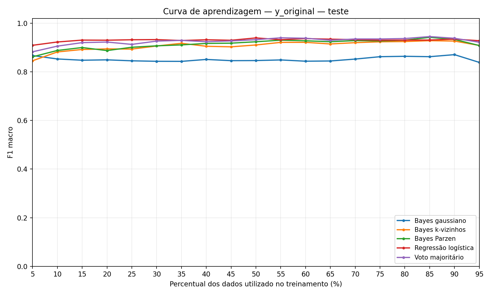
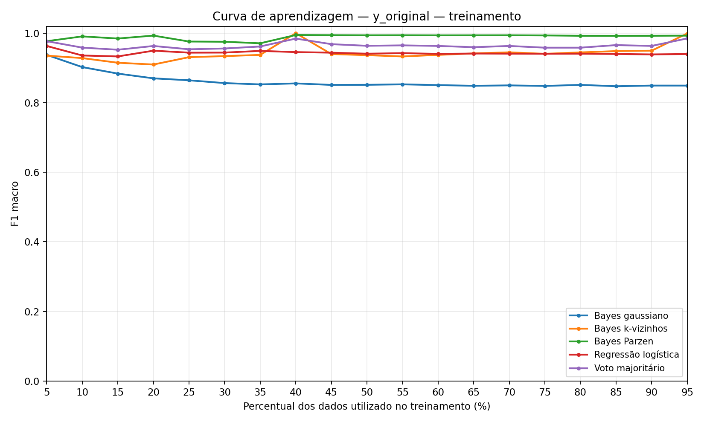
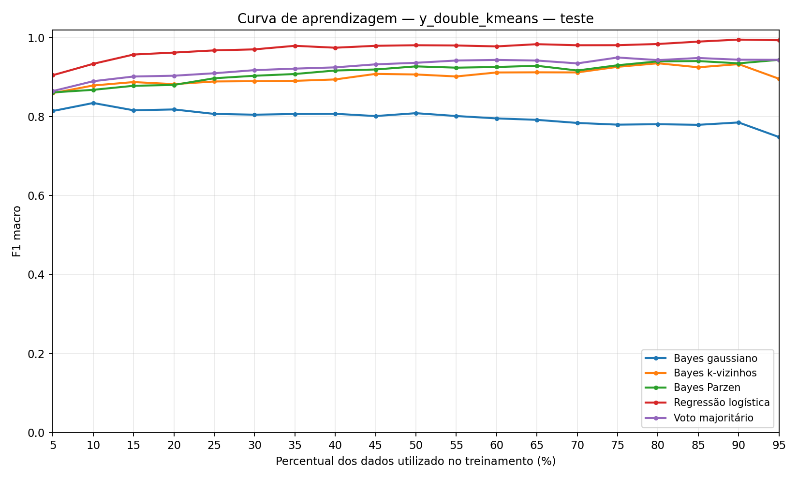
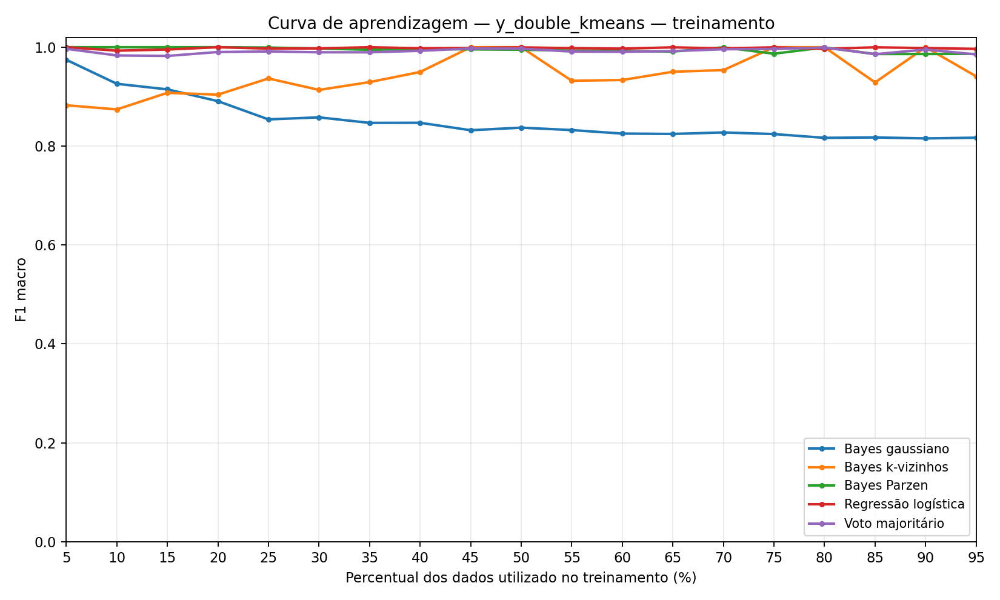

# Questão 2(d) — Curvas de aprendizagem de F1 macro

## Situação e escopo

**Concluído:** execução das 19 proporções de treinamento (5%, 10%, …, 95%) para cinco classificadores e duas versões da Spambase: **38 divisões estratificadas e 190 ajustes/avaliações dos classificadores finais**, sendo o voto derivado dos quatro modelos treinados.

**Repetições:** foi executada **uma divisão estratificada por proporção e por alvo**, com semente 2026. A letra (d) do enunciado não determina 30 sorteios para curvas; as **30 repetições × 10 folds** obrigatórias da letra (a) foram realizadas e auditadas separadamente. A execução de curvas permite repetições adicionais opcionais.

## Protocolo metodológico

- Base: 4.601 e-mails, 57 atributos numéricos originais, `y_original` (duas classes) ou `y_double_kmeans` (três grupos obtidos via Log1p + MinMaxScaler, K*=3, H*=3).
- Para cada proporção de treinamento *p*, uma divisão estratificada e complementar separa **p% para treinamento e (100−p)% para teste**, sem interseção e preservando as classes. O plano de aleatorização é reproduzível; os subconjuntos entre proporções não são obrigatoriamente aninhados.
- Todos os cinco modelos usam o **mesmo treino e teste** em cada ponto da mesma variável resposta.
- Gaussiano multivariado, k-vizinhos, Parzen e regressão logística selecionam os hiperparâmetros por **5-fold estratificado interno**, exclusivamente dentro do treinamento de cada ponto. Log1p e MinMax são reajustados dentro dos respectivos `Pipeline` de treinamento, sem pré-processamento global.
- O voto majoritário utiliza as predições dos quatro modelos-base treinados sobre aquele subconjunto e desempata com a probabilidade a priori estimada nesse mesmo treino.
- As curvas registram **F1 macro de treinamento (in-sample) e de teste**, bem como métricas complementares; F1 macro evita tratar a classe minoritária como irrelevante.
- Foram salvos os hiperparâmetros e o F1 da CV interna em cada ponto, além de tamanhos de treino e teste. Arquivos de progresso são escritos atomicamente e podem ser retomados.

## Resultados — F1 macro de teste

Cada célula é o F1 macro de teste no percentual indicado; **não são médias de 30 repetições**.

### Versão 1 — spam versus não spam

| Modelo | 5% treino | 25% treino | 50% treino | 75% treino | 95% treino |
|---|---:|---:|---:|---:|---:|
| Bayes gaussiano multivariado | 0.8670 | 0.8454 | 0.8464 | 0.8623 | 0.8388 |
| Bayes por k-vizinhos | 0.8455 | 0.8937 | 0.9105 | 0.9236 | 0.9086 |
| Bayes Parzen | 0.8618 | 0.9012 | 0.9237 | 0.9271 | 0.9082 |
| Regressão logística | 0.9092 | 0.9320 | 0.9395 | 0.9301 | 0.9280 |
| Voto majoritário | 0.8824 | 0.9129 | 0.9323 | 0.9352 | 0.9218 |





### Versão 2 — clusters Double K-means

| Modelo | 5% treino | 25% treino | 50% treino | 75% treino | 95% treino |
|---|---:|---:|---:|---:|---:|
| Bayes gaussiano multivariado | 0.8143 | 0.8069 | 0.8088 | 0.7797 | 0.7484 |
| Bayes por k-vizinhos | 0.8597 | 0.8891 | 0.9069 | 0.9262 | 0.8960 |
| Bayes Parzen | 0.8614 | 0.8972 | 0.9274 | 0.9302 | 0.9440 |
| Regressão logística | 0.9050 | 0.9679 | 0.9809 | 0.9811 | 0.9936 |
| Voto majoritário | 0.8648 | 0.9100 | 0.9364 | 0.9498 | 0.9440 |





## Interpretação dos padrões encontrados

**Classes originais:** a regressão logística já alcança F1 teste de 0,9092 com 5% de treinamento. Com o aumento do treino, k-vizinhos, Parzen e voto apresentam ganhos em boa parte da faixa, mas as curvas não são estritamente crescentes. Aos 95%, o conjunto de teste contém cerca de 230 observações, aumentando a variação dos resultados. O gaussiano permanece próximo da faixa de 0,84–0,87 no teste.

**Clusters do Double K-means:** a regressão logística apresenta F1 teste de **0,9050 em 5%**, **0,9809 em 50%** e **0,9936 em 95%**. A partição gerada parece relativamente fácil de aproximar para um modelo discriminativo nesta amostra. Parzen e o voto também melhoram em geral à medida que cresce o treino. O modelo gaussiano não apresenta tendência de melhora, tendo **0,8143 em 5%** e **0,7484 em 95%**, mas esta queda **não permite concluir deterioração de generalização** sem avaliar vários sorteios e a incerteza de amostragem.

**Lacuna treino-teste:** Para os modelos que memorizam exemplos locais, sobretudo k-vizinhos e Parzen, o F1 de treinamento pode se aproximar de 1 pela inclusão dos próprios exemplos na vizinhança/densidade. Isso é uma medida in-sample, e **não uma estimativa independente da generalização**. A inspeção conjunta das curvas de treino e teste é o instrumento apropriado para discutir esta diferença.

**Limitações:** com uma divisão por proporção, as oscilações dependem do sorteio e do tamanho variável do teste. Seria possível repetir opcionalmente o estudo e traçar médias/faixas, mas isso não é condição imposta explicitamente pelo item (d). Os rótulos `y_double_kmeans` foram determinados pelo agrupamento de **toda** a Spambase na Questão 1; logo, bons escores supervisionados aqui medem a **reprodução dos rótulos construídos**, não validam novos clusters nem a qualidade semântica do agrupamento.

## Arquivos de evidência

- `resultados/curvas_aprendizagem/execucoes/{alvo}/rep_01_pct_YY.csv`: arquivo bruto com os cinco modelos de cada uma das 38 divisões.
- `resultados/curvas_aprendizagem/curvas_pontos_consolidados.csv`: 190 registros (um por modelo/alvo/proporção).
- `resultados/curvas_aprendizagem/resumo_curvas.csv`: tabela de F1 treino/teste agrupada por alvo, modelo e percentual (190 registros, uma repetição).
- `resultados/curvas_aprendizagem/graficos/`: 14 figuras, quatro comparando os cinco modelos e dez confrontando treino/teste de cada modelo.
- `src/curvas_aprendizagem.py`, `src/graficos_curvas.py`, `scripts/rodar_curvas.py` e `tests/test_curvas_aprendizagem.py`: código de reprodução, consolidação e testes.

## Como reproduzir

Na raiz do repositório:

```bash
python -m questao2.scripts.rodar_curvas --repeticoes 1
python -m questao2.scripts.rodar_curvas --repeticoes 1 --apenas-consolidar
python -m unittest discover -s questao2/tests -v
```
