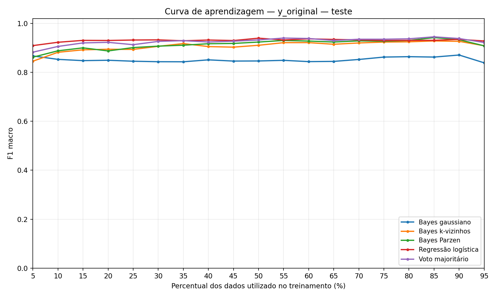
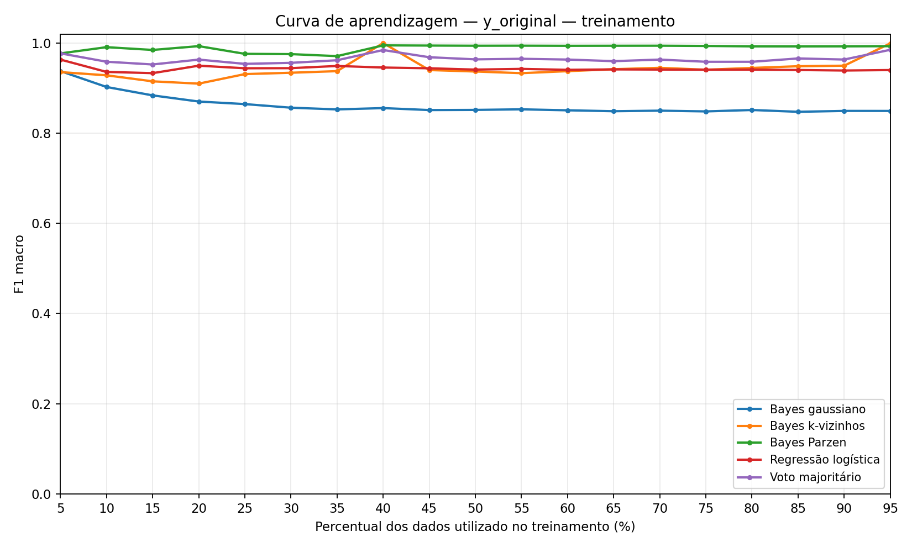
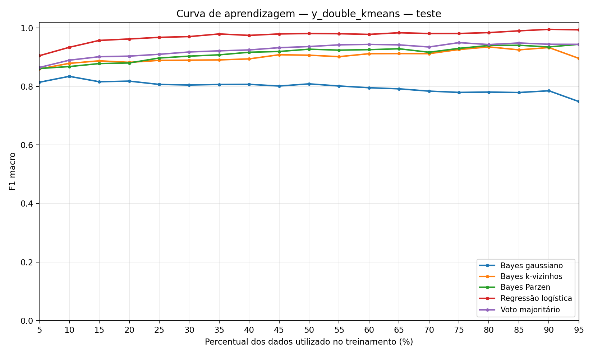
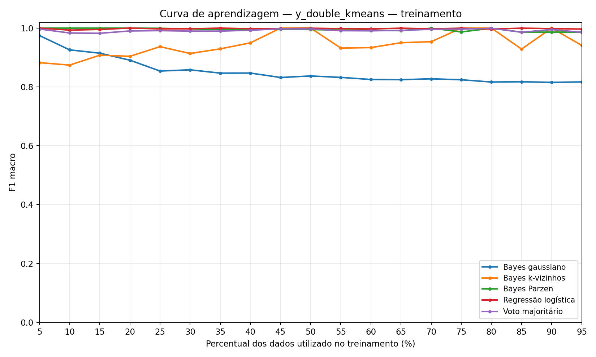

# Relatório final — Questão 2: avaliação supervisionada das duas versões da Spambase

**Aprendizagem de Máquina — 2026.2 — CIn/UFPE**  
**Objeto:** comparar cinco classificadores nas classes originais da Spambase e nos três rótulos obtidos por Double K-means na Questão 1.  
**Situação:** experimentos 30 × 10-fold completos; métricas e testes estatísticos calculados; curvas de aprendizagem executadas em 19 proporções; 62 testes automatizados aprovados.

> **Interpretação central.** Nas classes originais, voto majoritário (F1 macro de 0,9397) e Bayes Parzen (0,9394) apresentaram praticamente o mesmo desempenho. Nos três clusters, a regressão logística alcançou F1 macro de 0,9827 e taxa de erro de cerca de 0,95%. Resultados sobre os rótulos do Double K-means quantificam sua *reprodução supervisionada*, não a validade externa dos grupos.

## 1. Objetivos e escopo

A Questão 2` solicita: (a) avaliar cinco classificadores por validação cruzada estratificada repetida **30 × 10-fold**, com ajuste interno por **5 folds** quando necessário; (b) estimar taxa de erro, precisão, cobertura e F-measure com estimativas pontuais e intervalos de confiança; (c) comparar classificadores por Friedman e Nemenyi, em cada métrica; (d) analisar curvas de aprendizagem de F-measure em treino e teste com 5% a 95% de treinamento (passo de 5%).

O trabalho utiliza duas tarefas supervisionadas separadas com os mesmos atributos preditivos, mas diferentes variáveis resposta. Os resultados de uma tarefa **não são comparáveis diretamente como medida de qualidade da outra**.

## 2. Dados, versões e proveniência

Foram utilizados **4.601 e-mails**, descritos por **57 atributos numéricos**, sem valores ausentes no CSV verificado. O arquivo `dados/spambase_q2.csv` contém as variáveis preditivas em **escala original**, seguidas por `y_original` e `y_double_kmeans`. O hash SHA-256 está registrado em `dados/proveniencia_q1.json`.

| Versão | Rótulos e distribuição | Origem |
|---|---|---|
| `y_original` | classe 0: **2.788**; classe 1: **1.813** | Classes originais da Spambase (não spam/spam) |
| `y_double_kmeans` | cluster 0: **2.619**; cluster 1: **265**; cluster 2: **1.717** | Double K-means sobre Log1p + MinMaxScaler, **K*=3**, **H*=3**, seed **33044** |

A partição da segunda versão foi obtida na Questão 1 com 100 inicializações por configuração (K,H). Para a escolha final Log1p + MinMaxScaler, foram registrados Silhouette **0,1292187**, ARI **0,3911114** e W **2906,2307**. O número do cluster é apenas um identificador; não equivale diretamente ao conceito spam/não spam.

**Separação essencial:** o pré-processamento usado para produzir os rótulos não foi gravado como transformação dos 57 atributos no CSV. Ao treinar os classificadores, o código aplica `log1p` e ajusta `MinMaxScaler` *dentro de cada fold de treinamento*, tanto interno quanto externo, sem ajustar o escalonador sobre o teste.

## 3. Métodos implementados

| Modelo | Formulação utilizada | Parâmetros selecionados por CV interna 5-fold |
|---|---|---|
| **Bayes gaussiano multivariado** | Prioris por frequência e médias/covariâncias ML completas por classe; avaliação por log-densidades e Cholesky | Regularização relativa da covariância: `1e-6`, `1e-4`, `1e-2`, `1e-1` |
| **Bayes k-vizinhos** | Probabilidades posteriores estimadas pela fração de vizinhos em cada classe | `k ∈ {1,3,5,7,11,15,21}`; distâncias Euclidiana, City-Block e Chebyshev |
| **Bayes Parzen** | Estimador de densidade com kernel gaussiano multivariado produto, uma largura `h` compartilhada pelos atributos | `h ∈ {0,04; 0,08; 0,12; 0,20; 0,35; 0,55}` |
| **Regressão logística** | Modelo discriminativo com regularização L2; classificação binária ou Softmax multiclasse | `C ∈ {0,03; 0,3; 3; 30; 300}` e ponderação de classes `None`/`balanced` |
| **Voto majoritário** | Um voto de cada um dos quatro classificadores anteriores | Não possui ajuste de hiperparâmetros adicional; desempata pela maior priori estimada no treino |

O classificador gaussiano não é um Naive Bayes: sua matriz de covariâncias possui os termos fora da diagonal. Quando necessário, usa `Σ_utilizada = Σ_ML + λ · s_treino · I` para contornar matrizes singulares. **A matriz regularizada já não é a estimativa ML pura**, o que é explicitamente documentado.

O Bayes Parzen usa probabilidades e densidades calculadas em escala logarítmica para evitar subfluxo numérico; no voto, a priori é calculada exclusivamente no treinamento do fold. A otimização de hiperparâmetros maximiza F1 macro nos dados de validação interna.

## 4. Protocolo de avaliação e métricas

Para cada variável resposta:

1. São realizadas **30 repetições** de validação cruzada estratificada **10-fold**, com sementes reproduzíveis (`2026 + repetição − 1`). Em cada repetição, cada observação participa de um teste externo exatamente uma vez.
2. Os quatro modelos-base compartilham a mesma divisão externa em cada repetição; o voto usa as predições externas desses modelos nos **mesmos índices de observações**.
3. A escolha de hiperparâmetros usa **cinco folds internos estratificados**, restritos ao treino externo. Em seguida, o modelo escolhido é reajustado em todo o treino externo e avaliado exclusivamente no teste externo.
4. Para cada fold, registram-se classe real, classe prevista, hiperparâmetros e métricas. A **média dos dez folds** constitui a medida da repetição; a média das 30 repetições é a estimativa pontual.
5. A auditoria dos arquivos confirma **10 conjuntos alvo/modelo × 300 folds = 3.000 avaliações externas**, equivalentes a **1.380.300 predições externas** (4.601 exemplos × 30 repetições × 10 conjuntos alvo/modelo).

**Métricas:** taxa de erro = `1 − acurácia`; precisão = `TP/(TP+FP)`; cobertura (recall) = `TP/(TP+FN)`; F-measure (F1) = `2·precisão·cobertura/(precisão+cobertura)`. Para precisão, cobertura e F1, usa-se **média macro**, isto é, a média dos valores calculados individualmente por classe, com divisão por zero definida como 0. O F1 macro é a média dos F1 por classe, **não** o F1 calculado a partir da precisão e cobertura macro.

### 4.1 Intervalos de confiança — caráter descritivo

Para cada métrica, foram calculados intervalos bilaterais aproximados de 95% pela distribuição t de Student sobre **30 médias por repetição**. Esses intervalos descrevem a variação da validação cruzada repetida *nesta base fixa*. Como os mesmos 4.601 objetos reaparecem nas repetições, não se trata de 30 amostras independentes; portanto, **não se reivindica cobertura inferencial rigorosa para novas amostras de e-mails**.

## 5. Resultados da avaliação 30 × 10-fold

Em todas as tabelas desta seção, as células representam **média [limite inferior; limite superior]** do IC95 *descritivo*. A taxa de erro é apresentada em porcentagem; as demais métricas variam de 0 a 1.

### 5.1 Classes originais — spam versus não spam

| Classificador | Taxa de erro [IC95] | Precisão macro [IC95] | Cobertura macro [IC95] | F1 macro [IC95] |
|---|---:|---:|---:|---:|
| Bayes gaussiano multivariado | 15,16% [15,11%; 15,21%] | 0,8525 [0,8520; 0,8529] | 0,8683 [0,8678; 0,8688] | 0,8471 [0,8466; 0,8476] |
| Bayes k-vizinhos | 6,74% [6,67%; 6,82%] | 0,9321 [0,9313; 0,9329] | 0,9266 [0,9257; 0,9274] | 0,9290 [0,9282; 0,9298] |
| Bayes Parzen | 5,75% [5,70%; 5,81%] | 0,9422 [0,9416; 0,9428] | 0,9372 [0,9366; 0,9378] | 0,9394 [0,9389; 0,9400] |
| Regressão logística | 6,16% [6,12%; 6,20%] | 0,9357 [0,9352; 0,9361] | 0,9359 [0,9354; 0,9364] | 0,9355 [0,9351; 0,9360] |
| Voto majoritário | 5,71% [5,66%; 5,76%] | 0,9439 [0,9434; 0,9444] | 0,9364 [0,9358; 0,9370] | 0,9397 [0,9392; 0,9402] |

**Discussão:** o voto majoritário teve o menor erro médio (5,71%) e o maior F1 macro (0,9397), mas sua vantagem em F1 sobre Parzen (0,9394) é de apenas **0,0003** aproximadamente. Parzen também obteve erro de 5,75%. A regressão logística teve F1 de 0,9355; o k-NN, 0,9290. O modelo gaussiano ficou mais distante, com F1 de 0,8471 e erro de 15,16%.

### 5.2 Rótulos do Double K-means — três clusters

| Classificador | Taxa de erro [IC95] | Precisão macro [IC95] | Cobertura macro [IC95] | F1 macro [IC95] |
|---|---:|---:|---:|---:|
| Bayes gaussiano multivariado | 16,99% [16,93%; 17,04%] | 0,7624 [0,7616; 0,7632] | 0,8774 [0,8768; 0,8781] | 0,7976 [0,7968; 0,7984] |
| Bayes k-vizinhos | 6,55% [6,46%; 6,63%] | 0,9392 [0,9376; 0,9408] | 0,8903 [0,8883; 0,8922] | 0,9114 [0,9099; 0,9129] |
| Bayes Parzen | 5,66% [5,61%; 5,71%] | 0,9521 [0,9510; 0,9532] | 0,9000 [0,8990; 0,9011] | 0,9224 [0,9217; 0,9232] |
| Regressão logística | 0,95% [0,92%; 0,98%] | 0,9840 [0,9832; 0,9848] | 0,9819 [0,9810; 0,9828] | 0,9827 [0,9821; 0,9833] |
| Voto majoritário | 4,64% [4,59%; 4,69%] | 0,9612 [0,9600; 0,9625] | 0,9141 [0,9129; 0,9153] | 0,9347 [0,9338; 0,9357] |

**Discussão:** a regressão logística liderou em todas as quatro métricas pontuais (erro médio de 0,95%; F1 macro de 0,9827). Em seguida aparecem voto (0,9347), Parzen (0,9224), k-NN (0,9114) e gaussiano (0,7976) em F1 macro. O modelo linear é especialmente eficaz para **reproduzir esta partição no próprio conjunto de objetos**. Entretanto, os rótulos de cluster foram calculados usando toda a base, de modo que o experimento não equivale a testar uma regra de agrupamento aplicada independentemente a dados novos.

**Observação sobre classe minoritária:** o cluster 1 possui apenas 265 e-mails (5,76% do conjunto). Por isso, o relatório enfatiza métricas macro e preserva as métricas por classe nos CSVs de cada fold; a acurácia isolada poderia mascarar falhas nessa classe.

## 6. Friedman e pós-teste de Nemenyi

O procedimento estatístico empregado usa, para cada classificador, **uma média por repetição** como unidade de ranking. Em cada repetição os cinco modelos são comparados nas mesmas divisões. Para taxa de erro, menor valor recebe rank melhor; para as demais métricas, maior valor recebe rank melhor. O teste de Friedman avalia diferença global dos ranks; o Nemenyi compara pares de ranks médios com α = 0,05.

**Limitação formal importante:** embora o emparelhamento entre modelos seja adequado, as 30 repetições compartilham as mesmas observações; portanto, os blocos não têm a independência usualmente assumida pelo teste. Os p-valores abaixo são **exploratórios**, não garantias inferenciais. O voto também é construído dos quatro classificadores-base, introduzindo dependência entre modelos.

### 6.1 Testes globais de Friedman

| Variável resposta | Métrica | χ² de Friedman | p-valor |
|---|---|---:|---:|
| Classes originais | Taxa de erro | 114,5175 | `7,91e-24` |
| Classes originais | Precisão macro | 115,8933 | `4,02e-24` |
| Classes originais | Cobertura macro | 98,2400 | `2,33e-20` |
| Classes originais | F1 macro | 114,2400 | `9,07e-24` |
| Clusters | Taxa de erro | 120,0000 | `5,34e-25` |
| Clusters | Precisão macro | 120,0000 | `5,34e-25` |
| Clusters | Cobertura macro | 119,2267 | `7,81e-25` |
| Clusters | F1 macro | 120,0000 | `5,34e-25` |

Os oito testes globais apresentaram p-valores baixos (inferiores a 10⁻¹⁹), indicando diferenças marcantes de ordenação dentro do procedimento aplicado, sujeito às limitações já expostas. A diferença crítica de Nemenyi para cinco modelos e trinta blocos é **1,1136 rank**.

### 6.2 Pós-teste de Nemenyi — F1 macro nas classes originais

| Par comparado | Diferença de ranks médios | p-valor de Nemenyi | Diferença detectada pelo procedimento? |
|---|---:|---:|:---:|
| Bayes gaussiano multivariado × Bayes k-vizinhos | 1,00 | `0,102449` | Não |
| Bayes gaussiano multivariado × Bayes Parzen | 3,40 | `9,99e-16` | Sim |
| Bayes gaussiano multivariado × Regressão logística | 2,00 | `9,54e-06` | Sim |
| Bayes gaussiano multivariado × Voto majoritário | 3,60 | `1,11e-16` | Sim |
| Bayes k-vizinhos × Bayes Parzen | 2,40 | `4,13e-08` | Sim |
| Bayes k-vizinhos × Regressão logística | 1,00 | `0,102449` | Não |
| Bayes k-vizinhos × Voto majoritário | 2,60 | `1,91e-09` | Sim |
| Bayes Parzen × Regressão logística | 1,40 | `0,005473` | Sim |
| Bayes Parzen × Voto majoritário | 0,20 | `0,988321` | Não |
| Regressão logística × Voto majoritário | 1,60 | `0,000845` | Sim |

Ranks médios de F1 macro: **Voto majoritário: 1,40, Bayes Parzen: 1,60, Regressão logística: 3,00, Bayes k-vizinhos: 4,00, Bayes gaussiano multivariado: 5,00**.

O contraste principal é **voto versus Parzen**, cuja diferença de rank médio é de 0,20, com **p = 0,9883**: o pós-teste exploratório não detectou diferença entre ambos. Portanto, o voto tem a maior média de F1, mas **não é justificável afirmar superioridade estatística sobre Parzen** com estes dados/procedimento. O Nemenyi também não detectou diferença entre gaussiano e k-NN em ranks, apesar da diferença expressiva nas médias de F1; isso ilustra como ranking e magnitude dos escores respondem a perguntas distintas.

### 6.3 Pós-teste de Nemenyi — F1 macro nos três clusters

| Par comparado | Diferença de ranks médios | p-valor de Nemenyi | Diferença detectada pelo procedimento? |
|---|---:|---:|:---:|
| Bayes gaussiano multivariado × Bayes k-vizinhos | 1,00 | `0,102449` | Não |
| Bayes gaussiano multivariado × Bayes Parzen | 2,00 | `9,54e-06` | Sim |
| Bayes gaussiano multivariado × Regressão logística | 4,00 | `1,11e-16` | Sim |
| Bayes gaussiano multivariado × Voto majoritário | 3,00 | `2,00e-12` | Sim |
| Bayes k-vizinhos × Bayes Parzen | 1,00 | `0,102449` | Não |
| Bayes k-vizinhos × Regressão logística | 3,00 | `2,00e-12` | Sim |
| Bayes k-vizinhos × Voto majoritário | 2,00 | `9,54e-06` | Sim |
| Bayes Parzen × Regressão logística | 2,00 | `9,54e-06` | Sim |
| Bayes Parzen × Voto majoritário | 1,00 | `0,102449` | Não |
| Regressão logística × Voto majoritário | 1,00 | `0,102449` | Não |

Ranks médios de F1 macro: **Regressão logística: 1,00, Voto majoritário: 2,00, Bayes Parzen: 3,00, Bayes k-vizinhos: 4,00, Bayes gaussiano multivariado: 5,00**.

Embora a regressão logística tenha F1 numericamente mais alto que o voto por aproximadamente **0,0480**, os ranks médios diferem por apenas 1,0 e o Nemenyi exploratório retorna **p = 0,1024** para esse par; logo, o procedimento não detecta a diferença ao nível de 5%. A comparação entre logística e Parzen, em contraste, retorna p próximo de `9,54e-06`. Não detecção estatística **não é prova de equivalência**.

Os pares e p-valores do pós-teste para **todas as quatro métricas** estão registrados integralmente em `resultados/analise_estatistica/{alvo}/nemenyi_pares.csv`, e os rankings correspondentes em `ranking_medio.csv`.

## 7. Curvas de aprendizagem — item (d)

O estudo das curvas foi executado **separadamente do 30 × 10-fold**. Para cada uma das duas respostas e para cada percentual **5, 10, ..., 95%**, realizou-se uma divisão estratificada treino/teste complementar: com p% para treino e (100−p)% para teste, sem sobreposição. Em cada ponto os mesmos subconjuntos são usados pelos cinco modelos; a seleção de hiperparâmetros ocorre novamente apenas no treino desse ponto.

**Foram executadas 38 divisões estratificadas e 190 avaliações finais de modelos** (19 percentuais × 2 alvos × 5 classificadores), com **uma divisão por percentual e por alvo** (semente 2026). Os percentuais diferentes não formam necessariamente subconjuntos aninhados. Portanto, estas curvas não são médias de 30 sorteios e não devem ser interpretadas como tendências livres de incerteza amostral.

### 7.1 F1 macro de teste — classes originais

| Classificador | 5% | 25% | 50% | 75% | 95% |
|---|---:|---:|---:|---:|---:|
| Bayes gaussiano multivariado | 0,8670 | 0,8454 | 0,8464 | 0,8623 | 0,8388 |
| Bayes k-vizinhos | 0,8455 | 0,8937 | 0,9105 | 0,9236 | 0,9086 |
| Bayes Parzen | 0,8618 | 0,9012 | 0,9237 | 0,9271 | 0,9082 |
| Regressão logística | 0,9092 | 0,9320 | 0,9395 | 0,9301 | 0,9280 |
| Voto majoritário | 0,8824 | 0,9129 | 0,9323 | 0,9352 | 0,9218 |





**Interpretação:** a regressão logística já registra F1 de teste **0,9092** com 5% de treino. k-NN, Parzen e voto melhoram em boa parte da faixa, com oscilações. A regressão logística registra **0,9395** em 50% e **0,9280** em 95%; a ausência de crescimento monótono não prova perda de capacidade de generalização, pois cada ponto utiliza um teste de tamanho e composição diferentes. A classe de modelos gaussianos permanece por volta de 0,84 a 0,87 na maior parte da curva.

### 7.2 F1 macro de teste — rótulos dos clusters

| Classificador | 5% | 25% | 50% | 75% | 95% |
|---|---:|---:|---:|---:|---:|
| Bayes gaussiano multivariado | 0,8143 | 0,8069 | 0,8088 | 0,7797 | 0,7484 |
| Bayes k-vizinhos | 0,8597 | 0,8891 | 0,9069 | 0,9262 | 0,8960 |
| Bayes Parzen | 0,8614 | 0,8972 | 0,9274 | 0,9302 | 0,9440 |
| Regressão logística | 0,9050 | 0,9679 | 0,9809 | 0,9811 | 0,9936 |
| Voto majoritário | 0,8648 | 0,9100 | 0,9364 | 0,9498 | 0,9440 |





**Interpretação:** a regressão logística cresce de **0,9050** em 5% de treino para **0,9809** em 50% e **0,9936** em 95%, confirmando que a partição em três rótulos é relativamente fácil de reproduzir com esse modelo nesta amostra. Parzen e voto também tendem a melhorar. O gaussiano varia de **0,8143** em 5% para **0,7484** em 95%; com um único sorteio por proporção não é apropriado atribuir a variação a uma degradação real de generalização.

### 7.3 Treino versus teste

As **dez figuras individuais** (uma por classificador e por alvo), disponíveis em `resultados/curvas_aprendizagem/graficos/`, confrontam F1 macro no treino e no teste. A lacuna entre as curvas pode evidenciar ajuste excessivo nos próprios exemplos, especialmente nos métodos locais k-NN e Parzen. Contudo, F1 em treino é **in-sample**, podendo inclusive se aproximar artificialmente de 1 para modelos que reutilizam os exemplos. O resultado fora da amostra deve ser discutido com base no teste complementar.

As métricas completas dos 19 pontos constam de `resultados/curvas_aprendizagem/curvas_pontos_consolidados.csv` e `resumo_curvas.csv`; a análise extensa aparece em `RELATORIO_CURVAS_APRENDIZAGEM.md`.

## 8. Discussão integradora e limitações

**O que os resultados apoiam:**

- **Classes originais:** voto e Parzen alcançam F1 macro praticamente igual, com vantagem numérica mínima do voto; o pós-teste exploratório não os distingue. Isso não fornece base para anunciar ganho robusto do ensemble sobre Parzen.
- **Clusters Double K-means:** regressão logística apresenta desempenho numérico muito elevado e crescente nas curvas de aprendizagem, sugerindo que há regularidades no espaço de atributos que um discriminador linear consegue explorar na reprodução da partição.
- **Bayes gaussiano multivariado:** teve o pior desempenho médio de F1 nas duas tarefas. A limitação pode se relacionar ao ajuste da hipótese gaussiana em dados heterogêneos e à regularização de matrizes singulares; este experimento, sozinho, **não identifica causalmente** qual desses mecanismos prevalece.
- **Desbalanceamento:** a classe minoritária dos clusters contém 265 exemplos; por isso macro-F1, precisão e cobertura macro são mais informativas do que apenas acurácia.

**Limitações do estudo:**

1. **Dependência nas repetições:** os testes 30 × 10-fold reutilizam os mesmos 4.601 e-mails. ICs t e testes Friedman/Nemenyi fornecem resumos/exploração de variação entre partições, não inferência rigorosa para amostras futuras independentes.
2. **Rótulos transdutivos no segundo alvo:** `y_double_kmeans` foi obtido a partir do **conjunto completo**, antes da CV supervisionada. A avaliação mede a generalização do *imitador supervisionado* desses rótulos dentro do conjunto de dados existente, mas não avalia a estabilidade de uma partição reestimada em bases novas.
3. **Curvas com um único sorteio por percentual:** a variação dos conjuntos de teste e os tamanhos diferentes permitem oscilações amostrais. Repetições adicionais poderiam fornecer faixas de variação, mas não foram exigidas explicitamente na letra (d).
4. **Escolhas de implementação:** o gaussiano emprega regularização da covariância em vez da forma ML estrita quando necessário; a janela Parzen compartilha um `h` entre as 57 dimensões escalonadas; ambos os detalhes são compromissos metodológicos documentados.
5. **Comparação entre as duas tarefas:** dois versus três rótulos, frequências de classe diferentes e rótulos produzidos por processos distintos. Diferenças nos F1 não estabelecem que uma tarefa ou partição seja intrinsecamente melhor.

## 9. Conclusões

A Questão 2 foi concluída segundo o protocolo experimental especificado: **cinco classificadores nas duas versões da Spambase, 30 repetições de dez folds, ajuste interno, quatro métricas com intervalos descritivos, Friedman/Nemenyi e curvas de aprendizagem com 19 proporções**.

Na tarefa original de spam/não spam, **voto majoritário (F1 macro 0,9397)** e **Bayes Parzen (0,9394)** alcançaram os melhores resultados, sem diferença detectada entre eles no Nemenyi exploratório (p≈0,9883). Para os rótulos do Double K-means com K*=H*=3, **regressão logística (F1 macro 0,9827)** apresentou maior desempenho numérico e erro de aproximadamente 0,95%. A facilidade de reproduzir clusters não substitui uma avaliação da qualidade do agrupamento da Questão 1.

Os resultados evidenciam a utilidade do controle de pré-processamento, do ajuste aninhado de hiperparâmetros, de métricas macro e da distinção entre avaliação preditiva e avaliação de agrupamento. **Todos os resultados e ressalvas devem ser apresentados conjuntamente**, sem transformar pequenas diferenças numéricas em conclusões de significância indevida.

## 10. Reprodutibilidade e localização dos arquivos

A partir da raiz do repositório:

```bash
python -m pip install -r questao2/requirements.txt
python -m questao2.scripts.validar_base
python -m questao2.scripts.status_estudo
python -m unittest discover -s questao2/tests -v
python -m questao2.scripts.analisar_resultados --repeticoes 30
python -m questao2.scripts.rodar_curvas --repeticoes 1 --apenas-consolidar
```

| Conteúdo | Localização no repositório |
|---|---|
| Base e procedência da Questão 1 | `dados/spambase_q2.csv`; `dados/proveniencia_q1.json` |
| Métricas por fold e predições por modelo | `resultados/{gaussiano,knn,parzen,logistica,voto}/` |
| Médias por repetição, ICs e estatística | `resultados/analise_estatistica/{y_original,y_double_kmeans}/` |
| Resultados de curvas (190 linhas) | `resultados/curvas_aprendizagem/curvas_pontos_consolidados.csv` |
| Figuras das curvas (14 gráficos) | `resultados/curvas_aprendizagem/graficos/` |
| Auditorias auxiliares | `AUDITORIA_30x10.md`; `RELATORIO_CURVAS_APRENDIZAGEM.md` |
| Implementação e testes | `src/`, `scripts/`, `tests/` |
