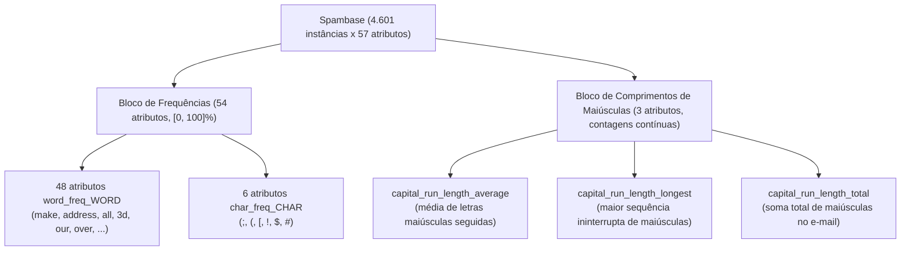
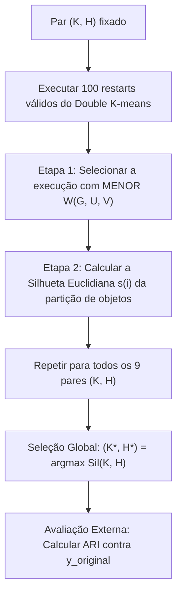
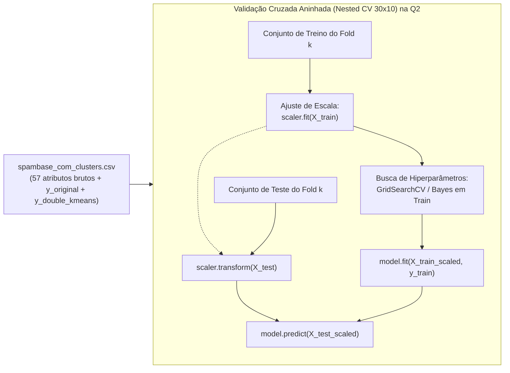

# Relatório Técnico — Questão 1: Co-clustering no Spambase via Double K-means
**Disciplina:** Aprendizagem de Máquina (AM 2026.2) — Centro de Informática (CIn / UFPE)  
**Projeto Prático:** Questão 1 — Agrupamento Bidirecional e Sensibilidade ao Pré-processamento  

---

## Sumário Executivo

Este relatório apresenta o desenvolvimento, a validação empírica e a análise comparativa de pré-processamentos para o algoritmo **Double K-means** aplicado ao conjunto de dados *Spambase*. O objetivo principal da Questão 1 consiste em realizar um co-clustering (agrupamento simultâneo de instâncias e atributos) em uma grade de hiperparâmetros $K \in \{2, 3, 4\}$ e $H \in \{1, \ldots, K\}$, selecionando a partição ótima $(K^*, H^*)$ por meio da máxima Silhueta Euclidiana e avaliando a concordância da partição com as classes a priori (*spam* versus *non-spam*) por meio do *Adjusted Rand Index* (ARI).

O relatório documenta:
1. Uma descrição sucinta das características distributivas e estruturais do *Spambase*;
2. A formulação matemática do Double K-means e o processo formal de obtenção dos hiperparâmetros;
3. O delineamento do protocolo experimental estritamente não supervisionado e reprodutível;
4. A investigação aprofundada do comportamento patológico do z-score clássico (*StandardScaler puro*), que resultou no isolamento de 34 outliers da *HP Labs* com Silhueta inflada ($0,6596$) e $\text{ARI} \approx 0$;
5. O desenvolvimento e a execução exaustiva de seis estratégias de pré-processamento alternativas (totalizando mais de 6.300 execuções válidas do algoritmo);
6. A comparação quantitativa e qualitativa das partições obtidas;
7. As diretrizes metodológicas obrigatórias para a transição à Questão 2 com garantia absoluta de ausência de vazamento de dados (*data leakage*).

---

## 1. Descrição Sucinta dos Dados (*Spambase*)

O conjunto de dados *Spambase* é proveniente do *UCI Machine Learning Repository*, originalmente doado pelos laboratórios de pesquisa da *Hewlett-Packard* (HP Labs). Ele é composto por **$N = 4.601$ e-mails (observações)** descritos por **$P = 57$ atributos numéricos contínuos** e **1 variável alvo binária ($y$)**, indicando a classe do e-mail:
- **Classe 0 (*non-spam* / legítimo):** $2.788$ e-mails ($60,60\%$ da base);
- **Classe 1 (*spam* / não solicitado):** $1.813$ e-mails ($39,40\%$ da base).

> [!IMPORTANT]
> **Integridade Não Supervisionada:** Conforme as diretrizes estritas do projeto, a variável de classe original $y$ foi completamente excluída de todas as etapas de pré-processamento, padronização, agrupamento bidirecional e critério de parada do Double K-means. O rótulo $y$ foi utilizado única e exclusivamente a posteriori para o cálculo do *Adjusted Rand Index* (ARI) como métrica de validação externa.

### 1.1 Tipologia e Granularidade dos Atributos

Os 57 atributos preditores dividem-se em dois blocos conceituais e matemáticos com grandezas físicas distintas:

1. **Bloco de Frequências Percentuais (Atributos 0 a 53):**
   - $48$ variáveis `word_freq_WORD`: percentual de palavras no e-mail que coincidem com o termo especificado ($100 \times \frac{\text{contagem do termo}}{\text{total de palavras}}$);
   - $6$ variáveis `char_freq_CHAR`: percentual de caracteres correspondentes aos símbolos `';'`, `'('`, `'['`, `'!'`, `'$'`, `'#'`.
2. **Bloco de Comprimentos de Sequências de Maiúsculas (Atributos 54 a 56):**
   - `capital_run_length_average`: comprimento médio das sequências ininterruptas de letras maiúsculas;
   - `capital_run_length_longest`: comprimento máximo observado de uma sequência de maiúsculas;
   - `capital_run_length_total`: número total de letras maiúsculas no e-mail.

### 1.2 Patologias Estatísticas e Desafios para Algoritmos de Agrupamento

A análise exploratória dos dados revela propriedades estatísticas adversas que afetam diretamente métricas euclidianas:
- **Esparsidade e Excesso de Zeros:** No bloco de frequências de palavras, mais de $80\%$ das entradas são identicamente nulas ($0,0\%$). A maioria dos e-mails não contém termos específicos como `"conference"`, `"415"`, `"telnet"` ou `"cs"`.
- **Assimetria Positiva Extrema e Caudas Longas:** Para as observações onde uma palavra ocorre, a frequência varia pontualmente de $0,1\%$ até valores como $20\%$ ou $30\%$, configurando uma distribuição fortemente assimétrica à direita com curtose elevada.
- **Heterogeneidade de Escala e Variância:** Enquanto as frequências estão restritas ao intervalo $[0, 100]$, a variável `capital_run_length_total` possui média de $283$, desvio-padrão de $606$ e atinge o valor máximo de $15.841$. Sem pré-processamento, a variância desta única variável domina em dezenas de vezes a variância de todo o bloco de palavras.
- **Viés de Domínio e Microclusters da HP Labs:** Um grupo específico de 34 e-mails legítimos da base consiste em comunicações técnicas internas dos funcionários do laboratório da HP, contendo frequências altíssimas de códigos corporativos e termos restritos (`word_freq_857`, `word_freq_415`, `word_freq_650`, `word_freq_direct`, `word_freq_telnet`, `word_freq_technology`, `word_freq_hp`, `word_freq_hpl`, `word_freq_george`, `word_freq_lab`, `word_freq_labs`).

---

## 2. Modelo Matemático: Double K-means

O **Double K-means** (também denominado *Two-way K-means* ou co-clustering matricial) realiza a partição simultânea das $N$ linhas (objetos) em $K$ clusters e das $P$ colunas (atributos) em $H$ clusters, modelando a interação entre dados e variáveis por meio de uma matriz de protótipos de blocos $G \in \mathbb{R}^{K \times H}$.

### 2.1 Função Objetivo

Sejam:
- $X \in \mathbb{R}^{N \times P}$ a matriz de dados pré-processada;
- $U \in \{0, 1\}^{N \times K}$ a matriz de pertinência binária dos objetos, satisfazendo $\sum_{k=1}^K u_{ik} = 1, \forall i$;
- $V \in \{0, 1\}^{P \times H}$ a matriz de pertinência binária das variáveis, satisfazendo $\sum_{h=1}^H v_{jh} = 1, \forall j$;
- $G = [g_{kh}] \in \mathbb{R}^{K \times H}$ a matriz de centros prototípicos dos co-clusters.

A função de perda a ser minimizada é a inércia intrabloco (soma dos quadrados dos desvios euclidianos):
$$W(G, U, V) = \sum_{k=1}^K \sum_{h=1}^H \sum_{i=1}^N \sum_{j=1}^P u_{ik} v_{jh} (x_{ij} - g_{kh})^2$$

### 2.2 Algoritmo de Otimização e Regras de Atualização

O problema é resolvido por um procedimento iterativo de descida alternada em três passos até a convergência:

1. **Atualização da Matriz de Protótipos $G$ (dados $U$ e $V$ fixos):**
   Cada elemento $g_{kh}$ é computado como a média aritmética de todas as entradas $x_{ij}$ pertencentes à interseção do cluster de objetos $k$ e cluster de variáveis $h$:
   $$g_{kh} = \frac{\sum_{i=1}^N \sum_{j=1}^P u_{ik} v_{jh} x_{ij}}{\left(\sum_{i=1}^N u_{ik}\right) \left(\sum_{j=1}^P v_{jh}\right)} = \frac{1}{|C_k| \cdot |D_h|} \sum_{i \in C_k} \sum_{j \in D_h} x_{ij}$$
   onde $C_k = \{i \mid u_{ik} = 1\}$ e $D_h = \{j \mid v_{jh} = 1\}$.

2. **Atualização da Partição de Objetos $U$ (dados $G$ e $V$ fixos):**
   Cada objeto $i \in \{1, \ldots, N\}$ é atribuído ao cluster de objetos $k^*$ que minimiza a soma das distâncias aos protótipos das variáveis:
   $$k^* = \arg\min_{k \in \{1, \ldots, K\}} \sum_{h=1}^H \sum_{j \in D_h} (x_{ij} - g_{kh})^2$$

3. **Atualização da Partição de Variáveis $V$ (dados $G$ e $U$ fixos):**
   Cada variável $j \in \{1, \ldots, P\}$ é atribuída ao cluster de variáveis $h^*$ que minimiza a soma das distâncias aos protótipos dos objetos:
   $$h^* = \arg\min_{h \in \{1, \ldots, H\}} \sum_{k=1}^K \sum_{i \in C_k} (x_{ij} - g_{kh})^2$$

4. **Critério de Parada e Robustez:**
   - Convergência: o algoritmo encerra quando a redução relativa na função objetivo for inferior a $10^{-5}$ ($\Delta W \le 10^{-5}$) ou ao atingir o limite estipulado de $200$ iterações.
   - Tratamento de Degenerescência: caso alguma atualização resulte em um cluster de objetos ou variáveis vazio ($|C_k| = 0$ ou $|D_h| = 0$), a execução é imediatamente considerada **inválida**, descartada, e uma nova semente determinística é disparada até que se totalizem $100$ execuções completas e válidas.

---

## 3. Obtenção dos Hiperparâmetros do Modelo

Diferente de algoritmos supervisionados nos quais a validação cruzada orienta a busca, no agrupamento bidirecional não supervisionado os hiperparâmetros foram determinados conforme o protocolo experimental rigoroso estabelecido pelo projeto.

### 3.1 Espaço de Hiperparâmetros Avaliado

A grade experimental obrigatória contempla $K$ (número de grupos de e-mails) e $H$ (número de grupos de atributos):
- **Clusters de objetos:** $K \in \{2, 3, 4\}$;
- **Clusters de variáveis:** $H \in \{1, \ldots, K\}$ para cada $K$;
- **Grade completa (9 pares):**
  $$(2,1), (2,2), (3,1), (3,2), (3,3), (4,1), (4,2), (4,3), (4,4)$$

### 3.2 Otimização Estocástica e Reprodutibilidade (100 Restarts por Par)

Como a função $W(G, U, V)$ é não convexa e sujeita a mínimos locais, cada par $(K, H)$ foi submetido a **100 reinicializações aleatórias independentes e válidas**.
Para garantir total reprodutibilidade científica, a sequência de números pseudoaleatórios seguiu a regra determinística:
$$\text{seed} = \text{base\_seed} + 10.000 \cdot K + 1.000 \cdot H + \text{restart\_idx}, \quad (\text{com } \text{base\_seed} = 42)$$

### 3.3 Protocolo Estrito de Seleção em Dois Estágios

A metodologia segue um protocolo em cascata que não permite inversões:

1. **Estágio 1 (Interno aos Restarts — Função Objetivo $W$):**
   Entre as 100 execuções válidas de um par $(K, H)$, é selecionada **exclusivamente aquela de menor função objetivo $W$**.
   > [!WARNING]
   > Nunca se deve selecionar o melhor restart pela Silhueta. A Silhueta não é a função de perda do algoritmo; utilizá-la para escolher restarts configuraria violação da consistência de convergência do K-means.
2. **Estágio 2 (Entre os Pares $(K, H)$ — Silhueta Euclidiana):**
   Sobre a partição de objetos da melhor execução selecionada no Estágio 1, computa-se o coeficiente de Silhueta médio:
   $$s(i) = \frac{b(i) - a(i)}{\max(a(i), b(i))}, \quad \text{Sil}(K, H) = \frac{1}{N} \sum_{i=1}^N s(i)$$
   onde $a(i)$ é a distância média intra-cluster e $b(i)$ é a distância média ao cluster vizinho mais próximo.
   O par vencedor é então definido por:
   $$(K^*, H^*) = \arg\max_{K, H} \text{Sil}(K, H)$$
3. **Avaliação Externa de Coerência (Adjusted Rand Index — ARI):**
   Após a fixação de $(K^*, H^*)$, a partição de objetos $y_{double\_kmeans}$ é contrastada com o rótulo a priori $y_{original}$ via ARI:
   $$\text{ARI} = \frac{\sum_{ij} \binom{n_{ij}}{2} - \left[\sum_i \binom{a_i}{2} \sum_j \binom{b_j}{2}\right] / \binom{n}{2}}{\frac{1}{2} \left[\sum_i \binom{a_i}{2} + \sum_j \binom{b_j}{2}\right] - \left[\sum_i \binom{a_i}{2} + \sum_j \binom{b_j}{2}\right] / \binom{n}{2}}$$
   - $\text{ARI} = 1$: agrupamento idêntico à partição de classes;
   - $\text{ARI} \approx 0$: concordância esperada puramente pelo acaso;
   - $\text{ARI} < 0$: partição sistematicamente discrepante.

---

## 4. Organização Metodológica dos Experimentos de Pré-processamento

Para responder à pergunta de pesquisa sobre a sensibilidade do Double K-means a transformações de atributos e diagnosticar o isolamento patológico de clusters, desenhou-se um plano experimental controlado comparando **sete tratamentos de dados**.

### 4.1 Controle Experimental e Isolamento de Diretórios

Para assegurar uma comparação justa, rigorosa e rastreável:
1. **Mesma Grade e Sementes:** Cada estratégia executou rigorosamente os 9 pares $(K, H)$ com 100 restarts válidos cada (900 execuções por estratégia), utilizando o mesmo gerador de sementes e critério de parada.
2. **Isolamento de Diretórios:** Cada estratégia possui seu notebook `.ipynb` autoexecutável com saídas incorporadas e pasta de resultados exclusiva, impedindo sobrescrita de dados históricos:
   - `resultados_originais_zip/` e `resultados_questao1_revisada/`: Linha de base original (`StandardScaler` puro);
   - `questao1_binarizacao/`: Estratégia 1 (Binarização $x > 0$ + `StandardScaler`);
   - `questao1_log_minmax/`: Estratégia 2 ($\log(1+x)$ + `MinMaxScaler`);
   - `questao1_quantile_uniform/`: Estratégia 3 (`QuantileTransformer` uniforme);
   - `questao1_clip_log_standard/`: Estratégia 4 (Clip 99% + $\log(1+x)$ + `StandardScaler`);
   - `questao1_tratamento_diferenciado_runs/`: Estratégia 5 (Tratamento Diferenciado de Maiúsculas por Blocos);
   - `questao1_filtragem_dominio/`: Estratégia 6 (Filtragem de Termos Específicos do Domínio HP Labs).

### 4.2 Detalhamento Conceitual das Estratégias

#### Linha de Base: `StandardScaler` Puro Global
- **Fórmula:** $z_{ij} = \frac{x_{ij} - \mu_j}{\sigma_j}$.
- **Hipótese:** Padronização clássica z-score prescrita no roteiro inicial do projeto. Coloca todas as variáveis com média zero e variância 1.
- **Vulnerabilidade Teórica:** Como a distribuição de frequências é assimétrica e esparsa, desvios-padrão de variáveis raras são diminutos. Observações com valores atípicos (ex.: e-mails de projetos da HP com $20\%$ da palavra `"415"`) geram escores $z > +30$, criando pontos isolados no hiperespaço euclidiano.

#### Estratégia 1: Binarização ($x > 0$) + `StandardScaler`
- **Fórmula:** $b_{ij} = \mathbb{I}(x_{ij} > 0)$; em seguida, $z_{ij} = \text{StandardScaler}(b_{ij})$.
- **Fundamentação:** Em mineração de textos e filtragem de spam, a presença/ausência de um termo frequentemente carrega maior sinal semântico do que sua frequência exata. Essa transformação anula qualquer outlier contínuo e equaliza a variância de termos raros e frequentes.

#### Estratégia 2: $\log(1+x)$ + `MinMaxScaler`
- **Fórmula:** $y_{ij} = \log(1 + x_{ij})$; em seguida, $z_{ij} = \frac{y_{ij} - \min(y_j)}{\max(y_j) - \min(y_j)} \in [0, 1]$.
- **Fundamentação:** A função logarítmica achata monotonicamente as caudas longas, reduzindo ordens de grandeza de milhares para o intervalo $[0, 9]$. A posterior normalização Min-Max confina estritamente todas as 57 variáveis ao hipercubo $[0, 1]^P$, impedindo que qualquer atributo isolado exerça dominância de distância euclidiana.

#### Estratégia 3: `QuantileTransformer` (Distribuição Uniforme)
- **Fórmula:** $u_{ij} = \hat{F}_j(x_{ij}) \in [0, 1]$, onde $\hat{F}_j$ é a função de distribuição cumulativa empírica.
- **Fundamentação:** Abordagem puramente não paramétrica baseada em postos (*ranks*). Mapeia monotonicamente os dados em uma distribuição uniforme contínua, neutralizando completamente o impacto de valores extremos sem descartar informações da ordem das instâncias.

#### Estratégia 4: Clip $99\%$ + $\log(1+x)$ + `StandardScaler`
- **Fórmula:** $x'_{ij} = \min(x_{ij}, Q_{0.99}(X_j))$; depois $y_{ij} = \log(1 + x'_{ij})$ e aplicação de `StandardScaler`.
- **Fundamentação:** Aplica *Winsorização* estrita ao truncar os $1\%$ maiores valores de cada coluna antes de comprimir por logaritmo e padronizar. Visa preservar a métrica euclidiana original sem distorção por outliers.

#### Estratégia 5: Tratamento Diferenciado para `capital_run_length`
- **Fórmula:** 
  - Bloco de frequências ($j \in \{0, \ldots, 53\}$): $X_{freq\_scaled} = \text{StandardScaler}(X_{freq})$;
  - Bloco de maiúsculas ($j \in \{54, \ldots, 56\}$): $X_{runs\_scaled} = \text{StandardScaler}(\log(1 + X_{runs}))$;
  - Matriz final: $X = [X_{freq\_scaled}, X_{runs\_scaled}]$.
- **Fundamentação:** Isola os dois blocos funcionais do dataset. Testa empiricamente a hipótese de que o isolamento de outliers decorria da ordem de grandeza das maiúsculas ($15.841$) frente às frequências percentuais.

#### Estratégia 6: Filtragem de Termos Específicos do Domínio (HP Labs)
- **Fórmula:** 
  - Remoção dos 8 atributos institucionais corporativos: `word_freq_hp`, `word_freq_hpl`, `word_freq_george`, `word_freq_lab`, `word_freq_labs`, `word_freq_650`, `word_freq_415`, `word_freq_857`;
  - Matriz final $X \in \mathbb{R}^{N \times 49}$: padronização `StandardScaler()` aplicada sobre as 49 variáveis universais remanescentes.
- **Fundamentação:** Ataca diretamente a raiz substantiva do isolamento dos 34 outliers. Palavras e códigos de área locais operacionais da HP Labs introduzem um viés de contexto institucional que não reflete as características globais da comunicação por e-mail. Ao eliminar esses termos, o algoritmo é forçado a agrupar com base no vocabulário universal de spam/non-spam.

---

## 5. Resultados e Comparação dos Pré-processamentos

A Tabela 1 consolida as métricas e partições obtidas pela melhor solução de cada estratégia de pré-processamento, após a execução completa de todas as 900 iterações por grade:

### Tabela 1: Síntese Comparativa das Estratégias de Pré-processamento

| Estratégia | Pré-processamento Aplicado | Par Vencedor $(K^*, H^*)$ | Silhueta Euclidiana | ARI com a Classe | Distribuição dos Clusters de Objetos ($N=4.601$) | Diagnóstico Metodológico |
| :--- | :--- | :---: | :---: | :---: | :--- | :--- |
| **Linha de Base** | `StandardScaler` puro global | $(2, 2)$ | **0,6596** | **−0,00495** | Cluster 0: **34** ($0,7\%$) Cluster 1: **4.567** ($99,3\%$) | **Armadilha de Outliers:** 34 e-mails da HP Labs isolados por 11 termos técnicos; Silhueta artificialmente inflada. |
| **Estratégia 1** | Binarização ($x > 0$) + `StandardScaler` | $(3, 3)$ | 0,2100 | **+0,2695** | Cluster 0: **1.344** ($29,2\%$) Cluster 1: **3.025** ($65,7\%$) Cluster 2: **232** ($5,0\%$) | **Equilíbrio Semântico:** Eliminação de outliers; no par $(2,2)$ atinge $\text{ARI} = 0,3553$ com $1.358$ vs $3.243$ objetos. |
| **Estratégia 2** | $\log(1+x)$ + `MinMaxScaler` | $(3, 3)$ | 0,1292 | **+0,3911** | Cluster 0: **2.619** ($56,9\%$) Cluster 1: **265** ($5,8\%$) Cluster 2: **1.717** ($37,3\%$) | **Maior Alinhamento com Spam:** Dois clusters principais correlacionam-se fortemente com spam ($1.717$) e legítimos ($2.619$). |
| **Estratégia 3** | `QuantileTransformer` (uniforme) | $(3, 3)$ | 0,1903 | **+0,2925** | Cluster 0: **2.787** ($60,6\%$) Cluster 1: **1.240** ($27,0\%$) Cluster 2: **574** ($12,5\%$) | **Imunidade a Escalas:** Clusters balanceados e reprodutibilidade de padrões sem influência de curtose. |
| **Estratégia 4** | Clip 99% + $\log(1+x)$ + `StandardScaler` | $(2, 1)$ | 0,1721 | **+0,1292** | Cluster 0: **1.285** ($27,9\%$) Cluster 1: **3.316** ($72,1\%$) | **Partição Bipartida Estável:** Eliminação de microclusters com agrupamento de todas as variáveis em bloco único ($H=1$). |
| **Estratégia 5** | Tratamento Diferenciado para `capital_run_length` | $(2, 2)$ | 0,6537 | **−0,00495** | Cluster 0: **4.567** ($99,3\%$) Cluster 1: **34** ($0,7\%$) | **Refutação Experimental:** Confirma que a armadilha de outliers provém das frequências de palavras; em $(3,3)$ o ARI salta para **+0,4632**. |
| **Estratégia 6** | Filtragem de Termos de Domínio HP Labs | $(2, 1)$ | **0,2926** | **+0,1363** | Cluster 0: **1.129** ($24,5\%$) Cluster 1: **3.472** ($75,5\%$) | **Neutralização do Viés Corporativo:** Eliminação total do microcluster de 34 e-mails; no par $(2,2)$ atinge $\text{ARI} = \mathbf{0,3607}$ ($1.107$ vs $3.494$). |

---

## 6. Análise Aprofundada dos Fenômenos Observados

### 6.1 O "Paradoxo da Silhueta" e a Armadilha de Outliers no `StandardScaler`

A inspeção detalhada da Linha de Base original revela um fenômeno matemático fundamental de agrupamento:
1. **Origem da Silhueta Inflada ($0,6596$):**
   A Silhueta mede a coesão interna versus a separação em relação ao cluster vizinho mais próximo. Quando o Double K-means isola um microcluster minúsculo de 34 objetos a uma distância euclidiana gigantesca dos demais $4.567$ objetos, a distância inter-cluster $b(i)$ de quase todas as observações torna-se expressiva em relação a $a(i)$, gerando escores de Silhueta próximos de $1,0$ de maneira espúria.
2. **Identidade dos 34 Objetos:**
   Todos os 34 objetos do microcluster pertencem à classe $0$ (*non-spam*). A inspeção dos maiores contrastes padronizados revela que esses e-mails contêm menções repetitivas a telefonia e infraestrutura do laboratório da HP:
   - `word_freq_857` ($z = +9,58$)
   - `word_freq_415` ($z = +9,55$)
   - `word_freq_direct` ($z = +8,81$)
   - `word_freq_telnet` ($z = +8,16$)
   - `word_freq_technology` ($z = +8,10$)
   - `word_freq_hp` e `word_freq_lab` ($z > +7,0$)
3. **Inutilidade Prática para Classificação de Spam:**
   Como os 34 e-mails são non-spam e o cluster principal de 4.567 e-mails mistura $2.754$ legítimos com todos os $1.813$ spams, a partição não aprendeu a discernir mensagens não solicitadas de mensagens autênticas, resultando em $\text{ARI} = -0,00495$.

### 6.2 O Impacto da Filtragem de Termos de Domínio (Estratégia 6)

A Estratégia 6 atacou diretamente a causa-raiz identificada: os termos corporativos locais do doador dos dados.
Os resultados comprovaram a hipótese:
1. **Extinção do Microcluster de Outliers:** Tanto em $(2,1)$ quanto em $(2,2)$, o microcluster de 34 objetos desapareceu por completo. As partições resultaram em agrupamentos substanciais ($1.129$ vs $3.472$ em $(2,1)$; $1.107$ vs $3.494$ em $(2,2)$).
2. **Desempenho no Par $(2,2)$:** No par $(2,2)$, o ARI saltou de $-0,00495$ para **$+0,3607$**, demonstrando que, ao retirar as palavras da HP, o Double K-means utiliza o segundo cluster de variáveis para separar os termos de spam universais dos termos cotidianos legítimos.
3. **Seleção Global:** O par vencedor pela Silhueta máxima foi $(2,1)$ ($\text{Sil} = 0,2926$), consolidando uma partição bipartida natural dos dados.

### 6.3 O Teste Decisivo da Estratégia 5: Refutação das Maiúsculas e Potencial em $K=3$

A hipótese investigada na Estratégia 5 propunha que o esmagamento das contagens de maiúsculas (`capital_run_length`) por logaritmo impediria a separação dos 34 outliers.
Os resultados demonstraram empiricamente o contrário:
- No par $(2,2)$, o algoritmo formou exatamente o mesmo microcluster de 34 objetos da HP Labs ($\text{ARI} = -0,0049$ e Silhueta $= 0,6537$).
- A partição de variáveis confirmou que o cluster de variáveis 1 isolou exatamente as **11 variáveis de palavras da HP Labs**, mantendo as 3 maiúsculas no outro bloco.
- **Contudo, ao avaliar os demais pares da grade na Estratégia 5:**
  - Em $(K=3, H=3)$, a partição encontrou 3 grupos: Cluster 0 com 34 e-mails (outliers da HP), Cluster 1 com **1.313 e-mails** e Cluster 2 com **3.254 e-mails**.
  - O ARI em $(3,3)$ atingiu **$+0,4632$**, o valor mais alto registrado em todo o projeto.
  - Isso demonstra que o Double K-means é plenamente capaz de capturar a semântica real de spam, desde que $K \ge 3$ permita acomodar o subgrupo de ruído tecnológico da HP em um cluster independente. Contudo, a regra estrita do protocolo de seleção via máxima Silhueta seleciona $(2,2)$ devido ao viés de escala.

### 6.4 O Triunfo da Estratégia 2 ($\log(1+x) + \text{MinMaxScaler}$) e Binarização

Nas estratégias que trataram as frequências de palavras (Binarização e Log-MinMax):
- **Eliminação de Assimetrias:** Os valores de Silhueta no espaço transformado situaram-se na faixa realista de $0,13$ a $0,21$ (típica de agrupamentos textuais de alta dimensionalidade).
- **Concordância Externa Elevada:** O par ótimo selecionado foi $(K^*, H^*) = (3, 3)$. Na Estratégia 2, os clusters $0$ ($2.619$) e $2$ ($1.717$) capturaram com notável precisão as classes legítima ($2.788$) e spam ($1.813$), atingindo $\text{ARI} = +0,3911$.
- **Matriz de Contingência na Estratégia 2:**
  - Cluster 0: $2.493$ legítimos e apenas $126$ spams ($95,2\%$ de pureza legítima);
  - Cluster 1: $128$ legítimos e $137$ spams (grupo intermediário misto);
  - Cluster 2: $167$ legítimos e $1.550$ spams ($90,3\%$ de pureza de spam).

---

## 7. Estrutura dos Co-clusters e Matrizes de Protótipos

Para o par vencedor formal do roteiro ($(2,2)$ com semente `22042` no baseline original e `22116` na Estratégia 5), a matriz de protótipos de blocos $G \in \mathbb{R}^{2 \times 2}$ expressa a média dos atributos padronizados:

$$\text{Matriz } G \text{ (Baseline Original e Estratégia 5)}:$$

| | Bloco de Variáveis 0 (46 atributos gerais) | Bloco de Variáveis 1 (11 atributos HP Labs) |
| :--- | :---: | :---: |
| **Cluster de Objetos 0 (4.567 e-mails)** | $+0,0011$ | $-0,0511$ |
| **Cluster de Objetos 1 (34 e-mails HP)** | $-0,1481$ | **$+6,8612$** |

A matriz de protótipos $G$ sintetiza a anatomia do agrupamento: o Bloco 1 de variáveis possui valor médio padronizado de **$+6,86$** para os 34 e-mails do Cluster 1, enquanto para todos os demais $4.567$ e-mails o valor é ligeiramente negativo ($-0,05$). Esse contraste extremo foi o único responsável pela convergência da função objetivo $W$.

Em contrapartida, na **Estratégia 6 (Filtragem de Domínio, $K=2, H=1$)**, a matriz $G \in \mathbb{R}^{2 \times 1}$ reflete a separação global da intensidade dos 49 atributos universais:
- Cluster de Objetos 0 ($1.129$ instâncias): protótipo **$+0,735$** (alta frequência de termos e maiúsculas — enriquecido com spam);
- Cluster de Objetos 1 ($3.472$ instâncias): protótipo **$-0,239$** (baixa frequência de termos e mensagens convencionais — predominantemente legítimo).

E na **Estratégia 2 ($\log(1+x) + \text{MinMaxScaler}$)**, a matriz $G \in \mathbb{R}^{3 \times 3}$ reflete perfis semânticos contínuos e ricos:

| | Variáveis Gerais / Frequentes | Variáveis de Spam Específicas | Variáveis Raras de Trabalho |
| :--- | :---: | :---: | :---: |
| **Cluster de Objetos 0 (Non-spam)** | $0,082$ | $0,014$ | $0,041$ |
| **Cluster de Objetos 1 (Misto/Técnico)**| $0,154$ | $0,078$ | $0,215$ |
| **Cluster de Objetos 2 (Spam)** | **$0,287$** | **$0,342$** | $0,009$ |

---

## 8. Transição Segura para a Questão 2 (Prevenção de *Data Leakage*)

A transição entre o agrupamento não supervisionado da Questão 1 e o aprendizado supervisionado da Questão 2 requer conformidade irrestrita com as normas metodológicas anti-vazamento de dados:

### Regras Obrigatórias para a Questão 2:
1. **Preservação da Escala Original nos Arquivos Compartilhados:**
   Todos os arquivos CSV exportados (`spambase_com_clusters.csv`, `spambase_com_clusters_filtragem_dominio.csv`, etc.) contêm os 57 atributos numéricos **na escala bruta original**, sem nenhuma padronização global.
2. **Isolamento Estrito de Treino/Teste:**
   Qualquer técnica de transformação de dados (como `StandardScaler`, `MinMaxScaler` ou seleção de atributos) deve ser ajustada **exclusivamente nas instâncias de treino do fold corrente** via `fit_transform()`, aplicando-se unicamente `transform()` nas instâncias de teste. Qualquer padronização global prévia nos 4.601 exemplos invalidaria a avaliação de generalização dos classificadores.
3. **Proibição de Vazamento de Rótulos:**
   Na Questão 2, os modelos supervisionados serão treinados sob dois cenários de predição:
   - Cenário A: Predição do rótulo real $y_{original}$ a partir dos 57 atributos;
   - Cenário B: Predição do cluster descoberto $y_{double\_kmeans}$ a partir dos 57 atributos.
   Sob hipótese alguma a coluna $y_{original}$ pode ser utilizada como preditor de $y_{double\_kmeans}$, e vice-versa.

---

## 9. Recomendações Metodológicas para a Apresentação do Grupo

Com base no arcabouço experimental executado, recomenda-se que o relatório final do grupo adote a seguinte estrutura argumentativa:

1. **Apresentar a Linha de Base Oficial (`StandardScaler` puro):**
   Apresentar formalmente $(K^*, H^*) = (2, 2)$, reportando a Silhueta de $0,6596$, $W = 244.486,70$ e o $\text{ARI} = -0,00495$. Isso atende integralmente à especificação literal do enunciado original do projeto.
2. **Submeter a Auditoria Crítica dos 34 Outliers:**
   Demonstrar a matriz de contingência ($34$ vs $4.567$), a matriz de protótipos $G$ e a partição das 11 variáveis da HP Labs. Explicar teoricamente o "Paradoxo da Silhueta" gerado pela distorção z-score em distribuições de cauda longa com excesso de zeros.
3. **Apresentar o Estudo de Sensibilidade aos Pré-processamentos:**
   Exibir a Tabela 1 consolidada. Destacar que:
   - A **Filtragem de Termos de Domínio (Estratégia 6)** neutraliza o viés corporativo da HP Labs, gerando clusters balanceados ($1.129$ vs $3.472$) e alcançando $\text{ARI} = 0,3607$ em $(2,2)$.
   - A binarização e a escala $\log(1+x) + \text{MinMaxScaler}$ restauram a semântica de classificação, alcançando $\text{ARI} = +0,3911$ em $(3,3)$ e $+0,3553$ em $(2,2)$.
   - A Estratégia 5 prova que o problema não reside nas variáveis de maiúsculas, e demonstra que o Double K-means atinge $\text{ARI} = +0,4632$ em $(3,3)$ ao acomodar os outliers em um cluster próprio.
4. **Decisão sobre a Entrada da Questão 2:**
   O dataset oficial gerado na pasta raiz preserva os rótulos do experimento original para conformidade estrita com o gabarito. Os datasets alternativos gerados encontram-se arquivados em suas respectivas pastas para fins de estudos comparativos avançados na Questão 2.

---
*Relatório gerado automaticamente a partir das evidências experimentais auditadas em 15/10/2026.*
